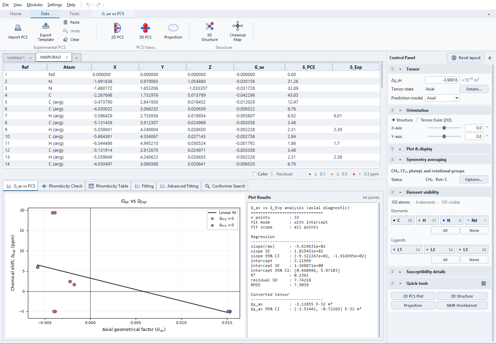
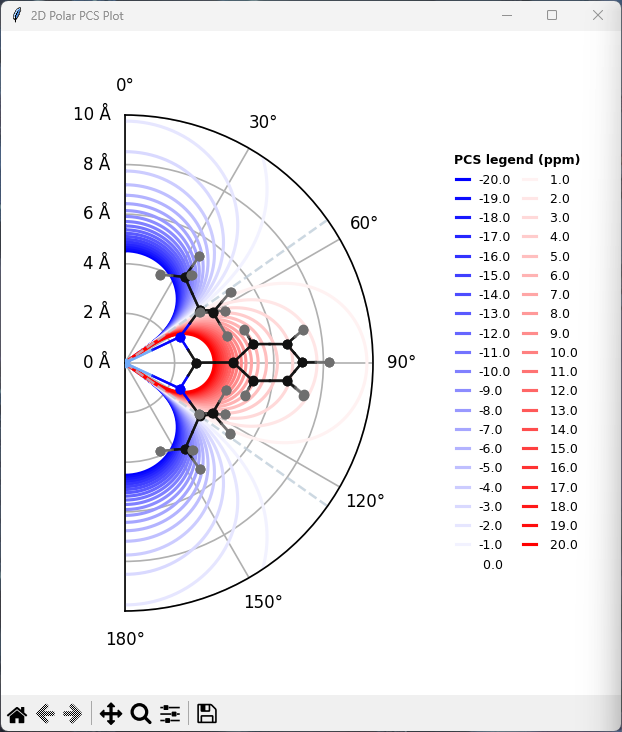
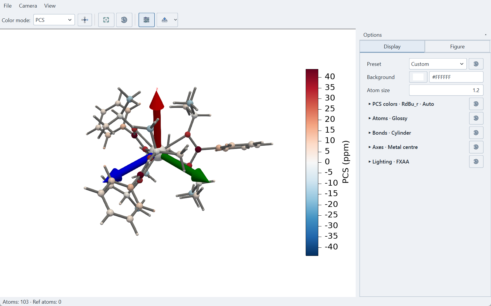

<p align="Left">
  
</p>

## Pseudocontact Chemical Shift (PCS) Analyzer
[](https://github.com/boseokhong/PCS-analyzer/releases/latest)


[](https://boseokhong.github.io/PCS-analyzer/)
[](https://doi.org/10.5281/zenodo.18752129)

<p align="center">
  
</p>

<p align="center">
  
  
  
  
  
</p>

**PCS Analyzer** is a Python-based desktop application for the analysis, visualization, and fitting of pseudocontact chemical shifts (PCS) in paramagnetic molecular systems. The program is designed for interactive structure-based PCS interpretation and is particularly suited to small and medium-sized coordination complexes for which tensor-frame analysis, geometrical inspection, and rapid model comparison are essential.

The software integrates molecular structure import, 2D and 3D PCS visualization, tensor utilities, regression-based diagnostics, rhombicity analysis, fitting workflows, NMR-oriented data inspection, and conformer-based refinement in a unified graphical interface.

> [!NOTE]
> Install the source dependencies with `python -m pip install -r requirements.txt`.
> See [Installation](https://boseokhong.github.io/PCS-analyzer/installation/)
> for package requirements and optional features.

---

## Documentation

The documentation is available online:

[PCS Analyzer Documentation](https://boseokhong.github.io/PCS-analyzer/)

> The core structure of the manual is now in place. Further revisions
> and step-by-step tutorials are in progress. Some topics remain incomplete;
> review the limitations documented for each workflow.

---
## Overview

PCS Analyzer provides an interactive workflow that connects molecular coordinates, PCS geometry factors, experimental shift data, and tensor-based fitting procedures. Rather than treating plotting, table inspection, fitting, and diagnostics as separate tasks, the program links them directly in the GUI to support iterative analysis.

Core use cases include:
- inspection of tensor-frame molecular geometry
- comparison of calculated and experimental PCS values
- axial and rhombic PCS diagnostics
- donor-axis and Euler-based fitting strategies
- advanced fitting and conformer-assisted refinement

## Recent Changes

### Current source additions

The current checkout also includes document Undo/Redo with cumulative history,
Help Documentation and a keyboard-shortcut reference, Tools Ribbon module
launchers with a separate ordering dialog, and shared editable residual-colour
cutoffs saved with each project. Standard fit previews and the latest Conformer
Search candidates can be restored from current project files.

Advanced Fitting includes structure-based Multi-Conformer fitting with conditional
reliability diagnostics, Joint PCS+RDC, PRE and Multi-Lanthanide/Reilley workflows.
See the [worked examples](examples/README.md) and the
[source changelog](docs/reference/changelog.md#unreleased) for inputs, limitations
and changes that may not yet be in a published binary.

### Version 1.4.0 overview

Release **v1.4.0**

This is a **BIG** one. The interface, NMR workflows, and analysis tools
have all received substantial updates.

The interface now uses a Ribbon toolbar to support future expansion.
Existing buttons and functions from the Analysis panel are now available
in the Ribbon menus.

The new layout may take a little getting used to. If you prefer the
familiar interface, [v1.3.4](https://github.com/boseokhong/PCS-analyzer/releases/tag/v1.3.4)
remains available with the previous core features.

- Added multiple project tabs and a more flexible Control Panel.
- Added Chemical Map for molecular diagrams and atom/site inspection.
- Expanded `NMR Shift Viewer` into `NMR Workbench`, with spectrum
  processing, peak assignments, and PCS preparation.
- Added variable-temperature NMR workflows, including batch processing,
  stacked spectra, peak tracking, and shift analysis.
- Improved fitting with uncertainty weighting and Fit History.
- Expanded Module Manager with online browsing, installation, and updates.
- Added workspace and NMR session saving.
- Expanded the documentation with updated screenshots and tutorials.

---
## Main capabilities

### 1. Structure import and coordinate handling
- import molecular structures from `.xyz`
- extract coordinates from ORCA `.out` and `.log` files
- inspect and rotate coordinates in the current tensor frame
- visualize molecular structures and PCS fields in interactive 3D viewers
- inspect angular distributions in a projection viewer (`φ / cos(θ)` and Mollweide modes)

The default molecular viewer uses PyVista, with linked atom selection, PCS color
controls, adjustable appearance and axes, and Figure output at a chosen size/DPI.
Visualization settings can be saved separately for reuse. The legacy Matplotlib
viewer remains accessible from its View menu. See the
[3D Structure Viewer manual](docs/visualization/3d-viewer.md) for controls and
output formats.

### 2. PCS visualization
- display axial PCS contour maps in a dedicated **2D polar plot** window
- overlay atomic positions directly onto PCS plots
- support symmetry-averaged pseudo-points for methyl and CF3 groups
- visualize PCS fields in a PyVista-based 3D viewer
- support interactive 3D inspection of isosurfaces / slices for PCS field analysis
- export PCS-related data and figures

### 3. Table-driven analysis and linked interaction
- interactive main table containing `Ref`, atom labels, rotated coordinates, `G_ax`, `δ_PCS`, and `δ_Exp`
- import, paste, clear, undo, and export workflows for experimental `δ_Exp`
- linked highlighting between the table and graphical views
- synchronized inspection across PCS plots, cartesian plots, and structure viewers

### 4. Rhombicity check and analysis
- linear analysis of `G_i` versus experimental shift data
- residual-based rhombicity inspection
- rhombicity table with `G_ax`, `G_rh`, `δ_PCS(ax)`, `δ_PCS(ax+rh)`, and residual comparison
- optional use of `Δχ_rh` and tensor-component reconstruction utilities

### 5. Fitting workflows
- **Mode A**: donor-axis-based fitting
- **Mode B**: global Euler-angle rigid-body fitting
- **Mode C**: full-tensor/metal fitting with 6–8 variables, depending on which tensor components are fitted
- optional global search for selected fitting modes
- fit summaries and graphical correlation analysis
- uncertainty-weighted fitting when experimental uncertainties are provided
- Fit History for reviewing, comparing, saving, and exporting results

### 6. Extended analysis modules
- **Advanced Fitting** tab for extended PCS-related workflows
- `NMR Workbench` for spectrum processing, peak assignments,
  observed-shift comparison, and reviewed PCS preparation
- variable-temperature NMR series, batch processing, peak tracking,
  and temperature-dependent shift analysis
- integrated **Conformer Search and Fitting** with preview, apply, revert, and discard workflows

### 7. PCS Workbench (distributed PCS / PDE)
- standalone FFT-based distributed PCS workflow using ORCA susceptibility tensors and spin-density grids
- comparison between distributed PDE PCS and point-dipole PCS
- interactive 3D visualization of PDE fields with signed PCS isosurfaces and spin-density overlays
- oblique PCS slice plotting for user-defined planes through the metal centre
- tensor spheroid visualization with temperature-dependent `GIF` export
- export of PDE fields, atom-wise comparison tables

The PDE implementation follows the distributed PCS / Kuprov-equation framework (*PCCP*, 2014, DOI: `10.1039/C4CP03106G`).

### 8. Chemical Map
- inspect molecular diagrams, ligand groups, atom Ref IDs, and NMR sites
- link selections with the main table and NMR Workbench
- edit bonds and 2D diagrams without changing molecular XYZ coordinates

### 9. Projects and sessions
- work with multiple PCS projects in separate tabs
- save project collections as `.pcsw` workspaces
- save committed NMR work as `.nmrsession` sessions

---
## Installation

Clone the repository:
```bash
git clone https://github.com/boseokhong/PCS-analyzer.git
cd PCS-analyzer
```

Install all required dependencies using `requirements.txt`:
```bash
pip install -r requirements.txt
```

Alternatively, the core dependencies can be installed manually:
```bash
pip install numpy scipy matplotlib pandas openpyxl
```
Install the additional packages for enhanced GUI styling, 3D visualization, FFT acceleration, drag-and-drop support, and GIF export:
```bash
pip install ttkbootstrap pyvista pyvistaqt vtk qtpy PySide6 pyfftw tkinterdnd2 imageio
```

Run the program with:
```bash
python main.py
```
---
## Suggested workflow

A typical analysis sequence is:

1. load a molecular structure (`.xyz` or supported ORCA output)
2. define the metal center and tensor input values
3. inspect rotated coordinates and the main PCS table
4. open the **2D PCS polar plot** for contour-based visualization
5. import or paste experimental `δ_Exp` values
6. inspect the **G_ax vs PCS** analysis and regression summary
7. evaluate residual patterns using **Rhombicity Check** and **Rhombicity Table**
8. apply fitting in the main **Fitting** tab
9. extend the analysis using **Advanced Fitting** or **Conformer Search** where appropriate

## Fitting modes

<details>
<summary><b>Click to expand fitting mode descriptions</b></summary>

### Mode A — donor-axis fit
This mode defines the fitting axis from one or more donor atoms and is useful when tensor orientation should follow a chemically intuitive ligand-based reference direction.

Available donor-axis definitions include:
- `bisector`
- `normal`
- `pca`
- `centroid`
- `average`
- `first`

### Mode B — Euler fit
This mode performs rigid-body fitting in the global frame using Euler rotations. It is useful when no donor-based axis definition should be imposed a priori.

### Mode C — Full tensor + metal
This mode always fits metal position `(x, y, z)` and three Euler orientation
angles. **Fit Δχ_ax** and **Fit Δχ_rh** each add one variable; an unchecked
component is held at its current value. The resulting fit has six, seven or
eight variables.

It is appropriate when simultaneous refinement of tensor magnitude, anisotropy, orientation, and metal position is required.

**Apply to Tensor** retains the assigned metal centre. Use **Preview Geometry**
to inspect the refined centre; see [Full Tensor Fitting](docs/fitting/full-tensor-fitting.md)
for application, persistence and interpretation limits.

</details>

## Export

PCS Analyzer supports export of:
- PCS tables / current visible structure (`.xyz`)
- cartesian and PCS plots
- fitting summaries
- CSV / Excel tables
- graphical outputs (`PNG`, `PDF`, `SVG`, depending on the module)
---
## Version history

<details>
<summary><b>Click to expand version history</b></summary>

**v0.1**
- initial release
- `.xlsx` export with cartesian coordinate output

**v0.2**
- tensor values, PCS range, and interval input
- molar susceptibility tensor calculation

**v0.3**
- XYZ file import and plotting
- coordinate rotation
- atom coordinate table
- geometrical parameter analysis plot

**v0.3.1**
- clicking an atom point on the PCS plot highlights the corresponding table entry

**v0.4**
- added 3D molecular scatter plot

**v0.5**
- reorganized GUI
- added Mollweide projection plot

**v0.6**
- added half / quarter PCS plot view toggle

**v0.7**
- bug fixes

**v1.0.0**
- code refactoring
- PCS fitting

**v1.0.1**
- added `δ_exp` table export / import

**v1.0.2**
- fixed CSV export encoding

**v1.1.0**
- diagnostics
- rhombicity utilities
- fitting function updates

**v1.2.0**
- added NMR spectrum viewer
- added automatic methyl / CF3 symmetry averaging
- improved XYZ loader with ORCA `.out` / `.log` support
- bug fixes and refactoring

**v1.3.0**
- separated 2D PCS polar plot from the main window
- improved `G_i` vs `δ` plot interaction and result reporting
- added linked table ↔ plot highlighting / selection
- updated 3D molecular and projection plots
- added **Mode C** 8-parameter fitting
- added **Advanced Fitting** tab
- added integrated **Conformer Search and Fitting** workflow

**v1.3.1**
- added a PyVista-based 3D viewer for PCS fields and molecular structures.
- fixed coordinate reference used in the Rhombicity analysis table
- added residual-based text color highlighting for PCS tables
- added export function to save the current visible structure as an `.xyz` file

**v1.3.2**
- added **PCS Workbench** for FFT-based distributed PCS / PDE analysis
  - direct import of ORCA `.out` / `.log` files together with ORCA `.3d` spin-density files for PDE workflows
  - temperature-resolved tensor selection, ORCA tensor conversion, and rank-2 traceless tensor handling
  - configurable PDE options including zero-padding, density normalization, and contour auto-scaling
  - PyVista-based PDE field visualization with multi-level PCS isosurfaces, spin-density surfaces, and slice display
  - quantitative comparison between distributed PDE PCS and point-dipole PCS
  - export of computed PDE results to `.png`, `.csv`, compressed **NumPy (`.npz`)**, and temperature-dependent `.gif`
  - **oblique PCS slice plotting** for user-defined planes through the metal centre
  - a **traceless tensor spheroid viewer**
  - PDE field calculation follows the distributed PCS formalism of Charnock and Kuprov: *Phys. Chem. Chem. Phys.*, **2014**, DOI: `10.1039/C4CP03106G`

**v1.3.3**
- Interface and workflow
  - Added a main menu bar and settings menu.
    - Moved the **Load XYZ Structure** action to the main menu.
  - Added font options in the Settings window.
  - Changed the main-window control panel UI.
  - Refactored parts of the codebase.
  - Added a Modules/Plugins menu.
  - Added a Module Manager window for managing available modules and plugins.
- Project file I/O and loading
  - Added support for `.pcsp` project file I/O for project reproducibility.
  - Added drag-and-drop loading support for `.pcsp`, `.xyz`, `.out`, and `.log` files.
- Conformer Search
  - Added a new constraint-mode selector with two modes:
    - **Position mode**: legacy fitting mode introduced in v1.3.0. Fixed atoms are kept close to their original Cartesian coordinates, making this mode suitable for conservative, scaffold-preserving searches.
    - **Angular mode**: newly introduced mode in v1.3.3. Metal-centered donor directions are preserved while radial relaxation is allowed, making this mode more suitable for flexible coordination-complex searches.
  - Added false-bond detection and skipped-bond handling.
  - Added rigid mode for conformer searches.
- Gᵢ vs δExp plot
  - Added lasso selection functionality for selecting subsets of data points directly from the plot.
- 2D polar contour plot
  - Improved 2D polar contour plot visualization.

**v1.3.4**
- Module update: PCS Workbench v0.1.0 updates
  - **Corrected isotropic susceptibility calculation.**
  - Reorganized the control panel
  - Improved interaction between the control panel and PyVista viewer.
  - Added camera presets, projection modes, view saving/restoration, and improved PNG export.
- 3d pyvista view updates
  - Reorganized the control panel into a two-column layout.
  - Added bond appearance and hydrogen-visibility controls.
  - Added camera controls, view preservation, and improved PNG export.
- Symmetry averaging
  - Corrected PCS calculations to use averaged geometrical factors (G_i) rather than G_i evaluated at averaged coordinates.
  - Added rotational ensemble averaging for planar ring systems with automatic detection and configurable sampling.
  - Added visualization of ensemble-averaged coordinates and optional reference-structure overlays.

**v1.4.0**
- redesigned the interface with a Ribbon toolbar and multiple project tabs
- added Chemical Map and expanded NMR Workbench with VT workflows
- improved fitting and added Fit History
- expanded Module Manager, workspace/session saving, and documentation

</details>

---
## Citation

If you use PCS Analyzer in academic work, please cite the Zenodo record associated with this project.

- DOI (all versions): **10.5281/zenodo.18752129**

A dedicated paper describing **PCS Analyzer**, including its methodology, implementation, and representative applications in paramagnetic NMR analysis, is currently in preparation.

## Author

**Boseok Hong**  
Department of Chemistry of the f-elements, Institute of Resource Ecology, HZDR

Contact: [bshong66@gmail.com](mailto:bshong66@gmail.com)

GitHub: [boseokhong/PCS-analyzer](https://github.com/boseokhong/PCS-analyzer)

## License

The source code is distributed under the BSD 3-Clause License. See `LICENSE` for details.

The PCS analyzer name and logo are not licensed under the BSD 3-Clause License. Use of the project name and logo is subject to the terms described in `TRADEMARKS.md`.

## Acknowledgements

This project includes code or implementation ideas derived in part from the work of **Sebastian Dechert** for aspects of the 3D molecular scatter-plot functionality, distributed under the BSD 3-Clause License. The original project is available at:

- https://github.com/radi0sus/xyz2tab
