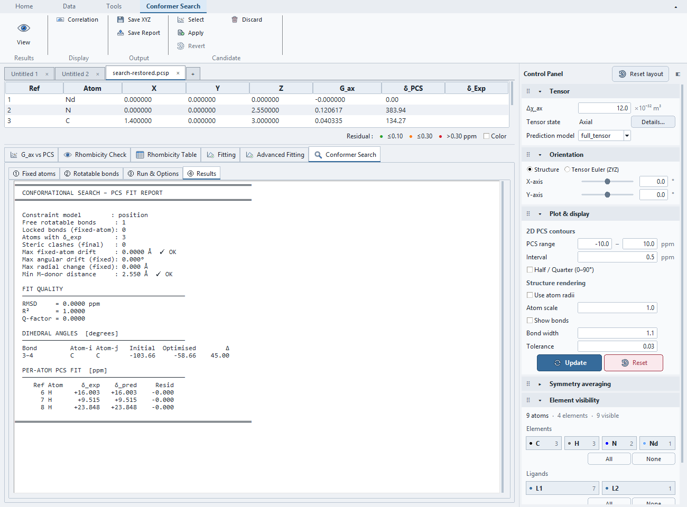

# Tutorial: One-bond Conformer Search

Use `examples/conformer_search_demo/` from the source checkout or portable release.
This nine-atom synthetic teaching fragment
demonstrates structural search, not chemically optimized conformers or population
fitting. Read the [search overview](overview.md) first.
Short paths below are relative to `examples/conformer_search_demo/`; see
[finding the example files](../examples.md#find-and-open-the-files).

## Inputs and fixed conditions

`demo.pcsp` contains `start.xyz` geometry and three target H PCS observations at
Refs 6–8. `truth.xyz` rotates the terminal fragment by +45° about **Ref 3–4**.
The metal remains at the origin, Δχ_ax=12 and Δχ_rh=3 E-32 m³. Orientation is zero,
and **Sync Main** preserves the same rotation in the search's ZYZ representation.

## Run the search

1. Use **File → Open PCS Project...** to open `demo.pcsp`, select
   **Conformer Search → Run & Options**, and choose
   **Sync Main** in the contextual Ribbon. Confirm three observations, zero
   orientation and tensor 12 / 3.
2. In **Fixed atoms**, fix **Refs 1 and 9**, then apply the locks. Use dihedral
   search, **Position** constraints and Anchor mode off.
3. In **Rotatable bonds**, select only **Ref 3–4**, clearing other detected bonds.
4. In **Run & Options**, use global DE, max iterations 80, population 8,
   workers 1 and three candidates. Choose **Run Search**.
5. Inspect candidate views, correlation and report. Expect about +45° change,
   RMSD below 0.0001 ppm, no detected clashes and unchanged fixed atoms.
6. Export with **Save XYZ** or **Save Report**. Apply/Revert are explicit actions;
   running the search does not automatically replace main geometry.

To inspect locking, temporarily fix terminal H Ref 6 and reapply locks; the
selected bond should become locked. Restore the original fixed set before running.
Candidate count/order can vary after angular deduplication. A small residual
does not establish chemical stability or a unique structure.

For Position constraints, verify Cartesian **Max fixed-atom drift**. Angular
drift excludes zero-length metal-centred vectors because their direction is
undefined. Cartesian and radial diagnostics still include those atoms. If no
valid directions remain, the angular summary is zero; it does not establish a
defined orientation for an atom at the metal.

For nonzero orientation, review the [orientation conversion](overview.md).
Do not use the truth geometry as the search's starting input.

Actual reopened position-constrained search result: one free bond, three PCS observations,
45° change and negligible Cartesian and angular fixed-atom drift.

## Save and resume candidates

After searching, save a new `.pcsp` copy, close its document and reopen the copy.
The latest candidate list, reports, displayed candidate and pending preview are
restored with embedded geometry and PCS inputs. Temporary Sync Main files are
not required. Reopening does not rerun optimization or apply a pending candidate.

Viewing a candidate report and queueing a candidate with **Select** are separate
actions; both states are retained. Use **Select** to queue the intended candidate
before **Apply**. An already applied structure remains applied after reopening,
and **Revert** still returns to the stored original structure. Changing main
structure, PCS, metal or tensor conditions, or changing the search's scientific
controls/constraints/connectivity, disables Apply for the recorded search;
results remain available for export. Current graph edits are retained separately
from the graph used for the recorded run. **Sync Main** replaces search inputs
and clears the previous candidate set/queued preview; save or export first.
Then run deliberately for new inputs.

Only the latest search set is retained. Save separate project copies or exports
to retain multiple searches. Older files with only RMSD/Q/clash summaries lack
the coordinates needed to reconstruct candidates.
