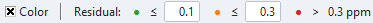
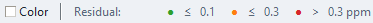

# Residual Analysis

PCS Analyzer exposes residuals in several views. They do not all use the same
sign, threshold, or model, so identify the workflow before comparing values.

## Residual definitions by workflow

| View or report | Residual definition |
| --- | --- |
| Main table colouring | active-model calculated PCS − δ_Exp |
| Standard Fitting report and plot | predicted PCS − δ_Exp |
| Multi-Conformer | ensemble predicted PCS − experimental PCS (ppm) |
| Joint PCS+RDC: PCS | predicted PCS − experimental PCS (ppm) |
| Joint PCS+RDC: RDC | predicted RDC − experimental RDC (Hz) |
| PRE | predicted Γ₂ − measured Γ₂ (s⁻¹); standardized plots divide by the fitted error scale |
| Multi-Lanthanide: Tensor fitting | predicted PCS − experimental PCS (ppm), separately for each dataset |
| Multi-Lanthanide: Reilley | predicted total paramagnetic shift − δ_para (ppm), in original shift space |
| Rhombicity Table | δ_Exp − calculated PCS |
| Rhombicity Check | δ_Exp − axial-only regression prediction |
| NMR Analysis δ_nonPCS | δ_para − calculated PCS |
| VT observed-shift analysis | measured − fitted in the selected y-coordinate units; Curie/Curie-Weiss model metrics use raw observed δ |

The δ_nonPCS quantity compares a derived paramagnetic shift with the calculated
PCS and is not the same as a δ_Exp fitting residual. See
[Observed and Diamagnetic Shifts](../experimental-data/delta-obs-dia.md).
See [VT Analysis](../nmr/vt-analysis.md) for the separate temperature-fit
residuals, coordinate transforms and model comparisons.

Normalized Reilley views show the recorded fit in transformed coordinates;
the residual plot remains in original ppm. Other Multi-Lanthanide diagnostics
have their own selected quantities, rather than one universal PCS residual.
The Joint fitting objective scales residuals by their selected error scales;
the configured RDC multiplier also affects that objective. Its plots retain
raw ppm/Hz residuals. Keep the raw
units distinct when reading standardized values or comparing weighted sums.
See [Advanced metrics](../fitting/quality-metrics.md#metrics-in-other-workflows).

## Main and Rhombicity table colouring

Enable **Color** below the main table or above the Rhombicity Table to apply
the shared absolute-residual classification. Both views share the accepted
cutoffs and Color state within the active document. The defaults are:

- green: |residual| ≤ 0.10 ppm;
- orange: 0.10 < |residual| ≤ 0.30 ppm;
- red: |residual| > 0.30 ppm; and
- gray: no residual is available.

With **Color** off, cutoffs appear as subdued values without input borders and
cannot be edited. Each dot, comparison sign and value forms a compact group,
with equal spacing between groups. Enable Color to turn the two cutoff values
into editable fields; both views switch together without resizing the whole row.
The legend stays right-aligned, keeping the ppm end fixed in both modes.
Edit the fields beside **≤** and press **Enter**, or leave the
field, to apply them. Values must be finite and satisfy
**0 ≤ green cutoff < orange cutoff**. Invalid input is marked and leaves
the accepted values and colours unchanged; Escape restores the accepted values.
The red label follows the orange cutoff automatically. Changing these controls
retags existing rows without rerunning PCS calculations or fitting.

Each document can have its own cutoffs. Changes mark the document as modified;
save the `.pcsp` to preserve them. Older projects without these settings use
0.10/0.30 ppm with Color off. These display settings are outside scientific
Undo/Redo history.

The Rhombicity Table colors the axial residual when **Enable Δχ_rh** is off
and the axial-plus-rhombic residual when it is on. These thresholds are
classification aids, not uncertainty estimates or universal acceptance
criteria.

The Fitting tab's residual plot has its own fixed 0.05/0.15 ppm color
thresholds; see [Quality Metrics](../fitting/quality-metrics.md).

## Selecting observations

The **G_ax vs PCS** view supports individual point picking and lasso or box
selection. **Fit** (Fit Selected) on its contextual Ribbon restricts that linear
regression to the selected subset; **Clear Selection** returns to all points.
Plot selections are reflected in the main table.

The standard nonlinear Fitting tab uses **PCS observations** instead,
including grouped targets when structured observations are available. Each
group contributes one residual. Its plot labels points by Ref ID but does not provide an
interactive include/exclude selector. In **Rhombicity Check**, a current
selection in the Fitting **PCS observations** list is used when present; otherwise the
diagnostic uses all available δ_Exp Ref IDs. At least three valid assigned
points are required.

## Reading the residual pattern

Review more than a single summary number. Useful checks include:

- the largest absolute residuals and their Ref IDs;
- whether residuals are concentrated in one atom class or region;
- whether the sign changes systematically with orientation;
- whether results change strongly when questionable points are excluded; and
- whether an axial-only residual correlates with the rhombic geometrical
  factor.

A residual can reflect experimental error, assignment mismatch, a structure
or centre error, an unsuitable tensor frame, averaging assumptions, or model
terms not included in the calculation. Residual structure alone does not
identify a unique cause.

## Exports

- **G_ax vs PCS Ribbon → Export Plot** writes the figure in the chosen image format and
  also creates a `_summary.txt` report and `_points.csv` data file.
- **Fitting Ribbon → Export Plot** saves the correlation and residual figure as
  PNG or PDF.
- **File → Save table...** exports the main table and, when populated, the
  Rhombicity Table. XLSX uses separate **Table** and **Rhombicity** sheets;
  CSV creates separate `_table.csv` and `_rhombicity.csv` files.

The textual **Rhombicity Check** report and its diagnostic figure do not have
a dedicated export command in the current tab. Copying or exporting those
items requires an external capture or a later implementation.

For the axial/rhombic comparison, see
[Rhombicity Diagnostics](rhombicity.md).
