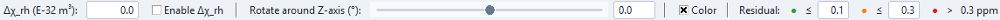

# Rhombicity Diagnostics

PCS Analyzer provides two related rhombicity views:

- **📊 Rhombicity Check** performs an axial-only regression and examines the
  remaining residuals; and
- **📊 Rhombicity Table** compares calculated axial and axial-plus-rhombic PCS
  point by point for user-supplied tensor values.

They are diagnostic tools with different purposes. A correlation or improved
residual is evidence to investigate, not proof that rhombicity is the only
missing contribution.

## Rhombicity Check

Choose **⟳ Update Diagnostic** after assigning δ_Exp and establishing the
current structure, centre, and tensor-frame orientation. The diagnostic uses
the selected Ref IDs in the Fitting **PCS observations** list when that list has a selection;
otherwise it uses all δ_Exp assignments that match the current atom set. At
least three valid points are required.

### Axial-only reference fit

The diagnostic first regresses δ_Exp against the current axial geometrical
factor Gax. By default it fits both slope and intercept. Selecting **Force b =
0 (through origin)** fixes the intercept to zero.

The report provides:

- number of points and axial residual RMSD;
- fitted slope and intercept;
- a Δχ_ax estimate converted from the slope; and
- per-point δ_Exp, axial prediction, residual, φ, and Grh.

Here the residual is **δ_Exp − axial prediction**, unlike the standard
Fitting tab's predicted-minus-experimental convention.

### Residual versus φ and Grh

The plot shows residual versus azimuth φ and residual versus Grh. The second
panel fits a line with an intercept and reports its Pearson correlation `r`
and R². The slope is converted to an approximate Δχ_rh value using the same
PCS scaling convention. The report also lists the five largest absolute
residuals.

A strong linear relationship between axial residual and Grh is consistent
with an omitted rhombic component in the current tensor frame. It is not
unique evidence: outliers, contact or other non-PCS shifts, incorrect
assignments, averaging, centre errors, and an unsuitable frame can generate
structured residuals. The converted Δχ_rh is therefore an interpretation aid,
not a confidence-bounded full-tensor estimate.

The diagnostic respects active symmetry and torsional averaging when it
builds Gax and Grh.

## Rhombicity Table

Enter **Δχ_rh (E-32 m³)**, choose **⟳ Update**, and use **Enable Δχ_rh**
to select which model controls the residual colouring. The table contains:

- Ref ID, atom, r, θ, and φ;
- `Gi_ax` and `Gi_rh`;
- `δ_PCS(ax)` and `δ_PCS(ax+rh)`;
- δ_Exp; and
- `res(ax)` and `res(ax+rh)`.

Both residual columns use δ_Exp minus calculated PCS. With rhombicity enabled,
changing **Rotate around Z-axis (°)** changes φ and the rhombic prediction
without changing the axial factor. The slider and entry cover −180° to +180°.

The Δχ_rh input and its Enable checkbox are grouped together. Thin separators
distinguish the tensor, Z-rotation and residual sections; controls share a
vertical centre and wrap in narrow windows. Residual colours use absolute values with
editable cutoffs shared with the main table. Defaults are green through 0.10 ppm,
orange through 0.30 ppm, and red above 0.30 ppm. See
[Residual Analysis](residual-analysis.md) for how these thresholds differ
from the Fitting plot.

## Axial versus rhombic comparison

Compare `res(ax)` with `res(ax+rh)` across the full table rather than choosing
Δχ_rh from one point. A systematic decrease in residual magnitude can support
the rhombic model, but adding a component also increases model flexibility.
The Rhombicity Table does not itself optimize Δχ_rh or calculate a model-
selection statistic.

`Gi_rh` depends on both θ and φ. Its sign and magnitude are meaningful only
in the current tensor frame, including the z-rotation that defines the x/y
directions. For the canonical factor and tensor definitions, see
[Axial and Rhombic PCS](../pcs/axial-rhombic.md) and
[Tensor Conventions](../pcs/tensor-conventions.md).

## Tensor reconstruction

**🧮 Calc χ(xx,yy,zz)** reconstructs the principal susceptibility components
from the current Δχ values. When **Enable Δχ_rh** is off, reconstruction uses
the axial case; when enabled, it includes the entered rhombic component. If a
molar isotropic susceptibility is supplied, it is retained as χiso;
otherwise the application constructs the traceless anisotropic tensor.

The exact definitions, units, and reconstruction formulas are documented in
[Tensor Conventions](../pcs/tensor-conventions.md).

## Export limitations

**File → Save table...** includes the populated Rhombicity Table in the table
export. The **Rhombicity Check** text and plot currently have no dedicated
export button, and the diagnostic does not report uncertainty intervals for
its approximate Δχ estimates.
