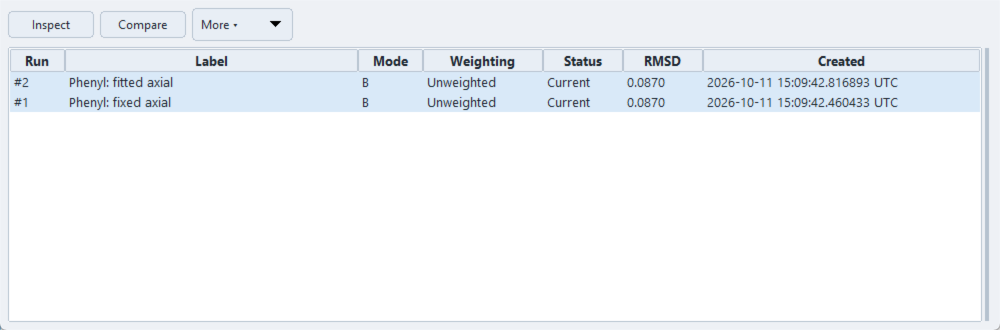

# Fit History

Open **Fit History** from the contextual **Fitting** Ribbon. It manages
standard Mode A/B/C runs for the active document. Each completed standard fit
adds a run; inspecting an older run does not overwrite the other runs or apply
its tensor. Advanced Fitting results are separate.

Mode B runs for Nd(*i*Pr₂BA)₃ with fixed and fitted axial anisotropy.

## Inspect and compare

Select a run and choose **Inspect**, or double-click it, to show its saved
parameters, metrics and predictions in the Fitting result area. With multiple
runs selected, Inspect uses the focused run. Select exactly two runs and choose
**Compare** for parameter and metric differences. Read the comparison warnings:
different observations, weighting, modes or fitting inputs can make numerical
rankings misleading. Compare residual patterns and scientific assumptions,
not just the lowest RMSD.

| Status | Meaning and action |
| --- | --- |
| **Current** | Checked scientific fit inputs match those used for this run. This does not prove model validity or uniqueness. |
| **Stale** | Checked inputs have changed. The stored report remains inspectable, but Apply to Tensor and Preview Geometry are blocked; rerun for the changed analysis. |
| **Unknown** | Validity cannot be checked. Review provenance and inputs; do not treat it as Current merely because application/preview is available. |

Status compares the run's recorded observation selection and configuration
against current scientific inputs; it is not simply a check of which rows are
currently highlighted. Changing geometry, data, averaging, weighting or a
tensor value needed by the run can change status. Inspecting a run does not
restore its original project or all its fitting controls.

After inspection, **Apply Tensor** and **Preview** obey the same mode-specific
rules as a fresh fit. Mode A cannot apply a tensor. Mode B retains the current
rhombic value. Mode C tensor application retains the assigned metal centre;
the refined centre is available only through the temporary geometry preview.
See [Running and applying a fit](overview.md#running-and-applying-a-fit).

## Manage and exchange runs

The **More ▾** menu provides:

- **Label…**: name one selected run, for example by subset or model assumption.
  There is no separate free-text notes editor; keep detailed analysis notes alongside the project.
- **Import Fit Run(s)…**: import a PCS Analyzer fit-run JSON export. Import
  preserves reports without running the optimizer or applying the tensor;
  duplicates are skipped and rejected records are reported. Imported results
  are checked against the active project's inputs.
- **Export selected as JSON…**: save one or several complete runs for later
  import, including labels, parameters, predictions and recorded fit provenance.
- **Export selected as CSV…**: write `<base>_summary.csv`; selecting one run
  also writes `<base>_observables.csv` with its experimental/predicted values
  and residuals. Multiple-run CSV export contains summaries only. CSV is for
  analysis/reporting, not fit-run re-import.
- **Delete…**: remove one selected run after confirmation. Export important
  results first, then save the project to retain the history changes.
- **Refresh**: update the list and status indicators.

## Reproducibility

Saving the **.pcsp project** retains complete standard runs, labels and the
inspected/latest run references. Reopening restores the reports without
rerunning the fit. Their predictions describe the original runs, while live
project displays are recalculated. Older summary-only records cannot recover
complete reports.

A fit-run JSON is evidence of a calculation, not a standalone reconstruction
of the structure and acquisition. Keep it with the corresponding project,
source data, application version and analysis notes. A plot export alone does
not preserve the numerical report. See [Projects and Persistence](../projects.md)
and [File Formats](../reference/file-formats.md#reproducing-an-analysis).
