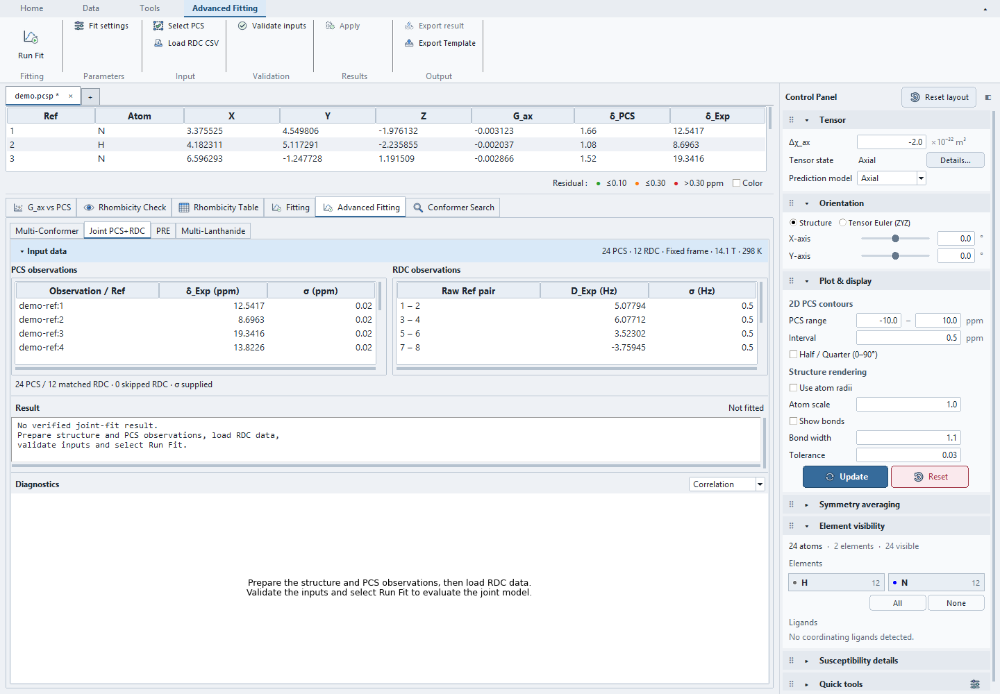
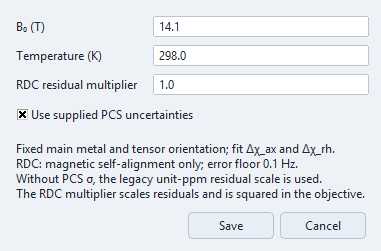
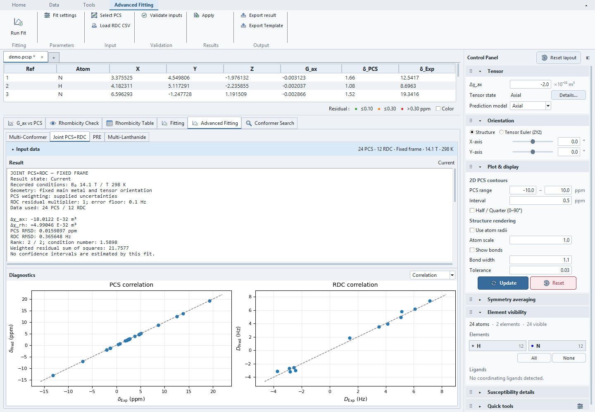
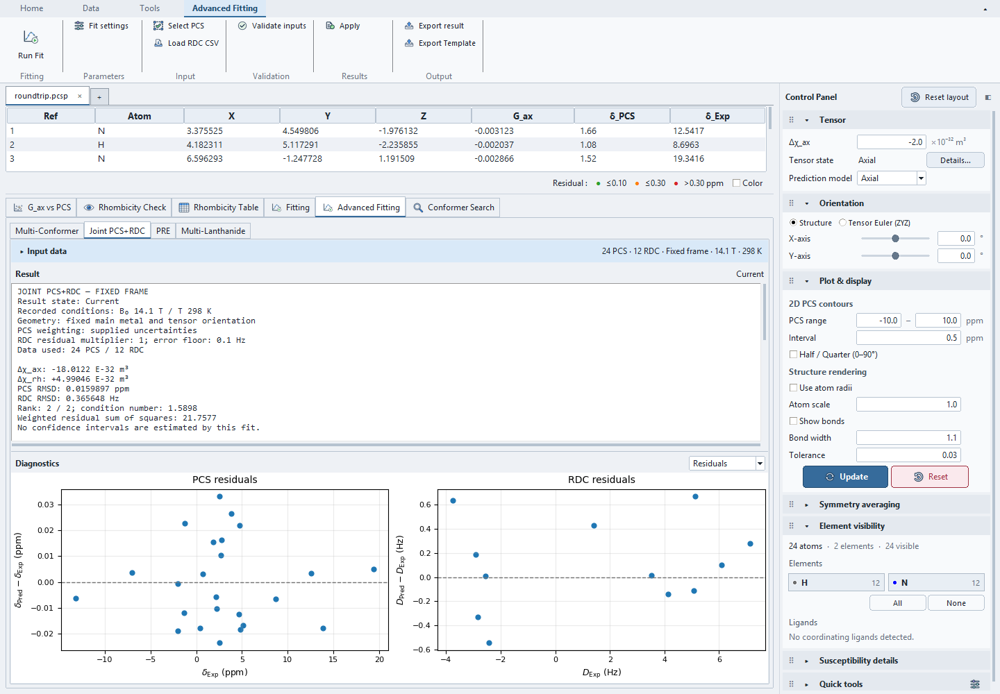

# Joint PCS+RDC tutorial

Use this workflow when PCS and RDC measurements describe the same structure
and susceptibility-induced magnetic self-alignment. It fits Δχ_ax and Δχ_rh
with the current metal position and tensor orientation fixed. RDCs from an
external alignment medium do not satisfy this coupled model.

The examples below use synthetic labelled probes, not an optimized molecular
structure or experimental dataset. Prepared projects and input files are in
`examples/joint_pcs_rdc_demo/`. The known tensor is Δχ_ax=-18 and Δχ_rh=5 E-32
m³ per molecule, at 14.1 T and 298 K.

Short paths below are relative to `examples/joint_pcs_rdc_demo/` from the release
or source archive; see [finding the examples](../examples.md#find-and-open-the-files).

## 1. Open the prepared project

Use **File → Open PCS Project...** to open `examples/joint_pcs_rdc_demo/noisy/demo.pcsp`, then
select **Advanced Fitting → Joint PCS+RDC**. The project contains 24 PCS
observations, 12 RDC bonds, supplied uncertainties and a recorded successful
fit. Reopening restores it as **Current** without rerunning or applying it.
No separate CSV import or structure loading is needed for this starting point.

The noiseless project verifies exact numerical recovery. The noisy project
adds reproducible independent Gaussian noise: 0.02 ppm for PCS and 0.5 Hz for
RDC. Use it to inspect realistic residuals rather than numerical rounding noise.

## 2. Review and select input data

**Select PCS** opens an observation selector in the Ribbon. Selection is local
to this joint fit; it does not change main atom visibility or selection.
Structured observation reductions use the existing PCS model.

**Load RDC CSV** reads explicit raw-atom `ref1`/`ref2` pairs, or unambiguous
legacy `atom1`/`atom2` labels. Ref pairs are recommended. A minimal row is:

```csv
ref1,ref2,rdc_exp,rdc_err,nuc1,nuc2
1,2,4.96,0.5,15N,1H
```

RDC values and errors are in Hz; `rdc_exp` is required. Missing `rdc_err`
defaults to 0.5 Hz and missing nuclei default to H/N. H/1H, N/15N and C/13C
are supported. Unmatched pairs are shown as skipped rows. Unsupported nuclei,
invalid values/errors and duplicate matched bonds are rejected. The loader
does not infer atom correspondence from row order.

The input tables, report and plot region have vertical splitters. **Input data**
can be collapsed; the summary retains data counts and live conditions. Short
windows scroll the entire tab. Reports remain selectable and scroll both ways.
With enough window height, plots fill the remaining vertical space while the
chosen input/report heights are retained; collapsing inputs releases space
to the plots. Smaller windows retain a usable plot height and scroll instead
of compressing away the axis labels.



This preparation screenshot clears the example's saved result in the disposable
capture session; the distributed noisy project itself includes that result.

## 3. Set conditions and weighting

Open **Fit settings** from the Ribbon. For this demo, keep B₀=14.1 T,
temperature=298 K, RDC residual multiplier=1, and **Use supplied PCS
uncertainties** enabled. Every selected PCS observation then needs positive σ.



The objective is the sum of squared PCS residuals divided by their σ, plus
squared RDC residuals divided by `max(rdc_err, 0.1 Hz)` and multiplied by the
RDC residual multiplier. Thus the multiplier is squared in the objective.
When PCS uncertainty weighting is disabled, the legacy unit-ppm PCS residual
scale is retained; it is not a statement about measurement uncertainty.

The current model fits both scalar components, retains the main metal and
orientation, and does not support torsional averaging of RDC bonds.
Use consistent signed RDC definitions when exchanging data with other software.
The molecular susceptibility alignment factor contains no Avogadro divisor.
See [Method References](../reference/method-references.md#joint-pcs-and-rdc)
for background and reporting scope.

## 4. Validate and run

Select **Validate inputs** to check mapping, errors and rank, then choose
**Run Fit**. The fixed-frame linear fit runs in the background. Inspect the
result before choosing **Apply**; neither validation nor running the fit changes
the main tensor.

For the noisy example, expect approximately:

| Quantity | Value |
| --- | --- |
| Δχ_ax | −18.012246 E-32 m³ |
| Δχ_rh | 4.990465 E-32 m³ |
| PCS RMSD | 0.015990 ppm |
| RDC RMSD | 0.365648 Hz |
| Rank | 2 / 2 |

Small last-digit differences after reopening reflect eight-decimal coordinate
tables, not a different optimization model. PCS and RDC RMSDs retain different
units and are reported separately; no combined physical-unit RMSD is defined.



## 5. Inspect residuals and result state

Switch **Diagnostics** to **Residuals**. Both plots show predicted minus
experimental values. The report records the original conditions and per-point
values even when live inputs change. Check rank and condition number alongside
RMSDs: rank 2 establishes independence in this two-scalar model, but neither
rank nor a low RMSD establishes structural correctness or precise parameters.



Editing the selected observations, geometry, orientation, RDC inputs or fit
conditions can make the report **Stale**, which disables **Apply**. Review the
changes and rerun the fit with the intended inputs. Tiny representation-rounding
differences and equivalent orientation representations do not alone make the
result stale; changed scientific inputs require refitting.

The model currently estimates no confidence intervals or bootstrap/CV results.
The noisy example is a reproducible calculation check, not a reliability study.

## 6. Inspect a failure case

Open `ambiguous/demo.pcsp`. All coordinates and RDC bonds lie along z, so the
rhombic basis column vanishes. **Run Fit** reports rank below 2 instead of
presenting an arbitrary rhombic value. No successful result is installed and
**Apply** remains disabled.


The screenshot shows the actual workspace after rejection; it is not an error
dialog mockup. Add independent geometry/observations or choose a different
scientific model before fitting. Importing `invalid-rdc.csv` separately should
reject its unsupported nucleus and retain the previous input collection.

## 7. Save, export and apply deliberately

**Save Project** retains the RDC inputs, selected PCS observations, fit settings
and last recorded result. Reopening checks the saved result without refitting
or applying its tensor. Older projects without joint-fit data open with empty
joint inputs and defaults. For storage and compatibility details, see
[File Formats](../reference/file-formats.md#specialized-csv-inputs).

**Export result** writes recorded inputs, matching and numerical diagnostics as
JSON, including stale results. It does not substitute live settings.
**Apply** copies only the fitted Δχ_ax/Δχ_rh scalars from a Current successful
result. It preserves metal, orientation, rhombic enablement and prediction
policy; enabling a rhombic contribution in main predictions remains a separate
choice. Joint reports stay separate from standard Fit History.

See [Fitting overview](overview.md#joint-pcsrdc),
[Projects](../projects.md) and [File formats](../reference/file-formats.md).
