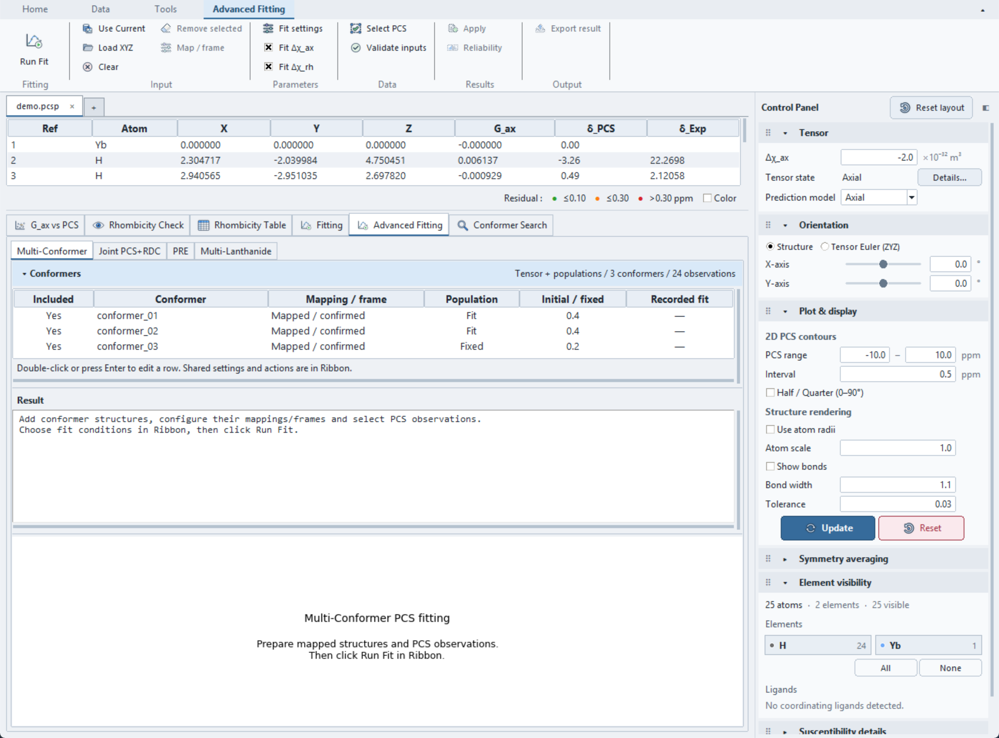
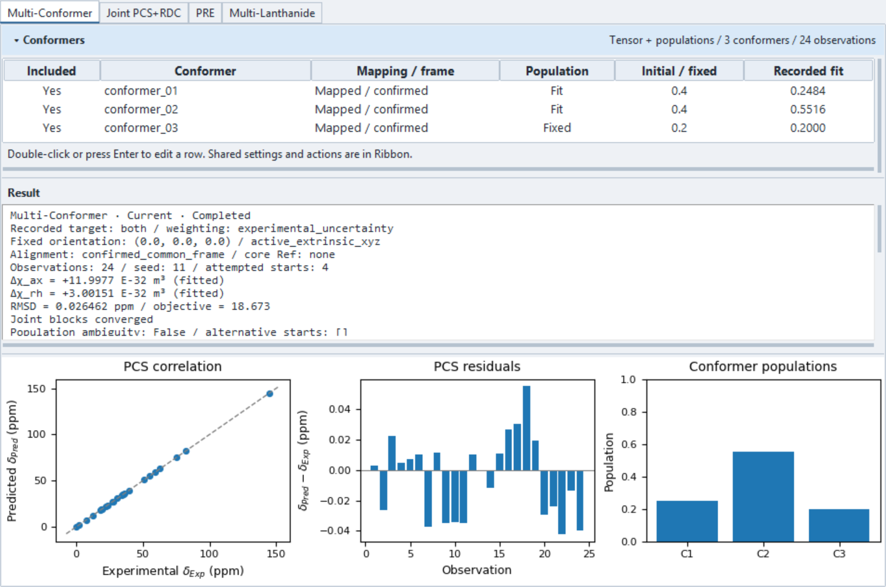
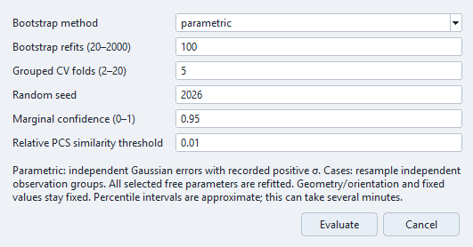
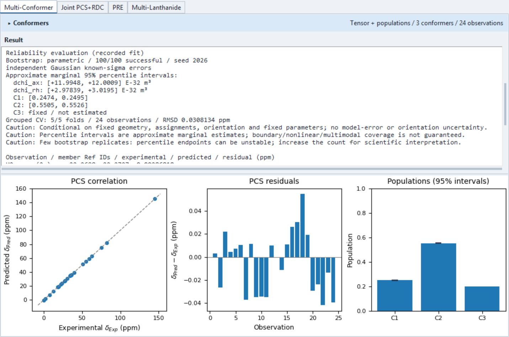
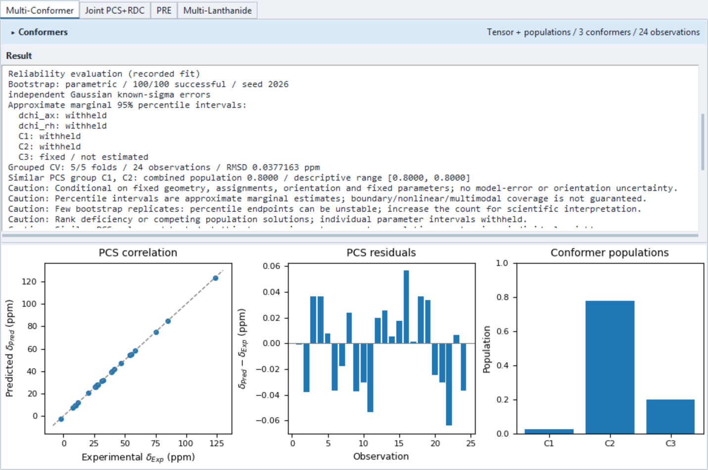

# Tutorial: Multi-Conformer PCS Fitting and Reliability

This tutorial fits populations and shared tensor magnitudes from structure-specific
PCS predictions, then evaluates uncertainty and held-out prediction error. It uses
two reproducible synthetic projects: one with distinguishable PCS signatures and
one where two conformers are indistinguishable.

The coordinates are labelled geometric probes around a metal, **not an optimized
chemical structure or experimental evidence for conformational exchange**. The
current model assumes fast exchange, a common fixed tensor orientation, and PCS
averaging after prediction for each conformer. It does not average coordinates or
fit independent tensors for different conformers.

Read [Multi-Conformer fitting](overview.md#multi-conformer) for the complete input
and model contract. Standard [Full Tensor Fitting](full-tensor-fitting.md) is a
different workflow; this tutorial does not optimize orientation or metal positions.

## 1. Get the demo projects

Use `examples/multi_conformer_demo/` from the source checkout or portable release:
short paths below are relative to this directory. See [finding the example files](../examples.md#find-and-open-the-files).

| Project | Purpose |
| --- | --- |
| `informative/demo.pcsp` | Recover tensor magnitudes and two fitted populations from different PCS signatures. |
| `ambiguous/demo.pcsp` | See why a good PCS fit does not determine populations of identical conformers separately. |

Each scenario also contains three XYZ files and `pcs.csv` for inspecting the inputs.
The project embeds the structures, explicit Ref
mapping, fit options and structured PCS observations including uncertainties.
**No CSV reimport or manual mapping is needed for these prepared projects.**

The ground truth is:

| Quantity | Value |
| --- | --- |
| Observations | 24 H probes, Ref 2–25 |
| Metal | Ref 1, origin (0, 0, 0) Å |
| True C1 / C2 / C3 populations | 0.25 / 0.55 / 0.20 |
| Δχ_ax / Δχ_rh | 12 / 3 E-32 m³ |
| Tensor orientation | Zero Euler angles, fixed |
| Measurement noise | Independent Gaussian, σ = 0.03 ppm |
| Initial C1 / C2 / C3 populations | 0.40 / 0.40 / 0.20 |

C3 is fixed at 0.20; C1 and C2 share the remaining 0.80. In the ambiguous project,
C1 and C2 have identical coordinates, so their combined population is the relevant
quantity rather than the two individual weights.

## 2. Open and inspect the informative project

1. Choose **File → Open PCS Project...** and open `informative/demo.pcsp`.
2. Select **Advanced Fitting → Multi-Conformer** in the Analysis area.
3. Inspect the conformer table. All three rows are Included and Mapped / confirmed.
   The **Population** column shows Fit for C1/C2 and Fixed for C3.
4. Double-click a row, or select it and press Enter, to inspect its mapping,
   metal/frame, inclusion and initial/fixed population. Cancel leaves it unchanged.
5. In the contextual Ribbon, confirm **Fit Δχ_ax** and **Fit Δχ_rh** are checked.

The **Fitting** group and **Run Fit** appear first. **Parameters** contains
**Fit settings** and native parameter checkboxes. **Data → Select PCS** selects
observations independently of main atom selection; **Validate inputs** checks
mapping, frame and population constraints. It does not certify the chemistry or
the statistical model.

### Check the fit conditions

Open **Fit settings** and confirm:

| Setting | Demo value |
| --- | --- |
| Fit target | `both` |
| Objective weighting | `experimental_uncertainty` |
| Alignment | `confirmed_common_frame` |
| Population initialization | `user` |
| Δχ_ax initial / fixed | −5 E-32 m³ |
| Δχ_rh initial / fixed | 1 E-32 m³ |
| Multi-start count | 4 |
| Random seed | 11 |

Both scalar checkboxes are enabled, so −5 and 1 are starting values rather than
fixed constraints. `tensor` fixes the supplied populations; `populations` fixes
both specified scalars. Clearing a scalar checkbox holds its specified value
fixed, including a nonzero rhombic value.

For your own structures, use **Use Current** or **Load XYZ**, then **Map / frame**.
Confirm chemical Ref correspondence and each file's metal origin/frame explicitly.
Equal atom counts do not establish chemical identity. Use metal-centered core
alignment only with at least three corresponding noncollinear anchors; use
**Already tensor-oriented** only when those are the actual coordinate axes.

## 3. Run the fit and read the results

Click **Run Fit**. The computation runs in the background. Completion records a
result; it does not automatically apply it to the main structure.

With the bundled noise realization and settings, the result is approximately:

| Quantity | Recovered value |
| --- | ---: |
| C1 | 0.2484 |
| C2 | 0.5516 |
| C3 | 0.2000, fixed |
| Δχ_ax | 11.9977 E-32 m³ |
| Δχ_rh | 3.0015 E-32 m³ |
| In-sample PCS RMSD | 0.02646 ppm |

Small last-digit differences can depend on numerical-library versions. Check the
recorded conditions and solver status before interpreting a number. A converged
multi-start solution is not proof of a global optimum or unique populations.

- **PCS correlation** compares experimental and ensemble-predicted PCS against the
  identity line. It is not a second regression fitted to the display points.
- **PCS residuals** are predicted minus experimental PCS in ppm.
- **Conformer populations** shows the fitted weights, including fixed C3.
- **Result** contains recorded conditions, per-conformer details, error metrics,
  ambiguity and per-observation results. Its text is selectable and scrollable.

Drag the two horizontal splitters to allocate height to the list, report and plots.
The **Conformers** header can collapse the list. Very short windows use the whole-tab
scrollbar; report text retains its own scrollbars.

## 4. Evaluate reliability

After reviewing a successful Current result, click **Results → Reliability**.
The command is unavailable while a Multi-Conformer job is running or inputs require
a refit. It also requires recorded/current uncertainties to match: changing σ can
leave an unweighted fit Current while still requiring a refit before evaluation.

Use these first-review settings:

| Control | Value | Interpretation |
| --- | --- | --- |
| Bootstrap method | `parametric` | Independent Gaussian perturbations using recorded positive σ. |
| Bootstrap refits | 100 | A practical initial review; increase for endpoint stability. |
| Grouped CV folds | 5 | Each observation group is held out once. |
| Random seed | 2026 | Reproducible sampling and solver starts. |
| Marginal confidence | 0.95 | Enter a fraction, not 95. |
| Relative PCS similarity threshold | 0.01 | Suggestions from structure-specific PCS columns at the fitted tensor. |

Click **Evaluate**. Progress appears in the Analysis header. Each replicate refits
every selected free tensor/population field; joint uncertainty is not approximated
by keeping the tensor fixed. Geometry, orientation and fixed values remain fixed.
Larger counts can take several minutes.

### Choose the resampling method deliberately

`parametric` requires known positive uncertainty for every selected observation and
assumes independent Gaussian errors. It is rejected for overlapping physical members
or shared source observables without a covariance model.

`cases` samples independent, exchangeable observation groups with replacement.
Overlapping member Ref IDs, pseudo-members or shared source observable IDs stay
together. Unknown correlations between the remaining groups are not automatically
modelled; selecting `cases` does not make correlated experimental data independent.

Grouped CV uses only training observations to fit the tensor and populations.
It starts from the recorded user/uniform initialization, not the full-data fitted
parameters. There must be enough independent groups for the selected fold count,
and each fold must retain at least three training observations. This is evaluation
of a preselected model, not nested validation of structure/model selection.

## 5. Interpret the reliability report

Collapse **Conformers** if useful and scroll the report to **Reliability evaluation**.

For the bundled example, 100/100 bootstrap refits and 5/5 CV folds succeeded.
The held-out PCS RMSD is approximately **0.03081 ppm**, compared with the in-sample
0.02646 ppm. Both are raw ppm errors; the weighted objective is a different quantity.

The displayed approximate marginal 95% intervals are:

| Parameter | Interval |
| --- | --- |
| Δχ_ax | [11.9948, 12.0009] E-32 m³ |
| Δχ_rh | [2.9784, 3.0195] E-32 m³ |
| C1 | [0.2474, 0.2495] |
| C2 | [0.5505, 0.5526] |
| C3 | Fixed / not estimated |

Population interval marks appear on the plot only where an interval is available.
These are percentile estimates, not normal/Hessian intervals. Fixed parameters do
not receive a zero-width estimated interval.

In this particular noise realization, C1's known truth 0.25 is outside its displayed
interval. A nominal 95% interval need not cover the truth in every realization;
one plot cannot establish coverage or calibrate intervals for other datasets.

Important report states:

| State | Meaning |
| --- | --- |
| Successful refit count | Failed repetitions are retained, not silently replaced. |
| Withheld interval | Too few successful refits or deficient/ambiguous parameter diagnostics prevent an individual interval. |
| Fixed / not estimated | The parameter was not varied in the evaluation. |
| Partial CV score | Some folds failed; the pooled score covers successful folds only. |
| Similar PCS group | Inspect the combined population; this is a suggestion, not an automatic merge. |

At least 20 and 80% of requested refits must succeed before intervals are considered.
Population boundaries, nonlinear or multimodal solutions, too few tail samples and
incorrect error assumptions limit interpretation. Multi-start spread measures
optimizer sensitivity; it is not a confidence interval. Uncertainty in geometry,
orientation, metal positions, assignments or the chosen model is not propagated.

## 6. Compare the ambiguous project

Open `ambiguous/demo.pcsp`, then repeat **Run Fit → Reliability → Evaluate** with
the same settings. The fixture intentionally gives C1 and C2 identical PCS signatures.

The fit still predicts PCS well; the held-out RMSD is approximately **0.03772 ppm**.
The individual weights are not determined uniquely: a run can retain the initial
0.40/0.40 split or return another pair summing to 0.80. The screenshot's
0.0239/0.7761 is one such solver choice, not a numerical checkpoint to reproduce.
None of these splits establishes recovery of the true 0.25/0.55 populations.

The report withholds individual parameter intervals when the joint diagnostics are
rank deficient or ambiguous. It suggests **C1, C2: combined population 0.8000** with
a descriptive bootstrap range [0.8000, 0.8000]. C3 is fixed at 0.20, so the remaining
sum 0.80 is itself fixed by the model; the zero-width aggregate range is not evidence
of a precisely measured exchange population. No conformer is merged or removed.

## 7. Save, export and apply deliberately

- **Export result** saves the recorded inputs, all fit starts, contributions,
  bootstrap/fold runs, assumptions and diagnostics as JSON.
- Save the PCS project to a new working path to retain the conformer inputs, fit
  and reliability result. Reopening restores the record; it does not recompute it.
  Keep the bundled example projects unchanged for repeatable comparisons.
- Check Current/Stale/Unknown after changing inputs. A previous result retains
  its historical conditions rather than reading numbers from the live table.
- **Apply** explicitly copies fitted scalar fields only. It preserves main
  orientation, metal, rhombic enablement and prediction policy. It does not install
  ensemble PCS in the main table or apply local fixed overrides. Population-only
  fitting has no newly fitted tensor fields to Apply.

Multi-Conformer results are separate from standard Fit History. See
[Projects and Persistence](../projects.md#what-the-current-project-restores) and
[Quality Metrics](quality-metrics.md) for the corresponding storage and metric scope.

The screenshots show the Light theme and 100-refit results described above.
For statistical background and the limits of these estimates, see
[Method References](../reference/method-references.md#reliability-evaluation).
