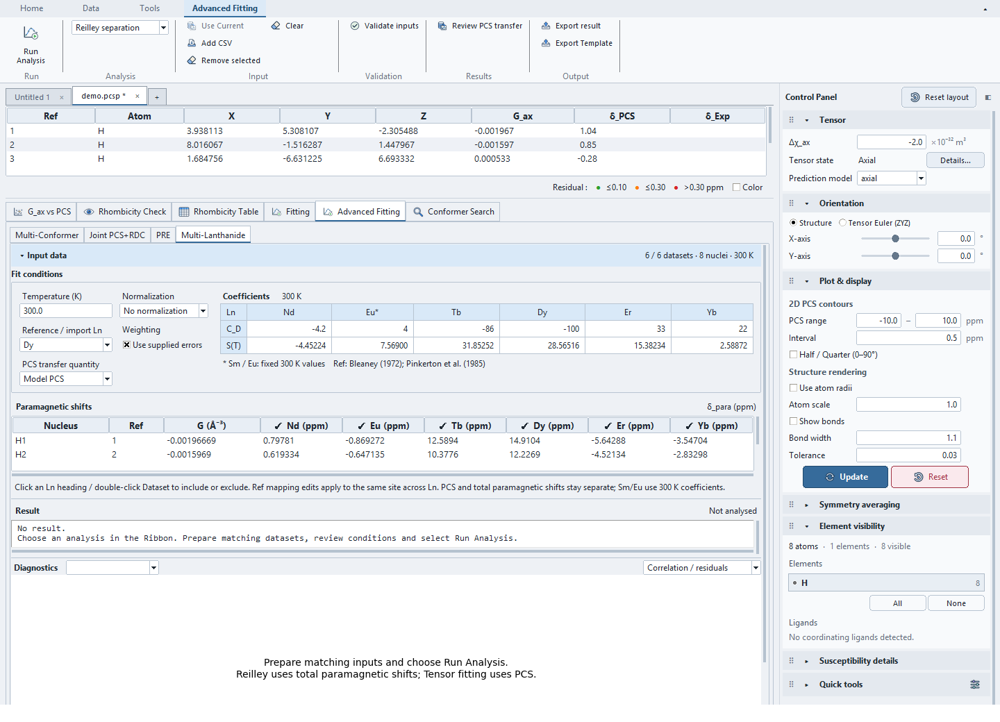
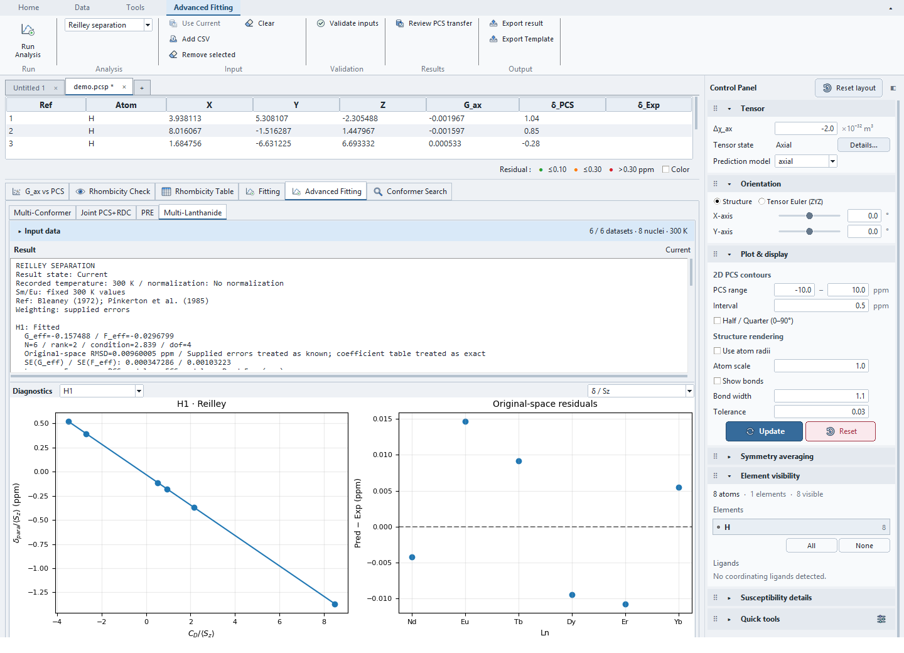
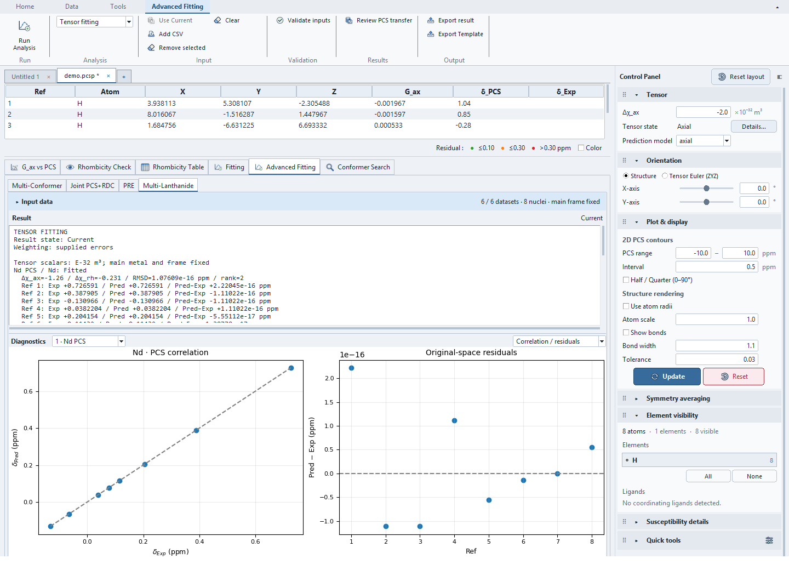
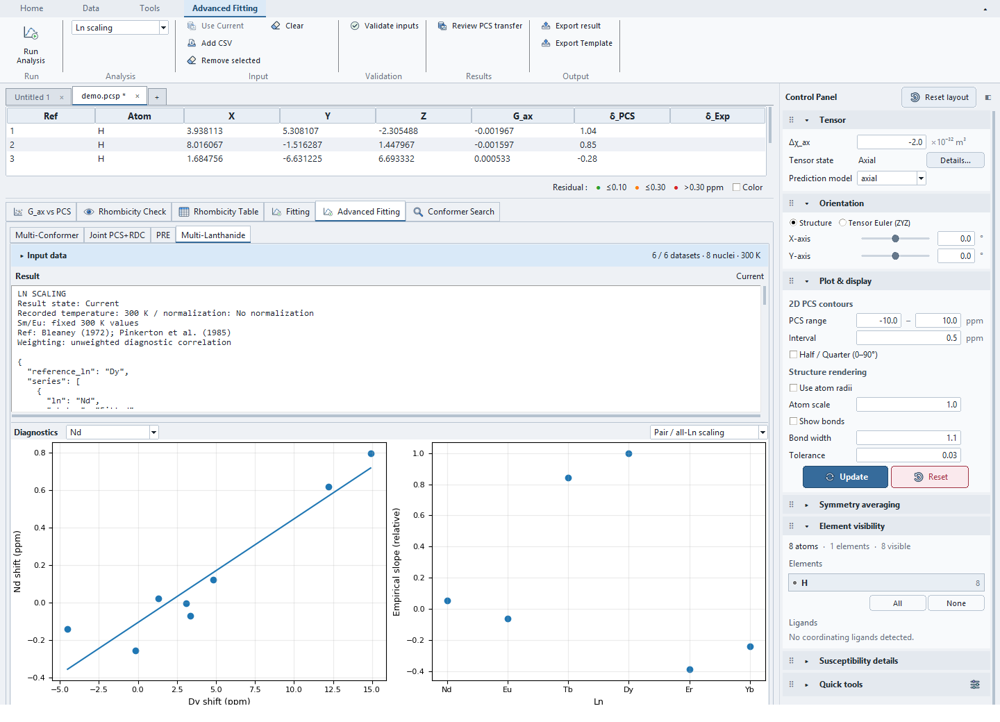
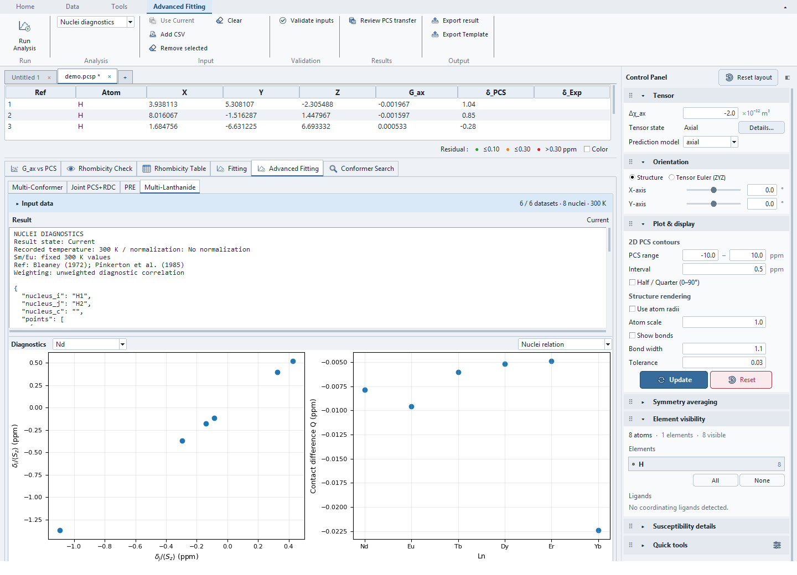

# Multi-Lanthanide and Reilley tutorial

Use **Advanced Fitting → Multi-Lanthanide** to compare independent tensor fits
and analyse corresponding nuclei across a lanthanide series. Select the tool in
the contextual Ribbon **Analysis** selector. **Run Analysis** executes the selected
analysis; **Validate inputs** checks it without installing a result.

## 1. Open the synthetic example

Open `examples/multi_lanthanide_demo/noisy/demo.pcsp`. It contains eight synthetic
probes, PCS and total paramagnetic-shift datasets for six Ln ions, supplied
errors and a recorded result for each of the six analysis modes. Reopening
restores them as Current. The coordinates are not a chemically optimized molecule.

`noiseless/demo.pcsp` verifies exact recovery. The noisy example perturbs total
shifts with a fixed-seed 0.015 ppm Gaussian noise; recorded errors are 0.03 ppm.
Its independently generated tensor PCS data remains noiseless.

## 2. Prepare and review input data

Reilley and series diagnostics use **total paramagnetic shifts**
δ_para=δ_obs−δ_dia. Tensor fitting uses **PCS**. These quantities must not be
interchanged. Nucleus labels identify corresponding assigned sites across Ln;
matching numeric Ref IDs alone does not establish consistent assignments.

**Add CSV** accepts the historical wide Reilley matrix:

```csv
Nucleus,ref_id,G_common,Nd,Eu,Tb,Dy,Er,Yb,error
H1,1,-0.00196669,0.80,-0.87,12.59,14.91,-5.64,-3.55,0.03
```

Values are total paramagnetic shifts in ppm, not raw observed shifts. Blank
cells remain missing; zero is a valid geometry value. Geometry may also use
`Ln_G_i` columns. Errors may use `Ln_err` columns or the shared `error` column.
Invalid numbers, nonpositive errors and duplicate nucleus labels are rejected.
Geometry ratios/CFP checks need explicitly supplied structural G values.

Single-dataset CSVs use integer `ref_id`/`ref`/`id`, a `site`/`Nucleus` label,
`pcs_exp` in Tensor fitting or `delta_para` in a series analysis, and optional
`pcs_err`/`error`. Legacy `delta_exp`/`d_exp`/`ppm` aliases use the selected mode's
input type. **Reference / import Ln** assigns the ion when importing a single
dataset. **Use Current** copies main PCS into a local dataset, preserving
single-atom observation errors. Grouped targets require explicit review and are
not imported through this action.



Click an Ln heading to include/exclude that dataset. In Tensor fitting,
**Input view → Datasets** provides a dataset summary; double-click its first
column to change inclusion. **Ref mapping** shows assigned sites and shifts.
Double-click Ref and press Enter to map the same site across local Ln datasets;
Escape cancels the edit. It does not modify the main structure or PCS table.
Duplicate included Ln datasets are rejected for Reilley/series analysis; choose
one per Ln. Independent tensor fits can retain multiple datasets for the same ion.

For Reilley, a compact **Coefficients** table inside **Fit conditions** shows C_D
and S(T) for included Ln ions, with 2 px cell padding and short references.
Settings use compact, font-aware control widths; coefficients take the remaining
width. Settings and coefficients sit side by side when space permits and stack in
narrow windows. Cell borders distinguish headings and numeric values.
Temperature edits update S(T); Sm/Eu keep their marked 300 K values. Excluding an
Ln removes it from this coefficient area. The input quantity is **δ_para (ppm)**.
The same coefficient area is available in nucleus/geometry diagnostics.

Input data collapses conditions, coefficients and its table together. Resize the vertical
splitters to allocate input/report height; diagnostics fill the remaining height.
Short windows scroll the whole workspace, while reports/tables retain native
scrollbars for their contents.

## 3. Reilley separation

The selected coefficient convention fits each nucleus independently:

\[
\delta_{para}=G_{eff}C_D+F_{eff}\langle S_z\rangle.
\]

The **Normalization** selector offers **No normalization**, **Normalize by S(T)**
and **Normalize by C_D**. **No normalization** fits the original δ_para (ppm)
values. The other objectives divide the equation by S(T) or C_D. With **Use supplied errors**, errors are
divided by the absolute same denominator, preserving the original weighted
objective. Without weighting, normalized regressions have different objectives
and may yield different coefficients. Zero normalization denominators are rejected.



The Result report provides G_eff/F_eff, coefficient standard errors when
estimated, rank, scaled-design condition number, residual degrees of freedom,
original-space RMSD and per-Ln PCS/FCS predictions. Exactly two Ln points can
provide an identifiable two-point estimate but no residual degrees of freedom;
R² and residual-based standard errors are withheld. Insufficient/rank-deficient
nuclei and missing supplied errors are reported as excluded, rather than omitted.

The plot selector displays δ/〈S_z〉, δ/C_D or PCS/FCS components. Normalized
views display the recorded fit in the selected coordinates; changing a plot
does not fit another objective. The right plot uses Pred−Exp in original ppm.

### Coefficients and assumptions

**Coefficients** shows the values used for the selected temperature. **Parameter
table** shows the full supported relative C_D and RHF spin-factor set. Short
references identify Bleaney (1972) and Pinkerton et al. (1985); coefficient
identity remains recorded in project/export data.

The default temperature for new inputs is **300 K**. Reopening a project preserves
its recorded temperature, including existing 303 K analyses. The supplied demo
datasets and recorded analyses are generated at 300 K.

The implemented temperature expression is S(T) = a + b × 10⁻⁴ T for
Ce, Pr, Nd, Tb, Dy, Ho, Er, Tm and Yb. Sm/Eu use fixed 300 K values even when
a different temperature is selected. C_D is relative and remains constant;
effective fitted coefficients absorb this convention at the selected temperature.
This is a single-temperature separation model, not a general variable-temperature
model. In particular, selecting 303 K does not convert the fixed Sm/Eu values
into 303 K coefficients. Prepare each included series at a common measurement
temperature; the CSV does not record separate temperatures for measurements.

Pinkerton Table 1 (p. 422) gives the RHF a/b coefficients and 300 K values.
Its Sm/Eu values use the full equations (footnote d); Eu additionally uses
g = 4.4 for the ground state (footnote e). The application's fixed Sm/Eu values
at other temperatures are an approximation, not a linear expression supplied
for these ions in that table.

For Reilley and total-shift diagnostics, supply the paramagnetic increment
(δ_para = δ_obs − δ_dia, in ppm), rather than
the absolute observed chemical shift. The importer does not subtract a
diamagnetic reference automatically. The
[published application](https://pubs.rsc.org/en/content/articlehtml/2015/dt/c5dt02398j)
describes this subtraction and a dataset-specific Sm outlier; review such cases
for your series rather than assuming all included ions are equally reliable.

Reilley separation assumes compatible structures, assignments and coefficient
interpretation across the series. Linearity is a diagnostic, not proof of
isostructurality. Crystal-field and contact-coupling changes can also affect the
trend. See the [published Reilley application and assumptions](https://pubs.rsc.org/en/content/articlehtml/2015/dt/c5dt02398j)
and [Pinkerton's spin-polarization paper](https://doi.org/10.1016/0022-2364(85)90104-0).
Coefficient uncertainties and temperature uncertainty are not propagated; supplied
measurement errors are treated as known for coefficient covariance calculations.

## 4. Retain independent Tensor fitting

Choose **Tensor fitting** to fit Δχ_ax and Δχ_rh independently for each included
PCS dataset. Main geometry, metal and tensor frame stay fixed. Explicit Ref
mapping replaces dependence on main visibility or atom selection. Zero-distance
metal sites are excluded from the PCS design. Missing Refs are listed; singular
designs and incomplete supplied errors are rejected for the affected dataset.



Tensor values use E-32 m³. The report and selected-dataset correlation/residual
plots describe the recorded fit. Standardized residuals require supplied errors;
otherwise raw ppm residuals remain displayed. This fits no shared metal position,
orientation, tensor ratio or cross-ion crystal-field model, and has no Apply-to-Main
action. Geometry overrides and torsional averaging are unsupported.

## 5. Use series diagnostics

- **Ln scaling:** correlations across matching nuclei against the chosen
  reference ion, with per-Ln slope/intercept/rank. These diagnostic regressions
  are unweighted; both-axis measurement uncertainty is not modelled. Total-shift
  slopes may contain contact contributions and are not certified Bleaney constants.
- **Nuclei diagnostics:** choose two distinct nuclei to inspect δ_i/〈S_z〉 versus
  δ_j/〈S_z〉 and the geometry-subtracted contact difference. An optional distinct
  third nucleus gives Q_A/Q_B diagnostics. Missing/zero geometry and unmatched
  denominators are recorded as exclusions. This does not independently determine
  absolute PCS or supply an anchor contact estimate.
- **Geometry / CFP:** compare total-shift ratios with explicit geometry ratios.
  **Relative CFP** compares Reilley G_eff against common nonzero G_struct through
  origin/free-intercept regressions. Ln-varying or near-zero structural factors
  are excluded from that comparison. Values are relative coefficients under the
  selected coefficient convention, not absolute energy-unit crystal-field parameters. Ratio
  checks do not assume that contact contributions vanish automatically.





Empirical absolute separation, anchor-corrected PCS, nonlinear geometry fitting
and general uncertainty propagation remain outside this implementation.

## 6. Transfer deliberately, save and export

From a **Current** Reilley result, choose **PCS transfer quantity**:

- **Model PCS:** fitted G_eff C_D.
- **Measured − contact:** δ_para−F_eff〈S_z〉; it differs from model PCS by the residual.

**Review PCS transfer** creates local typed PCS datasets and opens Tensor fitting
in Ref mapping view. Review their mapping and inclusion before fitting. Existing
datasets remain present; avoid including unintended duplicates. Derived values
share fitted-coefficient uncertainty and are correlated. Their errors are not
silently treated as independent measured errors; transfer leaves supplied-error
weighting off. Any subsequent tensor covariance is descriptive, not a calibrated
uncertainty propagation from the Reilley analysis. The main PCS table and tensor
are not overwritten.

**Export result** writes the selected recorded analysis as JSON, including stale
results. **Export Template** produces a wide paramagnetic matrix. Projects retain
typed inputs, mapping, inclusion, conditions, coefficient convention and a result
for each analysis in an optional `[multi_lanthanide]` section. Loading verifies
recorded outputs by deterministic linear replay; it neither launches an analysis
worker, replaces those outputs nor applies a tensor. Older projects default to
empty Multi-Lanthanide state. These results remain separate from standard Fit History.
