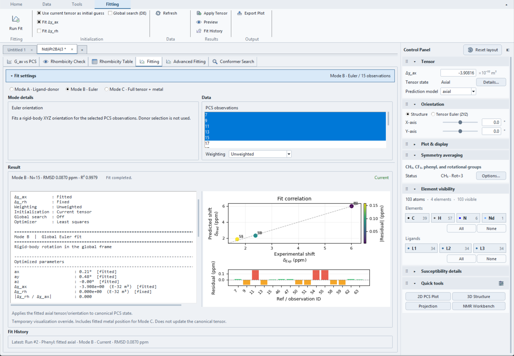

# Fitting Overview

The **🔍 Fitting** tab optimizes PCS predictions against selected δ_Exp
assignments. It provides three orientation/centre models and a common result
report. The separate **🔍 Advanced Fitting** tab contains several fixed-
geometry workflows described at the end of this page.

Standard Mode B/C **Apply to Tensor** is recorded in the active document's
[Undo/Redo history](../projects.md#undo-and-redo). Undo restores the previous
tensor and any geometry preview removed by Apply; recorded Fit History remains
available. Redo restores the applied values without rerunning fitting. Mode A's
geometry-preview workflow is unchanged.

## Inputs shared by the standard fitting modes

Before fitting, provide:

1. a loaded structure with a valid metal-centre assignment;
2. experimental PCS values as δ_Exp or structured observations;
3. a current Δχ_ax value and, when used, Δχ_rh; and
4. enough independent selected PCS observations to constrain the parameters.

Selecting **Fitting** exposes its contextual Ribbon: **Run Fit**, initialization
options, **Refresh** (the **Refresh Inputs** command), **Apply Tensor**
(**Apply to Tensor**), **Preview** (**Preview Geometry**), **Clear Preview**, **Fit History**, and
**Export Plot** (**Export Fit Plot**). Model and observation choices remain in
the analysis area. These commands act on the active document.

Choose **Refresh** after changing the structure, filter, or assignments.
**PCS observations** lists structured assignments when available; otherwise it
lists visible proton Ref IDs with legacy δ_Exp data. Select at least three
valid observations and substantially more when fitting several parameters.
A grouped target contributes one residual, regardless of its atom count; see
[Structured observations](../experimental-data/delta-exp.md#structured-observations-and-grouped-targets).

Mode C rejects a run with fewer than three matched PCS observations. Modes A and
B currently enforce only that the selections are nonempty; they can therefore
start an underdetermined fit with fewer than three matched points. Avoid using
that permissive behavior as evidence that the data are sufficient.

Mode A also requires one or more non-hydrogen Ref IDs from its donor list.

## Standard fitting modes

| UI mode | Always fitted | Optionally fitted | Fixed in this mode |
| --- | --- | --- | --- |
| **Mode A · Ligand-donor** | donor-axis θ and axial twist α | Δχ_ax, Δχ_rh | metal position |
| **Mode B · Euler** | global `ax`, `ay`, `az` orientation | Δχ_ax, Δχ_rh | metal position |
| **Mode C · Full tensor + metal** | three Euler angles and metal x, y, z | Δχ_ax, Δχ_rh | unchecked tensor components |

Mode C has six, seven, or eight variable parameters depending on the **Fit Δχ_ax**
and **Fit Δχ_rh** checkboxes. See
[Full Tensor Fitting](full-tensor-fitting.md).

## Fitted and fixed tensor components

**Fit Δχ_ax** and **Fit Δχ_rh** determine whether each component is included
in the parameter vector. An unchecked component is read from the current
main-window value and held fixed. Tensor inputs and results use units of
\(10^{-32}\,\mathrm{m^3}\) per molecule.

Rhombic fits require a defined in-plane frame because the rhombic term depends
on azimuth. See [Orientation Fitting](orientation-fitting.md) and
[Tensor Conventions](../pcs/tensor-conventions.md).

## Initialization, bounds, and optimization

By default, orientation angles start at 0° and tensor parameters start from
the current Δχ values. **Use current tensor as initial guess** initializes
Mode B/C from the current tensor orientation and components; it is unavailable
for Mode A. Mode C still starts at the assigned metal position.

Orientation angles are restricted to −180° to +180°. Mode C restricts each
metal coordinate to ±1 Å around the assigned starting centre. Tensor components
are not bounded in the final refinement.

**Global search (DE)** searches for an initial solution before local refinement;
it can help with starting-point sensitivity but does not establish uniqueness.
Its preliminary search restricts tensor components to the current value ±50
in the application's Δχ units. Compare runs from different initial assumptions.

## Weighting

**Weighting: Unweighted** minimizes the sum of squared residuals in ppm.
**Experimental uncertainty** divides each residual by that observation's
uncertainty σ in ppm before optimization. Every selected observation must have
a finite, strictly positive σ; missing, zero, negative, or non-finite values
reject the run. Uncertainty belongs to the experimental observation, including
when its target contains several atoms. See [Quality Metrics](quality-metrics.md).

## Running and applying a fit

1. Select a mode and the required observations/donors.
2. Choose fitted tensor components, initialization, and weighting.
3. Select **Run Fit** and inspect the parameters, metrics and per-observation residuals.
4. Choose **Apply to Tensor** to change the current tensor, or **Preview Geometry**
   to inspect the fitted geometry using a temporary override.

| Mode | Apply to Tensor | Preview Geometry |
| --- | --- | --- |
| **A** | Unavailable: the donor-dependent orientation is not applied to the current tensor | Previews donor-axis orientation; does not copy fitted Δχ inputs |
| **B** | Applies fitted Δχ_ax and orientation; retains the current Δχ_rh and its enablement | Previews XYZ orientation; does not copy fitted Δχ inputs |
| **C** | Applies Δχ_ax, Δχ_rh and orientation; retains rhombic enablement and the assigned metal position | Previews orientation and refined metal position; also fills the Δχ input fields |

Tensor application clears an existing geometry override and refreshes the
views. It does not change **Prediction model** or enable rhombicity automatically.
Check both controls when comparing the main prediction with a fit that used a
rhombic term. Mode B application retains the existing rhombic value even if
that component was fitted.

**Preview Geometry** uses the existing visualization override and redraws
immediately. Mode C also uses its fitted Δχ input values in that redraw; it
does not apply fitted orientation to the canonical tensor. **Clear Preview**
removes the geometry override while retaining current tensor settings.
Both actions support [document Undo/Redo](../projects.md#undo-and-redo).
Undoing Preview restores the previous geometry and tensor values; Undoing Clear
restores the removed preview. The refined metal position is temporary and
is not adopted as the project's assigned centre. Consequently, Mode C's
post-application main predictions can differ from its fit report, which used
the refined centre.

**[Fit History](fit-history.md)** retains runs for inspection and comparison. Results marked **Stale** cannot
be applied or previewed because fit inputs changed. **Unknown** means validity
could not be established, not that the result is current; review its inputs.
Restoring or inspecting a run does not automatically apply it. **Export Fit Plot**
saves the standard figure as PNG or PDF.

!!! note

    A completed optimization is not evidence that the model is unique or
    scientifically appropriate. Compare parameter count with the number and
    spatial distribution of observations, inspect residuals, and test
    sensitivity to initialization and fixed assumptions.

The result header shows the mode, observation count, RMSD, R² and validity.
The report distinguishes fitted and fixed values and lists residuals; the figure
shows predicted versus experimental PCS and signed residual bars. RMSD remains
in ppm even for weighted fits; χ²/N is uncertainty-normalized chi-square per
datum, not reduced chi-square. See [Quality Metrics](quality-metrics.md).

Mode B fitting result for Nd(*i*Pr₂BA)₃.

This example fits Δχ_ax to the phenyl assignments with unweighted residuals;
the *i*Pr assignments are excluded. Its 15 selected Ref assignments span
symmetry-related ligands and do not represent 15 independent experimental
resonances.

## Current advanced fitting workflows

The following workflows are implemented under **🔍 Advanced Fitting**. They
do not replace the standard orientation and metal-position fit. Multi-Conformer
uses its own structure collection and observation selection; the other workflows
use the current selected atom set and geometry.

### Multi-Conformer

For a worked example with current screenshots, see the
[Multi-Conformer fitting and reliability tutorial](multi-conformer-tutorial.md).

Use at least two included conformers and three matched PCS observations. The
model averages structure-specific PCS, assuming fast exchange and a shared
tensor with fixed orientation. It does not predict PCS from averaged coordinates.

Use the contextual Ribbon **Use Current** or **Load XYZ** commands (XYZ, OUT and
LOG are supported). The current structure is copied in full; main visibility
filters do not determine its atom mapping. Imported files require **Map / frame**
or a row double-click/Enter to confirm chemical Ref correspondence, the file's own
metal origin and its frame. Equal atom counts or element sequences do not confirm
identity. Different file row orders are supported through explicit Ref mappings.

In **Fit settings**, choose a confirmed common frame or metal-centered core
alignment with at least three noncollinear corresponding anchors. Core alignment
uses proper rotations without shifting the metal origin; inspect the recorded
alignment RMSD. For exported coordinates already in the tensor axes, explicitly
choose **Already tensor-oriented** in the row editor to prevent a second rotation;
do not combine those inputs with core alignment. An active main geometry override is unsupported by this fixed-frame
workflow and must be cleared before fitting.

Use **Select PCS** for observation selection, independently of main atom selection.
Structured observations take precedence over legacy δ_Exp inputs. Member/site and
pseudo/torsion reductions occur within each conformer before population averaging.

**Fit settings** offers `tensor`, `populations` or `both`. Edit inclusion, initial
population and **Fixed population** in each Analysis row. Fixed populations retain
their values; only the remaining mass is fitted, with nonnegative populations
summing to one. Fixed totals greater than one are rejected. **Fit Δχ_ax** and
**Fit Δχ_rh** enable scalar variables; clearing either holds its specified local
value fixed, including a nonzero fixed rhombic value. `populations` holds both
specified scalars fixed. Unweighted fitting is the default; uncertainty weighting
requires a positive supplied uncertainty for every selected observation.

For `both`, seeded multi-start combines user/uniform and random feasible starts
(default eight, maximum twenty). Results retain starts, failures, fixed/fitted
conditions, raw PCS RMSD, objective, predictions and predicted-minus-experimental
residuals. Rank deficiencies and similar-quality population alternatives warn about
ambiguity; convergence does not establish unique populations or a global optimum.
After a successful current fit, **Reliability** in the Ribbon Results group opens
bootstrap and grouped cross-validation settings. Parametric bootstrap requires
independent PCS observations with known positive uncertainties; `cases` resamples
independent observation groups with replacement. Every replicate refits the selected
free tensor/population variables. Fixed values, orientation and geometry are retained.
Overlapping physical members/shared source observables stay together in cases
resampling and CV; parametric evaluation rejects them without a covariance model.

The report records refit counts/failures, approximate marginal percentile intervals,
training-only out-of-sample PCS RMSD and similar-PCS conformer groups. Insufficient
successful refits or ambiguous/rank-deficient individual estimates withhold intervals.
Fixed parameters have no estimated interval. Failed CV folds remain visible and a
partial pooled score is labelled accordingly. Similarity groups are suggestions at
the fitted tensor, not automatic merges or guarantees of structural equivalence;
their aggregate ranges are descriptive. Population boundaries, unmodelled errors
and correlated measurements limit interpretation. Multi-start variation is not a
confidence interval. Evaluation runs in the background and neither Applies the tensor
nor changes the original fit. JSON exports/projects retain its assumptions and runs.
Evaluation uses recorded uncertainties; after editing σ, refit before evaluating
again, including when an unweighted fit's objective still remains Current.

The repository's `examples/multi_conformer_demo/README.md` documents a ready-to-open
informative project and an ambiguous-conformer project, a command-line runner, and
finite synthetic coverage checks. The coordinates are synthetic labelled probes,
not a chemically optimized molecule or experimental validation.

The report uses recorded conditions even after live inputs change. **Apply** is
enabled only for a current successful result with fitted scalar fields, and applies
only those fields. It preserves main orientation, metal, rhombic enablement and
prediction policy. It neither applies local fixed overrides nor installs ensemble
predictions in the main table. Results are separate from standard Fit History.
**Export result** saves recorded inputs, runs and conformer contributions as JSON;
the dedicated `.pcsp` section retains source coordinates without requiring the
original files on reopen. Use the whole-tab scrollbar and report/plot splitters
for shorter windows.

### Joint PCS+RDC

This workflow fits Δχ_ax and Δχ_rh with the main metal position and tensor
orientation fixed. Select **Joint PCS+RDC** within **Advanced Fitting**.
The contextual Ribbon provides **Run Fit**, **Fit settings**, **Select PCS**,
**Load RDC CSV**, **Validate inputs**, **Apply**, **Export result** and
**Export Template**. Controls are separate from the Analysis data/results area.

RDC CSVs accept explicit raw-atom `ref1`/`ref2` columns (recommended), or
unambiguous `atom1`/`atom2` labels matching the structure. Required `rdc_exp`
values are in Hz. `rdc_err` defaults to 0.5 Hz when omitted; `nuc1`/`nuc2`
default to H/N. Explicit nuclear types H/1H, N/15N and C/13C are supported.
Unknown labels/Refs are listed as skipped rows. Duplicate matched bonds,
unsupported nuclei and invalid measured values/errors are rejected.

**Fit settings** provides field \(B_0\), temperature, an RDC residual
multiplier and optional PCS uncertainty weighting. RDC residuals are divided
by `max(rdc_err, 0.1 Hz)` and multiplied by the RDC multiplier, so its square
scales their contribution to the objective. Without PCS uncertainty weighting,
PCS residuals retain the legacy unit-ppm scale. With it enabled, every selected
PCS observation must have a positive supplied uncertainty. Structured PCS
target reductions use the existing PCS model. This joint model requires
magnetic self-alignment; RDCs from external alignment media must not be treated
as susceptibility-coupled data. Torsional averaging is not supported by its
fixed-bond RDC model.

Input data can be collapsed; vertical splitters resize the data, selectable
report and two-plot region. A whole-tab scrollbar provides access in short
windows. **Correlation** and **Residuals** show separate PCS/RDC diagnostics
with ppm/Hz units; residuals are predicted minus experimental.
The report records execution conditions, PCS/RDC RMSDs, per-observation values,
matching diagnostics, rank and condition number. Input changes mark the
recorded result **Stale**. **Apply** requires a Current successful result and
copies only the two fitted scalar fields, preserving orientation, metal and
main prediction settings. **Export result** writes the recorded inputs and
diagnostics as JSON, including stale results; it does not export live controls.

The fixed-frame solver uses linear least squares and rejects data that cannot
independently determine both tensor components. Unknown nuclear types and
nonpositive RDC uncertainties are rejected rather than silently substituted.
RDC prediction uses molecular susceptibility in E-32 m³ with
\(A=B_0^2\Delta\chi/(15\mu_0 k_B T)\), without a molar Avogadro conversion.
This corrects an earlier RDC scale error; previously obtained joint-fit results
should be recomputed. The existing signed RDC convention is retained.
The numerical example in `examples/joint_pcs_rdc_demo/README.md` checks known
parameter recovery against independent Cartesian equations. Its coordinates
are synthetic probes, not an experimentally validated molecular model.

The optional `[joint_pcs_rdc]` project section retains inputs, settings and the
last verified result. Older projects receive defaults; reopening does not fit
or apply automatically. No confidence intervals are estimated by this fit.
See the [Joint PCS+RDC tutorial](joint-pcs-rdc-tutorial.md) for prepared
noiseless/noisy/rank-deficient projects and illustrated workflows.

### PRE

The PRE tab fits one effective correlation time from proton increments
Γ₂=R₂,para−R₂,dia at fixed raw geometry, metal position, field and moment.
**Fit conditions** sits above the Input data table and collapses with it.
The Ribbon provides **Run Fit**, **Load PRE CSV**, **Validate inputs**,
**Export result** and **Export Template**. There is no PRE Fit settings popup.

Select supplied-error weighting or the legacy assumed-error rule; set positive
τ_c bounds (default 0.001–1000 ns). The report records execution conditions,
matching, time, boundary status, RMSD and weighted residual sum of squares.
Distance profile, correlation, standardized residuals and a recorded-data
τ_c objective scan support inspection. Confidence intervals are not estimated.
The fixed-field amplitude fit uses a bounded monotonic inverse. This simplified
proton Γ₂ model does not include full SBM/Curie relaxation, R₁ fitting or
ensemble-distance averaging. A preset fills μ_eff; it does not validate the
relaxation model for that ion.

PRE inputs, options and a verified result round-trip in projects without
refitting or changing the main tensor. See the [PRE tutorial](pre-tutorial.md)
for canonical/paired-rate CSVs, legacy alias warnings, synthetic examples and
actual screenshots.

### Multi-Lanthanide

The contextual Ribbon **Analysis** selector retains independent **Tensor fitting**
and adds **Reilley separation**, **Ln scaling**, **Nuclei diagnostics**,
**Geometry / CFP** and **Parameter table**. Input conditions and tables collapse
together; Result and selected-target diagnostic plots share adjustable sashes.

Tensor fitting uses PCS and explicit main Ref mapping, with the main metal/frame
fixed and independent axial/rhombic scalars per dataset. Reilley uses total
paramagnetic shifts, δ_para (ppm) = δ_obs−δ_dia, for matching nuclei across Ln. Direct and two
normalized objectives (**Normalization: No normalization / Normalize by S(T) /
Normalize by C_D**) support supplied errors with corresponding error scaling,
rank/conditioning checks, two-point diagnostics and explicit exclusions.

The compact Coefficients table inside Fit conditions displays included Ln values,
C_D and S(T), with short Bleaney/Pinkerton references. Temperature and coefficient
identity are recorded; new inputs default to 300 K and saved temperatures are
preserved. Sm/Eu retain fixed 300 K values. This is a single-temperature
separation model. Ln scaling/nucleus/geometry checks are
conditional diagnostics, not proof of a shared structure or independent absolute
PCS separation. CFP comparisons are relative, not absolute energy-unit estimates.

Review PCS transfer creates local typed datasets from a Current Reilley result;
it does not overwrite main PCS or Apply a tensor. Separated values share coefficient
uncertainty. Projects retain typed inputs/conditions and verified results per analysis;
JSON export retains recorded inputs and diagnostics. See the
[Multi-Lanthanide and Reilley tutorial](multi-lanthanide-tutorial.md) for formats,
assumptions, synthetic examples and actual screenshots.
