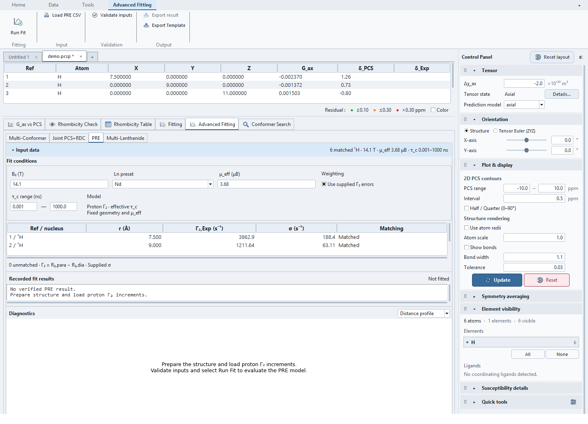
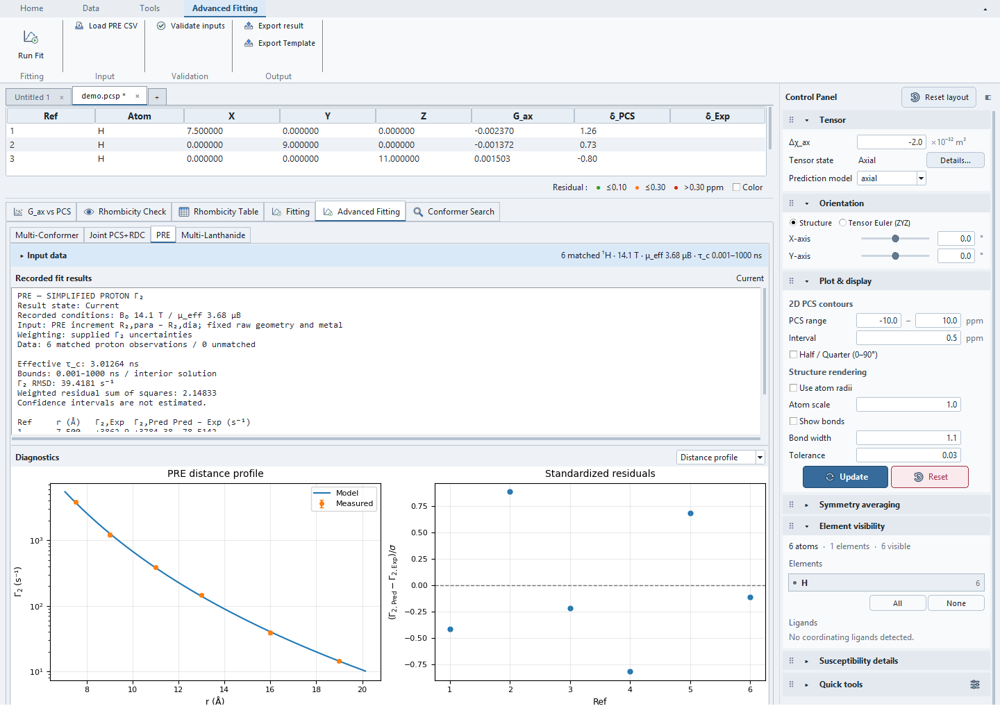
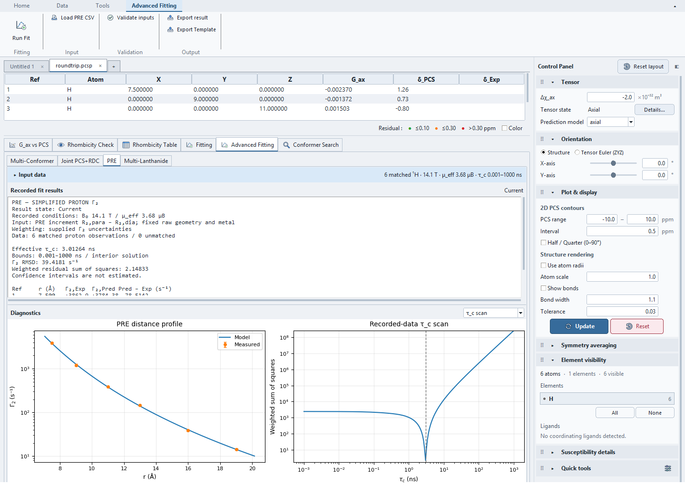
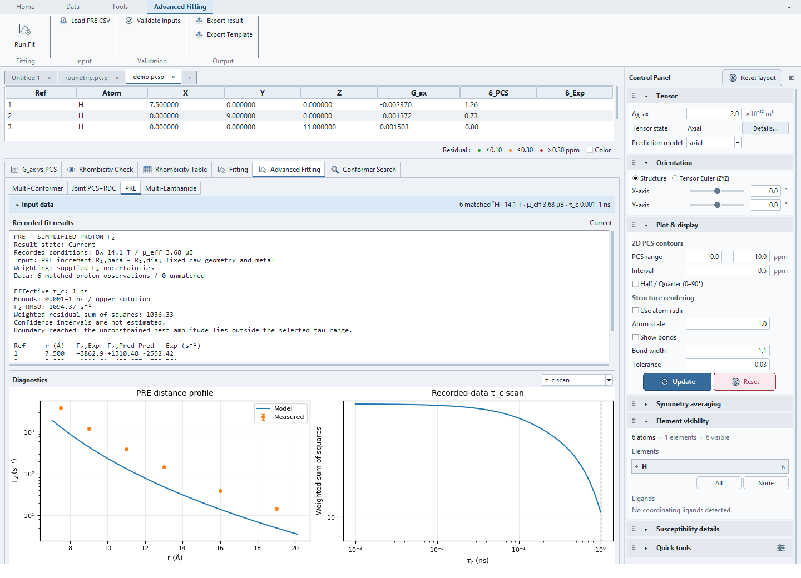

# PRE tutorial

Use **Advanced Fitting → PRE** to estimate one effective correlation time
from proton transverse PRE increments, Γ₂=R₂,para−R₂,dia. Structure, metal
position, magnetic field and effective moment remain fixed. This is a simplified
proton Γ₂ model; the fitted time is not necessarily pure rotational tumbling.

## 1. Open the example

Open `examples/pre_demo/noisy/demo.pcsp` using **Open Project**. Select
**Advanced Fitting → PRE**. The project contains six synthetic proton probes,
supplied errors and a recorded successful result, restored as **Current**.
These coordinates are not a chemically optimized molecular structure.

The exact generating time is 3 ns at 14.1 T and μ_eff=3.68 μB. Fixed small
perturbations give a fitted time of approximately 3.01264 ns. The separate
`noiseless/demo.pcsp` verifies recovery of 3 ns to numerical precision.

## 2. Review inputs and conditions

Expand **Input data**. **Fit conditions** sits above the matching table.
The top row contains **B₀ (T)**, **Ln preset**, **μ_eff (μB)** and **Weighting**;
the second row pairs the **τ_c range (ns)** with the model description.
Shorter widths reflow the fields. Collapsing Input data hides the conditions
and table together; no settings popup is needed.



**Ln preset** supplies a moment; the equation uses the displayed moment.
Changing it manually selects Custom. The default positive bounds are
0.001–1000 ns. Keep supplied-error weighting selected for this demo.
Every matched observation then needs a positive uncertainty. With weighting
unchecked, the existing assumed-error rule is used:
σ=max(0.05 Γ₂,Exp, 0.1 s⁻¹). The report identifies this assumption.

**Load PRE CSV** in the Ribbon reads integer raw-atom Ref IDs. For example:

```csv
ref_id,gamma2,gamma2_err,nucleus
1,3862.897755468303,188.43403685211234,1H
```

Rates and errors are in s⁻¹. `ref`/`id` and `g2` are accepted aliases.
Alternatively, provide `r2_para,r2_dia`; their difference is used. If both
`r2_para_err,r2_dia_err` are supplied, their root-sum-square gives σ under
an independent-error assumption. Single `r2_para` or `r2` columns remain
legacy increment aliases and trigger an interpretation warning: they must
already contain the PRE difference, not raw R₂.

Only raw hydrogen atoms are supported. Missing Refs are listed as unmatched;
duplicates, non-finite values, invalid errors, unsupported nuclei and protons
at the metal centre are rejected. Signed noisy increments are accepted;
nonpositive measured values use linear diagnostic axes. Main visibility and
atom selection do not silently remove PRE observations. Geometry overrides
and torsional averaging are unsupported in this fixed-distance model.

## 3. Fit and inspect

Use **Validate inputs**, then **Run Fit** in the Ribbon. The fit runs in the
background and does not Apply a susceptibility tensor. The selectable report
records conditions, errors, matching, effective time, boundary status, Γ₂ RMSD,
weighted residual sum of squares and per-proton predictions.



**Distance profile** shows measured Γ₂ with errors and the fitted distance
dependence, alongside standardized residuals `(Pred−Exp)/σ`. **Correlation**
shows measured versus predicted rates with an identity line. Legends use
automatic placement. Splitters resize input, report and plots; plots fill
remaining height. A whole-tab scrollbar keeps the content accessible in short
windows.

Select **τ_c scan** to replace the residual plot with the actual weighted
objective evaluated against the recorded observations and errors. The vertical
line marks the fitted time; this curve is not a confidence interval.



For the noisy example, Γ₂ RMSD is approximately 39.4181 s⁻¹ and the weighted
sum of squares is approximately 2.14833. The latter is not reduced chi-square
or a likelihood-based confidence statement. Confidence intervals are not estimated.

## 4. Recognize a boundary solution

Open `examples/pre_demo/boundary/demo.pcsp`. Its same observations require
approximately 3 ns, but the allowed upper bound is 1 ns. The fit reaches that
bound and the report explicitly identifies a boundary solution and poor residuals.



Review bounds and model assumptions rather than interpreting a bounded optimum
as a precise physical estimate. A changed live field, moment, geometry, data or
objective marks a recorded result **Stale**; plots and report still use its
recorded execution inputs. Main tensor orientation does not enter this isotropic
distance model.

## 5. Save and export

**Export result** saves recorded inputs, predictions and diagnostics as JSON,
including stale results. **Export Template** produces canonical Γ₂ columns.
Saving the project retains PRE data, conditions and the last verified result in
an optional section. Reopening verifies it without refitting. PRE results remain
separate from standard Fit History and do not alter the main susceptibility tensor.

## Model and limits

The existing simplified proton forward equation is retained:

\[
\Gamma_2(r)=\frac{1}{15}\left(\frac{\mu_0}{4\pi}\right)^2
\gamma_H^2(\mu_{eff}\mu_B)^2 r^{-6}
\left(4\tau_c+\frac{3\tau_c}{1+(\gamma_H B_0\tau_c)^2}\right).
\]

The implementation converts Å to metres and ns to seconds. At fixed field,
moment and distances, all rates share a single amplitude. Weighted amplitude
fitting followed by a bounded monotonic inverse finds the one-parameter optimum.
Moment and time are not fitted together from one field.

This omits additional electron-frequency terms and Curie relaxation; presets
alone do not validate that simplification for a given ion. There is no R₁ fit,
multi-field fit, ensemble-distance averaging or general-nucleus model. See the
[Xplor-NIH PRE model description](https://nmr.cit.nih.gov/xplor-nih/xplorMan/node437.html)
and the [relaxation-model discussion, equations 12–14](https://pmc.ncbi.nlm.nih.gov/articles/PMC10500712/)
for assumptions behind simplified transverse PRE expressions.
