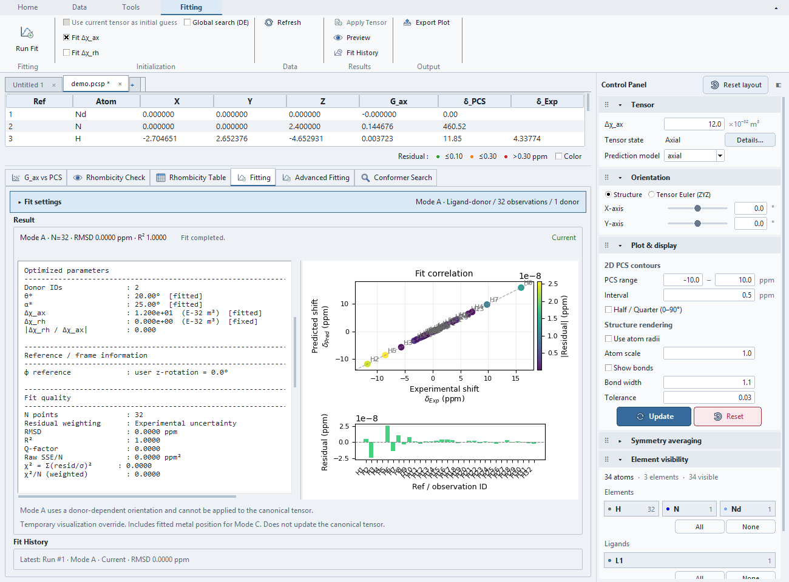
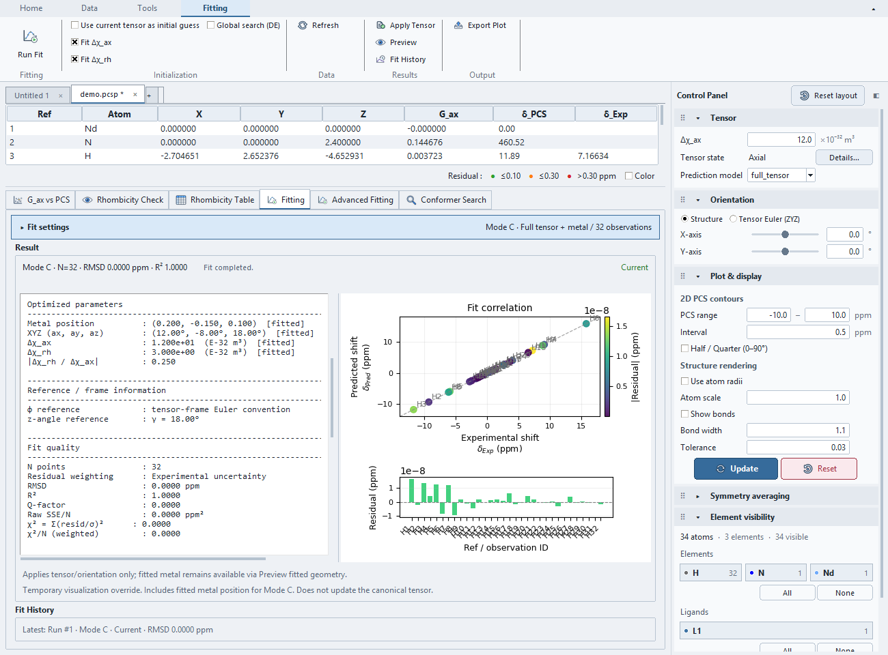

# Tutorial: Standard fitting and rhombicity

Use `examples/standard_fitting_demo/` from a source checkout containing this
tutorial. The [example README](https://github.com/boseokhong/PCS-analyzer/tree/main/examples/standard_fitting_demo)
contains detailed conditions, commands and generating truth. These synthetic
geometrical probes are not a chemically optimized molecule or experimental data.

## Choose the exercise

Each project has 32 H observations, Nd Ref 1 and donor N Ref 2. Coordinates are
Å; PCS is ppm; tensor scalars are E-32 m³. The noiseless input uses 0.02 ppm as
an objective scale. This is not measured precision or added random noise.

| Project | Mode | Known answer |
|---|---|---|
| `mode_a/demo.pcsp` | A, first donor Ref 2 | Axial 12, rhombic 0; θ=20°, α=25° |
| `mode_b/demo.pcsp` | B | Axial 12, rhombic 3; extrinsic XYZ 12°, −8°, 18° |
| `mode_c/demo.pcsp` | C | Same tensor; centre (0.20, −0.15, 0.10) Å |
| `axial/demo.pcsp` | Diagnostic reference | Axial 12, rhombic 0; zero orientation |
| `rhombic/demo.pcsp` | Diagnostic comparison | Axial 12, rhombic 3; zero orientation |

## Fit and review

Open a project and select **Fitting**. Expand **Fit settings**, verify the restored
mode and its **Mode details**, select all 32 PCS
observations and verify the count. Project loading does not restore row selection.
For A, select donor Ref 2 and **Axis vector mode: first**, fitting only Δχ_ax.
For B/C, fit both tensor components. Keep the saved uncertainty weighting and
disable global search for this reproducible exercise.

Choose **Run Fit** in the Ribbon. Expect RMSD below 0.00001 ppm after coordinate
rounding, recovered axial 12 and rhombic 3 in B/C. C recovers the centre listed
above. Equivalent angular representations can describe the same predictions;
this exercise does not establish global uniqueness or statistical precision.

Repeat a fit and compare recorded conditions in **Fit History**. The supplied
projects contain inputs only. Apply/preview behavior matters:

- A previews donor-axis geometry; Apply to Tensor is unavailable.
- B applies orientation/axial values while retaining the existing rhombic value.
- C applies tensor/orientation while preserving the assigned metal position;
  Preview Geometry uses the refined centre temporarily.

See [standard fitting behavior](overview.md#running-and-applying-a-fit). Reopen the
source project between exercises to reset all working values, or use
**Clear Preview** to remove only temporary geometry; save practice
results to a separate project.

To practice Mode C persistence, run the fit, choose **Preview Geometry**,
and save to a new `.pcsp` path. Preview redraws immediately. Close that document and reopen the
saved copy. The preview centre, orientation and displayed PCS should match;
the assigned metal centre stays unchanged and Fit History retains the run.
Opening the supplied input-only project instead starts with no preview.



Mode A: selected donor Ref 2, fitted θ/α and axial tensor. Settings are collapsed
and the selectable report is scrolled to the fitted parameters.



Mode C: the refined centre and tensor are recorded in the result. The main metal
assignment and main tensor have not been replaced by running the fit.

## Compare rhombicity diagnostics

Open `axial/demo.pcsp`, select **Rhombicity Check**, and choose **Update Diagnostic** with
structure and δ_Exp ready. Repeat with `rhombic/demo.pcsp`, all observations and
zero orientation. The first dataset has negligible axial-only residuals. The
second leaves structured residuals that the rhombic term explains.

Inspect residual against φ/G_rh, reconstructed tensor and **Rhombicity Table**.
A two-column G_ax/G_rh fit recovers 12 / 3 for the rhombic case. The diagnostic
residual is δ_Exp−δ_Pred; standard fit reports use the opposite sign. Preserve
the frame when comparing the two projects. This controlled comparison excludes
contact shifts and structural uncertainty; it is not an experimental acceptance
criterion. See [rhombicity definitions](../diagnostics/rhombicity.md).

## Regenerating the synthetic inputs

```shell
python examples/standard_fitting_demo/generate_demo.py --output dev_docs/standard-review
```

Use `--overwrite` only to replace existing generated files deliberately.
