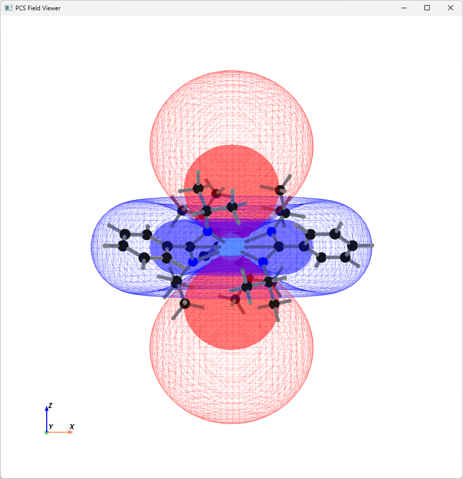
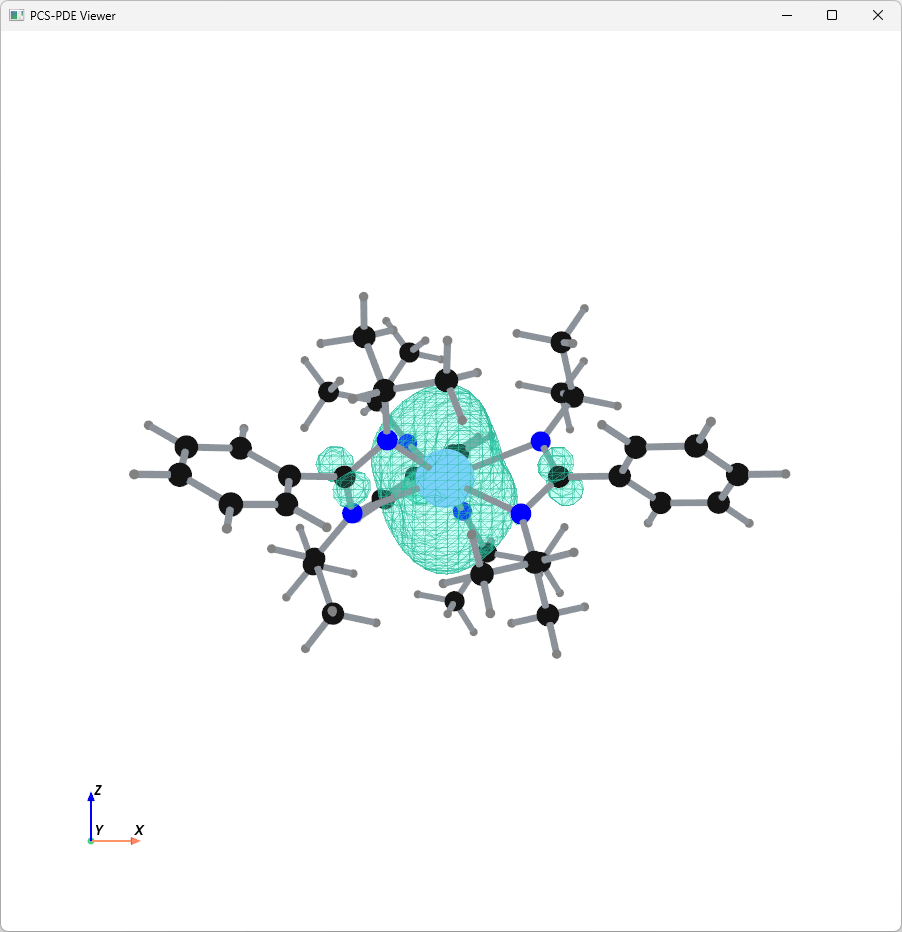

# PCS Analyzer

**PCS Analyzer** is a desktop application for the analysis, fitting and
visualization of **pseudocontact shifts (PCS)** in paramagnetic molecular systems.
It connects molecular structures with experimental NMR data to calculate PCS,
fit magnetic susceptibility tensors and examine agreement with the chosen model.

[Quick Start](quick-start.md){ .md-button .md-button--primary }
[Installation](installation.md){ .md-button }
[Examples](examples.md){ .md-button }

## Main interface

<figure>
  
  <figcaption>Structure and PCS data, analysis results and calculation controls in the main workspace.</figcaption>
</figure>

See [Interface Overview](interface.md) for the layout and
[Projects and Persistence](projects.md) for saving an analysis or reopening projects.

## Analysis capabilities

-   :material-molecule:{ .lg .middle } **Structure-based analysis**

    Load molecular geometries, assign the paramagnetic centre and calculate PCS
    with axial or rhombic tensor components. Account for symmetry and torsional
    averaging when the experimental assignments require it.

    [Structures](structures/loading.md) · [Averaging](structures/symmetry-averaging.md)

-   :material-chart-scatter-plot:{ .lg .middle } **PCS fitting and diagnostics**

    Fit tensor parameters and orientation, inspect residuals and compare
    conformer populations or complementary observables under their stated models.

    [Fitting](fitting/overview.md) · [Residuals](diagnostics/residual-analysis.md)

-   :material-axis-arrow:{ .lg .middle } **Scientific visualization**

    Inspect molecular geometry and PCS fields through polar plots, projections
    and 3D views, and export figures for further analysis or presentation.

    [2D PCS](visualization/polar-plot.md) · [3D structure](visualization/3d-viewer.md)

## Start with your data

Choose a starting point based on the data you already have.

| Your data | Start here |
| --- | --- |
| Molecular structure and experimental PCS | [Quick Start](quick-start.md): load, assign, analyze and save |
| Paramagnetic and diamagnetic chemical shifts | [Observed and Diamagnetic Shifts](experimental-data/delta-obs-dia.md) |
| Raw NMR FIDs | [NMR Workbench](nmr/spectrum-viewer.md) |

The [examples guide](examples.md) offers optional practice with starting files
and expected results. It includes standard fitting, Multi-Conformer, Joint
PCS+RDC, PRE, Multi-Lanthanide, Conformer Search and NMR exercises.

## Visualization

-   

    **2D Polar PCS Plot**

    Angular representation of the PCS field for inspection of axial contributions.

    [Learn more](visualization/polar-plot.md)

-   

    **3D Viewer**

    Inspect molecular geometry and calculated PCS colors, adjust appearance and axes, and prepare figures at a chosen size and DPI.

    [Learn more](visualization/3d-viewer.md)

-   

    **3D PCS Isosurface Plot**

    Three-dimensional visualization of PCS isosurfaces around the molecular structure.

    [Learn more](visualization/3d-pcs-isosurface.md)

-   

    

    **PCS Workbench**

    Separate ORCA and spin-density workflow for comparing point-dipole and distributed PCS fields, with molecular and field visualization.

    [Learn more](pcs-workbench/overview.md)

-   

    **NMR Workbench**

    Process raw 1D NMR data, reference spectra, pick and assign peaks, and prepare chemical-shift observables for PCS analysis.

    [Learn more](nmr/spectrum-viewer.md)

## PCS model

PCS Analyzer uses a point-dipole PCS model with an axial default and an optional
rhombic contribution. Structure, centre, tensor orientation and averaging must
match the experiment you intend to interpret. Paramagnetic shift differences
are not automatically pure PCS.

Polar contours and **G_ax vs PCS** are axial diagnostics. Tensor-aware tables
and views follow the [active prediction model](pcs/axial-rhombic.md#active-prediction-model).

Equations, input units and definitions are given in [PCS Theory](pcs/theory.md)
and [Tensor Conventions](pcs/tensor-conventions.md). The
[method references](reference/method-references.md) distinguish background
literature from the assumptions of the implemented workflows.

Some documentation topics remain incomplete. Review
[Current Limitations](reference/limitations.md) and the assumptions of the
workflow you intend to use.

## Modules and workbenches

[NMR Workbench](nmr/spectrum-viewer.md) processes spectra and prepares reviewed
shift observations. [PCS Workbench](pcs-workbench/overview.md) compares point-dipole
and distributed PCS fields using its own ORCA/grid inputs. External side tools
are installed and launched through [Module Manager](plugins-docs/overview.md).

## Citation

PCS Analyzer is research software developed for the analysis, fitting, and visualization of pseudocontact shifts in paramagnetic molecular systems.

Archived releases of PCS Analyzer are available through Zenodo:

[**PCS Analyzer on Zenodo**](https://doi.org/10.5281/zenodo.18752129){ .md-button }

Please cite the archived Zenodo release when using PCS Analyzer in academic work.

!!! info "Manuscript"
    A dedicated software description manuscript presenting the implementation, methodology, and scientific applications of PCS Analyzer is currently in preparation.
