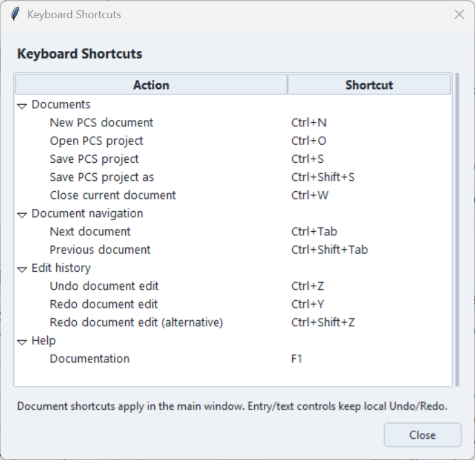

# Interface Overview

PCS Analyzer combines molecular coordinates, PCS calculations, experimental
data, fitting, diagnostics, and visualization in a multi-document workspace.

## Main interface

<figure>
  
  <figcaption>PCS Analyzer main workspace.</figcaption>
</figure>

| Area | Purpose |
|---|---|
| Menu bar | Opens and saves projects/workspaces, exports data, and launches viewers, workbenches, settings, and help. |
| Ribbon | Groups project, data, and tool commands; a contextual page follows the selected analysis. |
| Document tabs | Switches between separate PCS analyses. |
| Molecular data table | Shows visible atoms, transformed coordinates, geometrical factors, calculated PCS, and experimental values for the active document. |
| Analysis area | Contains regression, rhombicity diagnostics, fitting, and conformer search. |
| Control Panel | Sets tensor, orientation, averaging, visibility, and display options for the active document; also provides tool shortcuts. |

Drag the horizontal divider between the table and analysis area to change
how much space each receives. Moving it to an edge collapses that area;
use the edge divider to restore it. The document tabs remain above the split.
The Control Panel normally docks on the right and can also dock on the left.

## Ribbon

| Page | Commands |
|---|---|
| **Home** | **Load XYZ**, **Open Project**, **Save Project**, and output actions **Save XYZ**, **Plot Data**, **Table**. |
| **Data** | **Import PCS**, **Export Template**, **Paste**, **Undo**, **Clear**; PCS viewers (**2D PCS**, **3D PCS**, **Projection**) and structure viewers (**3D Structure**, **Chemical Map**). |
| **Tools** | **Workbenches** (NMR and PCS), **Modules** (Module Manager, Arrange modules and loaded module launchers), then **Application** (Settings). |
| Contextual page | Commands for the selected analysis, such as selection and regression, fitting, or conformer search. Its label follows the outer analysis tab. |

Selecting an analysis tab, or returning to its controls, selects the contextual
Ribbon page. In **Advanced Fitting** and **Conformer Search**, its commands
also follow the selected inner tab. **Data** remains available when another
analysis is selected, so importing PCS does not require returning to the
regression tab. Unavailable commands appear disabled.

Use the Ribbon chevron or double-click a Ribbon tab to collapse or expand
its command area. In narrow windows, **More commands ▾** provides access
to the commands on that Ribbon page.

The active Ribbon tab has a coloured underline; hovering an inactive tab adds
a faint neutral underline without changing the layout. Command groups use
short, subtle dividers. The contextual tab reserves enough width for the available
analysis names, so switching between long and short names keeps its outline and
underline steady. Theme and font changes recalculate that space.
The adjacent Undo/Redo controls beside Help use matching
16-pixel mirrored icons (scaled for display DPI). Their background and border
appear on hover; keyboard focus retains a solid outline. Disabled controls use
neutral grey icons. These presentation states do not change history scope,
keyboard shortcuts, or the dropdown commands.

## Document tabs and active analysis

Click a document tab to make it active. The main table, tensor and orientation
controls, experimental PCS assignments, and standard fitting results/history
then refer to that document. **Save Project** and the File export commands
use the active document.

- **+** creates an empty document. Use it before loading a second raw structure.
- **Open Project** opens a `.pcsp` in a document tab; reopening an already open path activates its existing tab.
- **Load XYZ** replaces the structure in the active document. Save existing work first.
- Drag tabs to reorder them. Use **×** or middle-click to close a tab; modified documents prompt for a save decision.
- Right-click a tab for **Save**, **Save As...**, **Duplicate Document**, **Project Name...**, **Tab Color**, **Close**, **Close Others**, or **Close All**. An asterisk marks unsaved changes.

Project files (`.pcsp`) store scientific analysis state. Workspace files
(`.pcsw`) record the project paths and tab arrangement; save the projects
before relying on a workspace to reopen them. See
[Projects and Persistence](projects.md). **File → Open Workspace...**
replaces the open document set after resolving unsaved changes.

Check the document name in secondary-window titles when comparing analyses.
The NMR Workbench retains its PCS-document binding when the main active tab
changes; use **Rebind to Active PCS Document** there when needed. See the
[NMR Workbench workflow](nmr/spectrum-viewer.md) and
[Chemical Map](visualization/chemical-map.md) for assignments and site mapping.

## Menu bar

| Menu | Main paths |
|---|---|
| **File** | **Load XYZ...**, **Recent files**, **Open PCS Project...**, **Save PCS Project**, **Save PCS Project As...**, **Save All**; **Open Workspace...**, **Save Workspace**, **Save Workspace As...**; **Save current XYZ...**, **Save plot data...**, **Save table...**, **Exit**. |
| **View** | **2D PCS Plot**, **3D PCS Plot**, **3D Structure**, **Chemical Map**, **Projection**. |
| **Modules** | **Module Manager...**, **PCS Workbench**, **NMR Workbench**, and commands from successfully loaded external plugins. |
| **Settings** | **Open settings...** for **General** and **Appearance** options, including startup viewers, recent files, default inputs, export DPI, theme, and fonts. |
| **Help** | **Documentation** (F1), **Keyboard Shortcuts...**, **Check for Updates...** (checks for a release without installing it), and **About PCS Analyzer**. |

**Load XYZ...** remains the first File command. New/Close Document are accessed
through the document tab's **+ / ×** or **Ctrl+N / Ctrl+W**, rather than File menu
entries. Workspace and export commands remain directly available in File.

In **Settings → Open settings... → Appearance**, **Theme** determines both
the base palette and accent colors. There is no separate Accent color selector.

Available palettes are **Light**, **Dark**, and their **Teal**, **Violet** and
**Slate** variants. The default is Light. UI font changes affect control sizes
and responsive layouts; use the workspace dividers and scrollbars as needed.

**Load XYZ...** accepts XYZ and supported ORCA `.out`/`.log` files despite
its label. See [Loading Structures](structures/loading.md),
[File Formats](reference/file-formats.md), and
[Plugins](plugins-docs/overview.md) for details.

## Molecular data table

The table columns are **Ref**, **Atom**, **X**, **Y**, **Z**, **G_ax**,
**δ_PCS**, and **δ_Exp**.

- **Ref** identifies atoms by structure-file order; filtering does not renumber them.
- **X**, **Y**, and **Z** are transformed coordinates relative to the PCS centre.
- **G_ax** is the axial geometrical factor.
- **δ_PCS** follows **Prediction model**: Axial, or Full tensor with the rhombic term included only when **Enable Δχ_rh** is on. Polar contours and **G_ax vs PCS** remain axial diagnostics; see [Prediction policy](pcs/axial-rhombic.md#active-prediction-model).
- **δ_Exp** is the assigned experimental PCS in ppm.

Double-click a **δ_Exp** cell to enter a value or leave it blank to clear it.
Bulk import, template export, paste, undo, and clear actions are on
**Ribbon → Data → Experimental PCS**. The **Color** toggle and residual
threshold legend remain beside the table. See
[Experimental-data Import and Export](experimental-data/import-export.md).

The table and linked plots share atom selection. Selecting a row highlights
its corresponding point in supported open views; clicking a linked atom or
point selects and scrolls to its table row. In **G_ax vs PCS**, **Lasso** or
**Box** selects a regression subset. Use **Fit** to fit that subset and
**Clear Selection** to return to all assigned points. A single highlighted
atom and a regression subset serve different purposes.

## Analysis areas

| Tab | Purpose |
|---|---|
| **G_ax vs PCS** | Axial regression of experimental PCS against the geometrical factor, with an optional forced origin, subset selection, and plot export. |
| **Rhombicity Check** | Examines axial-fit residuals for angular or rhombic trends. |
| **Rhombicity Table** | Compares axial/rhombic factors, predictions, and residuals; contains **Enable Δχ_rh**, rhombic susceptibility input, and structure Z-axis rotation. |
| **Fitting** | **Mode A · Ligand-donor**, **Mode B · Euler**, and **Mode C · Full tensor + metal**, with input selections, results, and fit history. |
| **Advanced Fitting** | Specialized **Multi-Conformer**, **Joint PCS+RDC**, **PRE**, and **Multi-Lanthanide** analyses. |
| **Conformer Search** | Structure constraints, search options, candidate results, and preview/apply actions. |

Use [Fitting Overview](fitting/overview.md) for inputs and result application,
[Rhombicity Diagnostics](diagnostics/rhombicity.md) for interpretation, and
[Conformer Search](conformer-search/overview.md) for structure-search usage.

In Fitting, use the **Fit settings** header to hide/show configuration while
keeping the recorded Result available. Advanced workspaces have their own
input-section collapse and report/plot dividers. Shared actions remain in the
contextual Ribbon. Worked examples: [Multi-Conformer](fitting/multi-conformer-tutorial.md),
[Joint PCS+RDC](fitting/joint-pcs-rdc-tutorial.md), [PRE](fitting/pre-tutorial.md),
and [Multi-Lanthanide/Reilley](fitting/multi-lanthanide-tutorial.md).

## Control Panel

Sections can be independently expanded or collapsed by clicking their
headers. Drag a section's **⠿** handle to reorder it and scroll to reach
sections below the visible area. The title-bar dock button switches sides;
drag the boundary toward the docked edge to collapse the panel, then click
or drag the collapsed boundary to restore it.

| Section | Controls and interpretation |
|---|---|
| **Tensor** | **Δχ_ax** in **×10⁻³² m³**, tensor status, **Details…** (opens Rhombicity Table), and **Prediction model**. |
| **Orientation** | **Structure** X/Y controls (Z is in Rhombicity Table) or **Tensor Euler (ZYZ)** angles: two representations of the molecular-to-tensor orientation. |
| **Plot & display** | **PCS range** and **Interval** in ppm, **Half / Quarter (0–90°)**, atom radii/scale, visual bonds, **Update**, and **Reset**. |
| **Symmetry averaging** | Current averaging status and **Options...** for local and rotational averaging. |
| **Element visibility** | **Elements** and **Ligands** filters, including all/none actions. These affect the visible table and current analysis, not just appearance. |
| **Susceptibility details** | Molar susceptibility input, auto-calculation, and derived tensor components with display-unit selection. |
| **Quick tools** | User-selected viewer, workbench, and module launchers. |

**Reset layout** restores the section order, expansion state, and default
pinned tools. It is distinct from **Plot & display → Reset**, which resets
PCS data and controls. Layout and pinned-tool preferences are application
settings shared across documents.

In **Quick tools**, use the header's settings icon to open **Customize Tools**.
Search available tools, choose which to pin, set their **Pinned order** with
**Up**/**Down**, and **Apply**. Unpinning a tool removes its shortcut; viewers
and workbenches remain available from the Data/Tools Ribbon and menus.
Plugin launchers are available when registered by loaded plugins.

See [Coordinate System](structures/coordinate-system.md),
[Tensor Conventions](pcs/tensor-conventions.md), and
[Symmetry Averaging](structures/symmetry-averaging.md) for the scientific
meaning of these controls.

## Help and keyboard shortcuts

**Help → Documentation** opens the online manual in your default browser.
**Help → Keyboard Shortcuts...** opens a reusable, non-modal reference window
with document, navigation, edit-history and help groups. Shortcuts are fixed;
this window does not customize bindings. File/View menu entries show their
shortcuts on the right.

| Shortcut | Action |
|---|---|
| **Ctrl+N** | Create a new PCS document tab |
| **Ctrl+O** | Open a `.pcsp` project |
| **Ctrl+S** | Save the active project; choose a path for its first save |
| **Ctrl+Shift+S** | Save the active project under another name |
| **Ctrl+W** | Close the active document, retaining its unsaved-change prompt |
| **Ctrl+Tab** / **Ctrl+Shift+Tab** | Next/previous document in tab order, wrapping at either end |
| **Ctrl+Z** | Undo a document edit |
| **Ctrl+Y** / **Ctrl+Shift+Z** | Redo a document edit |
| **F1** | Open Documentation |

Document/file/navigation/help shortcuts apply within the main window, including
its input controls. They do not trigger from auxiliary windows or while a modal
dialog owns the grab. Ctrl+Tab changes document tabs rather than analysis tabs.
Entry/text controls retain their local Undo/Redo editing behavior; see
[document Undo/Redo](projects.md#undo-and-redo) for its scope.
No shortcut is assigned to fitting execution or Reset.

## Next step

Continue with [Quick Start](quick-start.md) for a first analysis and
save/reopen workflow.
