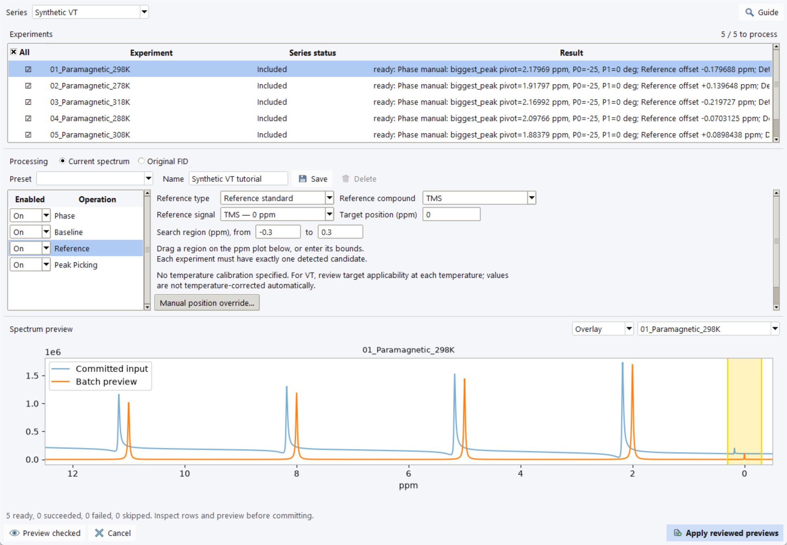

# Batch Processing

Use **VT Series → Batch Processing…**, **Processing → Batch Processing…** in
the Workbench panel, or **VT stacked → Batch** to review processing for multiple
experiments. The panel action can also use selected experiments without a VT
series. Settings describe an ordered recipe; each dataset retains its own
committed history and provenance.

## Choose targets and the starting spectrum

Select a series and check the experiments to process. The **All** header
selects/clears targets. Row selection browses a spectrum; it is not the batch
target selection. Included members are initially checked. Checking an excluded
member authorizes this batch only and does not change series inclusion.

| Starting point | Behavior |
| --- | --- |
| **Current spectrum** | Continue from committed processing. Untouched raw FIDs can receive default vendor preprocessing/FT automatically. |
| **Original FID** | Restart from available raw data. Review the visible Fourier Transform step and operation order. A processed-only dataset cannot recover an absent FID. |

Resolve any single-spectrum preview with Apply or Cancel before including
that experiment in a batch. Repeating a phase correction on an already
corrected current spectrum applies another correction.

## Build and review the recipe

1. Set each operation **On/Off**. Drag operation rows to change their order.
2. Select an operation and enter parameters. **Set common** stores its
   batch-wide settings; it does not process spectra.
3. For an experiment-specific setting, select that experiment and choose
   **Set for selected**. **Clear selected overrides** clears its operation
   overrides so common settings apply again.
4. Choose **Preview checked**. Inspect member results/warnings and the
   **Committed**, **Preview** or **Overlay** spectrum view.
5. Choose **Apply reviewed previews** and confirm explicitly. Failed/skipped
   experiments remain unchanged; changed source inputs require fresh review.

Five synthetic members are ready; no batch result has been committed in this
capture. The experiment list and long result messages can be scrolled. The
blue input trace includes deliberate phase, baseline and reference errors.

The usual tutorial sequence is **Phase → Baseline → Reference → Peak Picking**.
Apodization/zero filling and FT have different input requirements; enable them
only as intended for your starting data. **Cancel** discards pending previews.
Preview does not replace peaks or write committed processing history.

## Reference each experiment independently

Choose **Reference type**, compound/signal and **Target position (ppm)**.
A common **Search region** is evaluated separately in every experiment and
must contain exactly one detected candidate per member. Missing/multiple
candidates are reported rather than assigned silently. A manual observed
position is a per-experiment override, not one shared observed peak position.

Reference presets do not establish peak identity or correct condition-dependent
shifts automatically. Inspect their nucleus and temperature applicability.
Phase pivot is the origin of a phase ramp, not a chemical-shift reference.

Batch picker thresholds are **fractions**: 0.01 means 1%, unlike the percentage
fields in the single-spectrum picker. Minimum separation is in spectral points,
not ppm. Automatic replacement preserves manual peaks but can remove old
automatic IDs and invalidate track links. Processing/referencing changes can
also stale links; [review tracking again](peak-tracking.md).

## Reuse settings

Use **Preset**, **Name**, **Save** and **Delete** to manage reusable recipes.
Series presets retain configured targets/overrides. A preset saved from a
selected-experiment batch is a Workbench common preset without member IDs or
individual overrides; loading it keeps current checked targets and clears
individual overrides. Save the [NMR session](sessions.md) to retain presets.

For known settings and expected results, follow the [VT tutorial](tutorial-vt.md).
