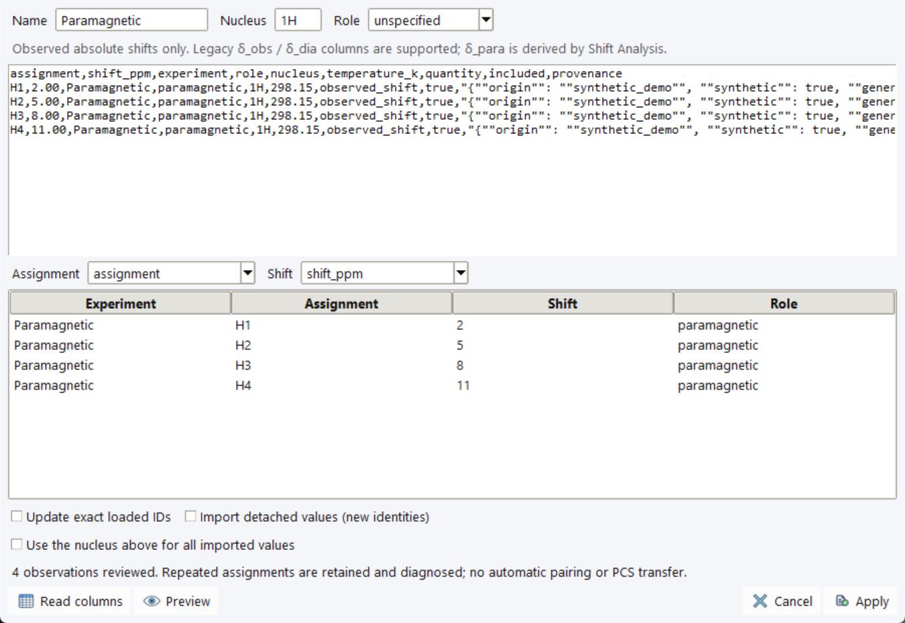

# NMR Data and Observed-Shift Tables

Open **Inspector → NMR Data** in [NMR Workbench](spectrum-viewer.md).
This table combines picked spectral peaks and prepared observed shifts. You can
start with a spectrum, import a shift table, paste values, or add observations
manually. Prepared values do not require an FID or manufacture spectral peaks.

## Read and filter the table

Choose **Experiment** (**Active experiment**, **All experiments**, or a named
experiment) and **Show** (**All**, **Assigned**, or **Unassigned**). Click a
column heading to sort; use the horizontal scrollbar for additional columns.

| Column | Meaning |
| --- | --- |
| **Use** | Include this assigned observation in single-pair shift comparison/PCS preparation. Click to toggle; unassigned peaks must first be assigned. |
| **Assignment** | Correspondence label used for pairing, not an inferred structural target. |
| **Shift / ppm** | Absolute observed chemical shift, not Δshift or experimental PCS. |
| **Source** | Spectrum-linked, manually entered/imported, or read-only PCS-project data. |
| **Status** | Readiness or diagnostics, including unassigned/duplicate labels, changed source shifts and missing conditions. |
| **Experiment**, **Role**, **Nucleus**, **T / K** | Dataset identity and conditions. |
| **σ / ppm** | Provided shift uncertainty; leave blank if unknown. |
| **Intensity**, **Picking** | Peak height and manual/automatic picking source when a spectral peak exists. |

**Use** does not change VT series member inclusion or a VT analysis fit mask.
Display filtering does not remove data. Check diagnostics even when a row is
included; a check mark alone does not establish scientific suitability.

For spectrum-linked rows, double-click **Assignment** or press **Enter**;
**Tab** advances and **Shift+Tab** goes back. See [Peaks and Assignments](peak-assignment.md).

## Add or edit prepared values

1. Choose **Add** and select **New experiment** or an existing editable experiment.
2. For a new experiment, enter its name, nucleus, role and temperature in Kelvin
   where known. Existing experiment conditions remain those of that experiment.
3. Enter **Assignment**, **Shift / ppm**, and optional **Uncertainty / ppm**.
4. Set **Use in shift comparison**, then choose **Save**.

Use **More → Edit details…** for an existing observation. Independent shifts
can be edited. A spectrum-linked shift stays owned by its source peak and is
read-only in this dialog; change spectral processing/referencing instead of
overwriting its measurement. Uncertainty, if supplied, must be finite and positive.

**More → Remove selected…** asks before removing a value. For a spectrum row it
removes the source peak and linked observation, which can stale track links.
**More → Clear picked peaks in active experiment…** concerns peaks, not all
independent observations. Review the confirmation before clearing.

## Import CSV or TSV



The synthetic [FID/CSV tutorial](tutorial-fid-csv.md) supplies this four-row
table. The screenshot shows Preview only; nothing has been applied.

1. Choose **Import → Observed shifts CSV / TSV…**, or **Paste observed shifts…**.
2. Review the text and fallback **Name**, **Nucleus**, and **Role**. File metadata
   can supply these conditions instead. Temperature values are in Kelvin.
3. Use **Read columns** after changing headings. Map **Assignment** and **Shift**
   to distinct columns; inspect the automatic mapping before accepting it.
4. Choose **Preview** and check experiment, assignment, shift and role.
5. Choose **Apply** explicitly. Import does not pair experiments or transfer PCS.

Use UTF-8 (a BOM is accepted) and a header row. The chooser accepts `.csv`,
`.tsv`, and `.txt`; comma, tab and semicolon delimiters are supported.
For example:

```csv
assignment,shift_ppm,experiment,role,nucleus,temperature_k
H1,2.0,Paramagnetic,paramagnetic,1H,298.15
H2,5.0,Paramagnetic,paramagnetic,1H,298.15
```

`assignment` and `shift_ppm` are the recommended headings. Common aliases such
as `Ref`/`Label` and `Shift`/`ppm` can be mapped, but a Ref-looking label does
not automatically accept a structural target. The import accepts absolute
observed shifts; do not map δ_para, Δshift, PCS or δ_Exp as an observed shift.

A legacy wide table with both `δ_obs` and `δ_dia` can create separate
paramagnetic and diamagnetic observations. Blank entries in those two columns
are omitted and numeric zero is retained. In a regular single-shift table,
a missing or invalid shift is an error. These are not the set/clear rules of
the [PCS-project importers](../experimental-data/import-export.md).

Repeated assignments are retained and diagnosed; they are not automatically
averaged. Changing import settings/text invalidates the review: Preview again
before Apply. Then choose the experiments explicitly in
[Shift Analysis](non-pcs-analysis.md#pair-and-compare).

## Export, identities and project projections

**Export → All observations CSV…** exports observations from all loaded datasets,
including excluded values and source identities/provenance, rather than just
the filtered rows. Unassigned picked peaks without observables are not exported.
Read-only PCS-project projections can also appear in this CSV; exporting them
does not make the original project records editable or session-owned.

The export includes experiment/observable IDs, peak links where present,
spectral revision, conditions, uncertainty and inclusion. For round trips:

- **Update exact loaded IDs** explicitly enables updates to existing identities;
  source links and experiment conditions must still match.
- Reopening a vendor FID creates new identities. Open the original
  [NMR session](sessions.md) to recover peak-linked records.
- **Import detached values (new identities)** creates independent values with
  retained source evidence. It does not restore an authoritative spectrum link.

This observed-shift export is distinct from the peak-linked assignment-review
CSV in **Assignments / Analysis**. Use that window's reviewed import for its
assignment table; do not substitute nearest-ppm matching or a general shift import.

When bound to PCS Analyzer, the Import menu also exposes **PCS project observed
shifts…** / **PCS project diamagnetic shifts…** and their paste counterparts.
These update the existing project layers through their own review dialogs.
Their Workbench projections remain read-only. **More → Copy experiment values…**
opens a detached-copy review for independent session data; choose the actual
nucleus explicitly if the old project did not specify one.

Use **More → Show in Chemical Map** and target-preview actions to inspect a
reviewed mapping. **Use reviewed target in PCS Preparation** accepts a mapping
explicitly; selection alone does not transfer PCS or establish an assignment.
