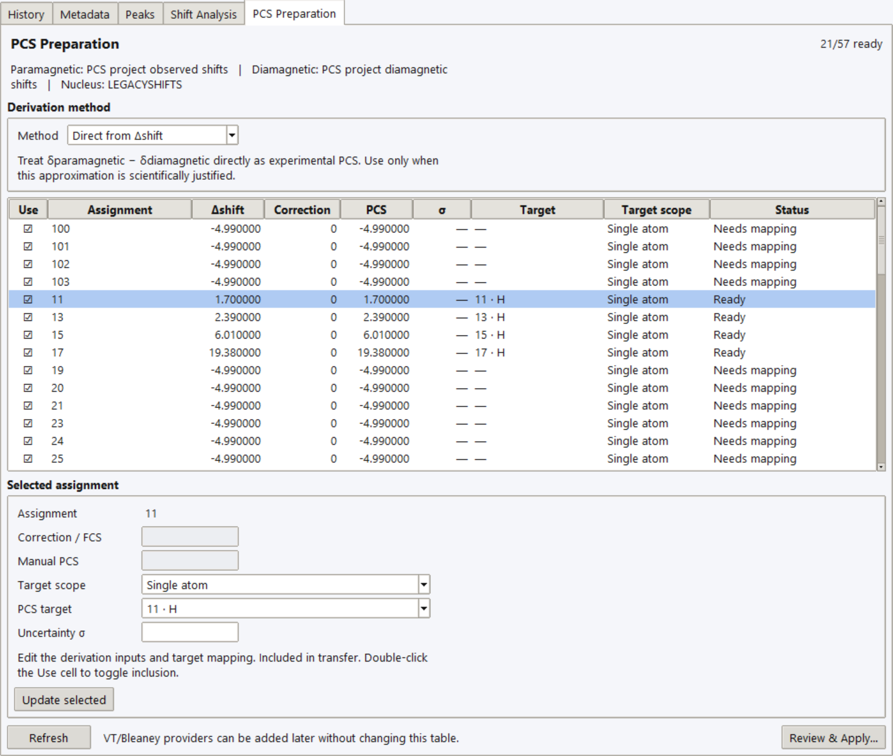

# Shift Analysis and PCS Preparation

Use the **Shift Analysis** and **PCS Preparation** Inspector tabs in
[NMR Workbench](spectrum-viewer.md), after processing, referencing, and
assigning corresponding paramagnetic and diamagnetic signals.
Alternatively, start from prepared absolute observed shifts in
[NMR Data](nmr-data.md); no measured spectrum is required for that route.

## Pair and compare

In **Experiments**, set one dataset's **Role** to **Paramagnetic** and the
other to **Diamagnetic**, then choose **Pair with**. Both must have the same
nucleus. Pairing matches observable assignments after trimming whitespace
and ignoring case. Missing partners and duplicate assignments are flagged;
duplicate observations are not silently averaged.

You can also choose **Observed / Para** and **Reference / Dia** directly in
**Shift Analysis**, then **Compare**. Role changes require confirmation.
Review NMR Data **Use** flags and assignment diagnostics before comparing.

All shifts are in ppm:

\[
\delta_\mathrm{para}=\delta_\mathrm{obs}-\delta_\mathrm{dia},
\qquad
\delta_\mathrm{nonPCS}=\delta_\mathrm{para}-\delta_\mathrm{PCS,calc}.
\]

**δ_obs** is the observed paramagnetic-sample chemical shift, **δ_dia** its
diamagnetic reference, and **δ_para** their difference. **δ_Exp** is the
experimental PCS supplied to fitting after choosing a derivation method.
These quantities are not interchangeable.

**Shift Analysis → View** offers **Table**, **Overlay**, **Stacked**, and
**Shift Diagnostics**. Spectrum comparisons use absolute chemical-shift
positions; diagnostics compare differences. A predicted absolute position
is δ_dia + calculated PCS + any supplied fixed correction, not δ_para.
Expand **Display** for plot-layer options. **Normalize** changes display scale. **Broaden sticks** creates a
visual envelope for shift lists, not experimental lineshape fitting.

Calculated PCS follows the bound document's **Prediction model**: **Axial**
excludes the rhombic term; **Full tensor (Axial + Rhombic)** adds it only when
**Enable Δχ_rh** is on. δ_nonPCS is a diagnostic, not a uniquely resolved
contact shift. Large discrepancies can also reflect assignment, referencing,
conditions, structure, tensor, metal-position, or averaging errors. Its sign
differs from some [fitting residuals](../diagnostics/residual-analysis.md#residual-definitions-by-workflow).

## Derive and map experimental PCS

Nd(*i*Pr₂BA)₃ / La(*i*Pr₂BA)₃ shift comparison in PCS Preparation.

1. Choose a **Derivation method** explicitly.
2. Select an assignment and enter its correction or manual PCS if required,
   and experimental uncertainty **σ** in ppm where known.
3. Choose **Target scope** and its structural target; click **Update selected**.
4. Review **Use**, **PCS**, **Target**, and **Status**. Double-click **Use** to
   include/exclude a row; resolve missing, ambiguous, or conflicting targets.
5. Choose **Review & Apply…**. Check additions, replacements, and δ_Exp
   overwrites in **Review Experimental PCS Handoff**, then explicitly apply
   to PCS Analyzer. Check the bound document first.

| Method | Meaning and requirement |
|---|---|
| **Direct from Δshift** | PCS = δ_para. Use only when non-PCS contributions are negligible or already accounted for. |
| **FCS-corrected** | PCS = δ_para − manually supplied FCS/contact correction. This is not an automatic contact-shift fit. |
| **Manual / Imported PCS** | Use a supplied PCS rather than δ_para; a matched assignment pair is still required as provenance. The label does not imply a dedicated CSV-import button. |

Targets include **Single atom**, **NMR site**, **Matching ligand sites**, and
**Custom refs**. A grouped target is one experimental observation. Prediction
averages member PCS values within each site and then reduces across sites;
it does not evaluate PCS at a mean coordinate or create independent
measurements for each member. See
[structured observations](../experimental-data/delta-exp.md).

Selecting atoms or an NMR site previews a target. Use **Use in PCS Preparation**
to accept it explicitly; highlighting alone does not change the mapping.
Use [Chemical Map](../visualization/chemical-map.md) to inspect membership and
matching ligand instances before applying grouped observations.

## Existing shift lists and limitations

Existing PCS-project δ_obs/δ_dia layers appear as read-only shift-list datasets
and can be paired without a measured trace. The documentation example supplies
Nd and La observed-shift CSVs separately from the canonical Nd `.pcsp`; the
capture recipe loads these lists transiently through the existing project-layer
bridge. General observed-shift CSV/TSV input is available through **NMR Data →
Import → Observed shifts CSV / TSV…**; the capture illustrates the project
bridge, not that import dialog. See the [FID/CSV tutorial](tutorial-fid-csv.md)
for spectrum-based and prepared-data workflows.

Prepared values and read-only project projections are not measured intensity
traces. A broadened stick display does not recover experimental line shapes.

Pairing checks role and nucleus, not chemical equivalence, solvent,
temperature, or assignment correctness. Review those experimentally.
Finite positive σ supports uncertainty-weighted fitting; see
[Quality Metrics](../fitting/quality-metrics.md). Handoff does not establish
that a correction or averaging model is scientifically valid.

For temperature-specific series evidence and reference matching, use the
separate [VT PCS Pairing and Reviewed Transfer](vt-pcs-preparation.md) workflow.
Its exact temperature checks are distinct from this single-pair comparison.
