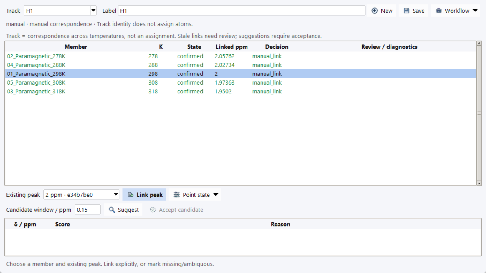

# Peak Tracking and Assignment Review

A track records reviewed correspondence between peaks in different series
members. Its label is not a molecular assignment, an atom mapping or an
automatically created observable. Process, reference and pick each spectrum
before establishing links.

Open **VT Series → Peak Tracking…**, or **VT stacked → Tracks**.

## Link existing peaks explicitly

1. Choose a series, enter a track **Label**, then **New**.
2. Select a member in the points table and inspect its spectrum.
3. Choose an **Existing peak**, then **Link peak**.
4. Repeat for the intended members. Inspect linked ppm and review diagnostics.

These H1 links use the tutorial's explicitly supplied correspondence. They do
not prove a molecular assignment. The table is shown in temperature order;
the original acquisition order is retained.

Use **Save** to update the label. **Point state** offers missing, ambiguous,
unlinking and removal. **Workflow** links to assignment review, analysis and
PCS preparation.

| State | Interpretation |
| --- | --- |
| Unreviewed / unlinked | Correspondence has not been confirmed. |
| Confirmed | Explicitly linked existing peak; source validity and member inclusion still matter. |
| Missing | No accepted observation for this member. |
| Ambiguous | Correspondence is uncertain; do not treat a candidate as a fit point. |
| Stale | Linked source/revision changed and requires review/reconfirmation. |

Only valid confirmed observations from included members can enter fitting.
Reprocessing, referencing or replacing peaks can stale links. Reinspect the
actual source and **Link peak** again when justified; the Workbench does not
silently recover links by nearest ppm.

## Use suggestions as review aids

After linking an anchor, set **Candidate window / ppm** and choose **Suggest**.
Inspect candidate shift, score and reasons, select the intended candidate and
choose **Accept candidate** explicitly. Suggestions do not create links until
accepted and must be refreshed if inputs change. Manual linking remains
available when no suitable candidate exists.

The current scoring uses acquisition-order continuity. Changing displayed
order to temperature order does not change that scoring. A score is not an
assignment probability or evidence of chemical equivalence. Inspect overlap,
crossings, line-shape changes and potential species changes independently.

## Convert correspondence into reviewed assignments

Open **Workflow → Assignment review…** from tracking, or the corresponding
VT analysis Workflow action. For the selected track:

1. Enter **Assignment**, **Nucleus** and a **Review note**.
2. Choose **Associate** to record reviewed assignment intent.
3. Inspect member actions, existing observable IDs and diagnostics.
4. Select intended members with Ctrl/Shift and choose **Confirm selected**.

Associate alone does not propagate labels into every dataset. Confirmation
acts only on selected safe proposals; existing conflicts are not silently
overwritten. **Use selected** copies a member's existing assignment into the
review form; Associate and member confirmation are still explicit steps.

Inspect the resulting dataset-local observations in [NMR Data](nmr-data.md).
Structural targets remain a separate reviewed mapping. An NMR assignment does
not become experimental PCS without [pairing/derivation](vt-pcs-preparation.md).
Save an [NMR session](sessions.md) to preserve identities and reviewed evidence.
