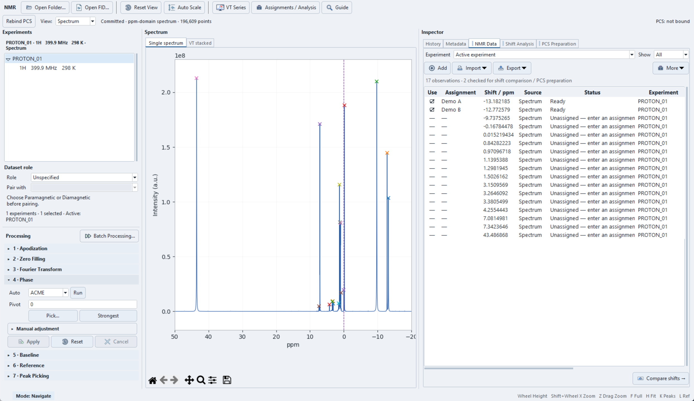

# NMR Workbench

The former `NMR Shift Viewer` functionality, available through v1.3.4, is now part of `NMR Workbench`.

Open **Modules → NMR Workbench** or **Ribbon → Tools → NMR Workbench**.
Choose the input route appropriate to your data:

**Vendor data → processing → referencing → peak picking → assignments →
observables → Shift Analysis → PCS Preparation.**

**Prepared observed-shift CSV / paste / manual values → NMR Data →
Shift Analysis → PCS Preparation.** A spectrum is not required for prepared
observations. See [NMR Data](nmr-data.md) and the
[FID/CSV tutorial](tutorial-fid-csv.md) for both routes.

For multiple temperatures, [VT Series](vt-series.md) provides series management,
[batch processing](batch-processing.md), stacked spectra,
[peak tracking](peak-tracking.md) and [VT analysis](vt-analysis.md). Tracking establishes
reviewed correspondence; it does not automatically assign a resonance or map
it to an atom. Save committed work as an [NMR session](sessions.md).
Follow the [VT tutorial](tutorial-vt.md) with the supplied synthetic FIDs;
[VT PCS preparation](vt-pcs-preparation.md) is a separate reviewed derivation step.

A broadened shift-list display is not a measured intensity trace; use the
vendor-data route above for processing measured spectra.

Yb(*i*Pr₂BA)₃ spectrum after processing and peak picking, with all 17 picked
peaks displayed in **NMR Data**. Demo A/B are the two assigned observations.

Demo A/B are illustrative peak annotations, not molecular assignments.
Inspect phase, baseline, referencing and peak picks before accepting a result;
automatic processing is only a starting point. See
[Raw Data and Processing](raw-processing.md) for the example input and
processing workflow.

## Workspace

| Area | Use |
|---|---|
| **Experiments** | Select a dataset, inspect conditions, assign **Paramagnetic** or **Diamagnetic** role, and choose **Pair with**. |
| **Processing** | Apodization, Zero Filling, Fourier Transform, Phase, Baseline, Reference, and Peak Picking. |
| **Spectrum** | Measured trace, peak markers, and Matplotlib toolbar. **View** switches **Spectrum** and **Raw FID** when available. |
| **Inspector** | **History**, **Metadata**, **NMR Data**, **Shift Analysis**, and **PCS Preparation** tabs. **NMR Data** combines picked peaks and prepared observations, with assignment editing and import/export controls. |

Use **Open Dataset Folder…** or **Open FID File…** to load vendor data.
**Reset View** restores the plot view; **Auto Scale** fits the intensity range.
See [Raw Data and Processing](raw-processing.md) and
[Peaks and Assignments](peak-assignment.md) for the practical sequence.

The spectrum area also has **Single spectrum** and **VT stacked** tabs.
**Assignments / Analysis** opens assignment CSV and saved-analysis exchange;
**Guide** opens the workflow, terms and file-purpose help. The same workflows
are available from the Workbench's File, VT Series and Help menus.

For standalone practice from the source repository, run
`python tools/nmr_workbench.py` with the application's dependencies installed.
Standalone mode supports NMR work but has no PCS document or structural targets.

## PCS-document binding

The Workbench binds to the PCS document active when it opens. Switching the
main document tab does not redirect structural selections or PCS handoff.
Check the **PCS:** indicator before mapping targets or applying results.
**Rebind to Active PCS Document** explicitly changes the binding. If the
bound document is closed, rebind before continuing those operations.

Loading a spectrum does not populate fitting data automatically. Only an
explicit, reviewed [PCS preparation handoff](non-pcs-analysis.md) supplies
experimental PCS observations to the bound document. Retain original vendor
data for reproducibility; a processed display or figure cannot replace it.
