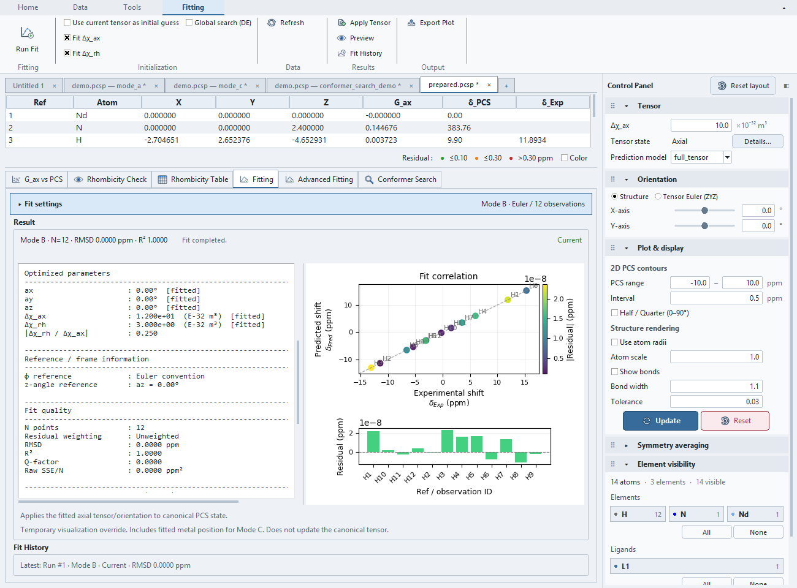

# Tutorial: Observed shifts to PCS fitting

Use `examples/nmr_pcs_fitting_demo/` for a CSV-only exercise linking NMR Workbench
to the main PCS fitting workflow. The supplied CSV files contain the mappings
and known values described below. Unlike the simulated FID/VT teaching
examples, these shifts are generated from a known tensor with explicit contact
assumptions. They remain synthetic probes, not measured assignments.

Use the files supplied with the application; see [finding the examples](../examples.md#find-and-open-the-files).
Paths below are relative to `examples/nmr_pcs_fitting_demo/`. Import both shift
CSVs from the same scenario as the open `start.pcsp`.

| File in each scenario | Use |
| --- | --- |
| `start.pcsp` | Open first; structure ready for the NMR-to-PCS exercise. |
| `paramagnetic.csv`, `diamagnetic.csv` | Import into the fresh NMR Workbench. |
| `mapping_and_truth.csv` | Read the supplied Ref mapping and contact corrections; do not import it as a third shift dataset. |
| `prepared.pcsp` | Open separately to start at the completed PCS-transfer checkpoint. |

## Generating assumptions

Twelve H observations at 300 K map H1–H12 to Refs 3–14. The known tensor is
Δχ_ax=12, Δχ_rh=3 E-32 m³ with zero orientation at the origin.

| Folder | Observed shifts | Appropriate provider |
|---|---|---|
| `direct/` | δ_obs = δ_dia + PCS; contact is exactly zero | Direct from Δshift |
| `contact_corrected/` | δ_obs = δ_dia + PCS + known contact | FCS-corrected |

`mapping_and_truth.csv` supplies assignment/Ref, both absolute shifts, contact and
PCS. No uncertainty or random noise is supplied; use unweighted fitting.

## Import, derive and transfer

1. Choose **File → Open PCS Project...**, open `direct/start.pcsp`, then launch a
   fresh **NMR Workbench** from the **Tools** Ribbon.
2. Import `paramagnetic.csv` and `diamagnetic.csv` through NMR Data Preview/Apply.
   Check roles, 1H, 300 K and twelve records per dataset.
3. Pair the datasets in **Shift Analysis**. Review twelve matched assignments
   and δ_para = δ_obs − δ_dia.
4. In **PCS Preparation**, choose **Direct from Δshift** and explicitly map
   Single atom targets H1–H12 to Refs 3–14. Labels alone do not establish targets.
5. Use **Review & Apply…** for the selected rows. Inspect the destination and
   conflicts before transferring twelve PCS observations to the main document.
6. In **Fitting**, choose Mode B, select all twelve observations, fit both
   tensor components, use Unweighted and disable global search/current-tensor
   initialization. Run Fit. Expect 12 / 3 and RMSD below 0.000001 ppm.

Repeat in a fresh session with `contact_corrected/start.pcsp`. Choose
**FCS-corrected** and enter the listed contact correction for each assignment.
Subtracting that known contact term recovers the same PCS and tensor. Direct
subtraction would include contact in this case and is not the correct PCS.

The correction values are supplied assumptions, not inferred by this application.
This exercise does not show that an unknown contact term can be identified from
one experimental shift pair. See [PCS preparation](non-pcs-analysis.md).

After transferring, the main Undo arrow beside **Help** restores the PCS
destination's previous values, observations and provenance. Redo reinstalls
the same recorded data without repeating preparation. The NMR source session
and historical transfer receipts remain intact. See
[document Undo/Redo](../projects.md#undo-and-redo) for supported edits and scope.

## Checkpoints and reproducibility

Each `prepared.pcsp` contains the expected data after PCS transfer.
It includes PCS provenance/targets, but no NMR
session or fitted result. Use it to practice fitting separately. Save your practice
`.nmrsession` and `.pcsp` independently; reopening a PCS file does not reconstruct
the underlying NMR datasets.

Actual Mode B fit of `contact_corrected/prepared.pcsp`: twelve observations,
unweighted residuals and recovered 12 / 3 tensor. This is the transferred PCS
checkpoint, not a screenshot of the observed-shift import dialog.
