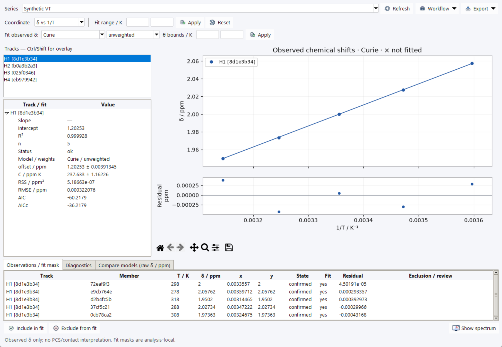

# VT Analysis of Observed Shifts

Open **VT Series → VT Analysis…**, or **VT stacked → Analysis**. Select a series
and one or more tracks (Ctrl/Shift overlays tracks). The input is **observed
chemical shift δ in ppm**, with effective temperature **T in Kelvin**.
It is not automatically PCS, contact shift or a para-minus-dia difference.

## Coordinates and fitted models

| Coordinate | x | y |
| --- | --- | --- |
| **δ vs T** | T / K | δ / ppm |
| **δ vs 1/T** | 1/T / K⁻¹ | δ / ppm |
| **δT vs 1/T** | 1/T / K⁻¹ | δT / ppm·K |

**Linear (coordinate)** fits an unweighted straight line in the selected
coordinates. Its slope/intercept units therefore depend on those coordinates.

**Curie** and **Curie-Weiss** fit raw observed shifts against temperature:

\[
\delta(T)=a+\frac{C}{T},\qquad
\delta(T)=a+\frac{C}{T-\theta}.
\]

Here a is in ppm, C in ppm·K and θ in K. Changing coordinates transforms the
displayed curve rather than changing the raw-shift fit objective. With a
nonzero offset, δT vs 1/T is not generally a straight line. Curie and a linear
δ vs 1/T fit are mathematically equivalent for unweighted fitting of the same
points, but a linear fit in the other coordinate views has a different meaning.

Five processed synthetic H1 observations, unweighted Curie fit, displayed as
δ vs 1/T. Processing and grid sampling make parameters differ slightly from
the generator's a = 1.2 ppm and C = 238.4 ppm·K.

## Choose fit points and weights

Valid fit points require a confirmed live peak link, an included series member,
finite observed shift and finite positive effective temperature. Missing,
ambiguous, stale and invalid points remain diagnostic evidence, not usable
measurements.

Use **Fit range / K** to limit temperatures and **Include in fit** / **Exclude
from fit** for selected rows in **Observations / fit mask**. These masks are
local to the analysis; they do not change member inclusion or track decisions.
Selecting a plotted point/row navigates to its member and peak. **Show spectrum**
returns to the series spectrum view.

The model selector supports **unweighted** and **measured_sigma** for Curie/
Curie-Weiss. Measured-sigma fitting requires a finite positive provided shift
uncertainty for every included point, synchronized with its linked observable.
Missing uncertainties are not invented or replaced silently. Coordinate linear
fits remain unweighted.

Curie needs at least two distinct temperatures; Curie-Weiss needs at least
three, and additional points are needed to estimate residual variance reliably.
The implemented Curie-Weiss branch requires T > θ. Use **θ bounds / K** to
enter finite increasing bounds below the minimum fitted temperature. Blank
bounds use guarded defaults; inspect the reported bound/conditioning diagnostics
and do not interpret these defaults as scientifically established limits.

## Interpret residuals and comparisons

Residuals are **measured minus fitted**. Plot/table residuals use the selected
y-coordinate units; raw-shift model metrics are in the observed-shift domain.
Inspect diagnostics and covariance/parameter correlation, not only R².
The models assume one unchanged resonance/species and a temperature-independent
offset; exchange/population changes and temperature uncertainty are not modeled.
C is a phenomenological coefficient, not a fitted susceptibility tensor.

**Compare models (raw δ / ppm)** compares empirical linear-in-T, Curie and
Curie-Weiss models using the same points and weighting. Review RSS, RMSE, R²,
AIC/AICc, point count and status in that common domain. AICc may be unavailable
with too few points; near-equal scores do not distinguish models. Good fit
quality or extra parameters alone do not establish physical meaning.

## Export and retain evidence

**Export** provides **Analysis table CSV…**, **Plot image / PDF…**, **Results
JSON…** and **Keep results in session**. CSV reports extracted/fitted values,
identities, inclusion and residuals. JSON retains historical source snapshots,
configuration, results and diagnostics. Keep results in session, then save the
`.nmrsession`, to retain that evidence alongside the sources. Imported saved
results do not recalculate the live fit. See [Sessions and Data Exchange](sessions.md).

Follow the [VT tutorial](tutorial-vt.md) for known observed-shift curves, and
[VT PCS Preparation](vt-pcs-preparation.md) for the separate derivation workflow.
