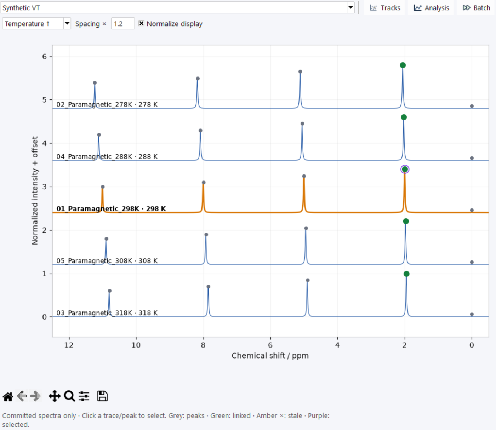

# VT Series and Stacked Spectra

A variable-temperature (VT) series groups loaded experiments while retaining
each dataset's own spectrum, processing history, peaks and identity. It does
not average spectra or infer which resonances correspond across temperatures.

Open **VT Series → Manage VT Series…**, or the **VT Series** toolbar button.
For a guided exercise with five synthetic FIDs, see the [VT tutorial](tutorial-vt.md).

## Create and inspect a series

1. Choose **New** and enter a series name.
2. Use **Add loaded** for an existing experiment, **Import → FID experiments…**
   for experiment directories, or **Import → Folder group…** for a group folder.
3. Review the imported members and any loading failures/skipped inputs.
4. Check **T / K**, **T source**, **Label**, **Use** and **Diagnostic**.

Keep vendor metadata beside its FID. A series member references an existing
dataset; removing a member does not delete that loaded dataset. Read-only
PCS-project shift projections are not acquired experiments and cannot be
added through this series workflow.

**Member order** offers **Acquisition**, **Temperature ↑** and **Temperature ↓**.
Temperature sorting changes presentation, not dataset identity or acquisition
order. Repeated temperatures do not become one averaged measurement.

## Temperatures and member inclusion

Select a member, edit **Override / K**, **Label** or **Include**, then **Apply edit**.
A blank override uses the next available temperature source. Effective
temperature precedence is member override → series override when present →
calibrated dataset temperature → nominal acquisition temperature. Values must
be finite positive Kelvin; invalid higher-priority values do not silently fall
back to nominal metadata. An override does not rewrite acquisition metadata.

**Include** controls use of a member in the series workflow; excluded members
remain loaded. It differs from batch target checkboxes and the VT analysis fit
mask. Verify temperatures and conditions before interpreting trends; imported
nominal temperature is not evidence of calibration.

## Compare stacked spectra

Synthetic VT tutorial spectra after phase, baseline and individual TMS
referencing. This is display normalization, not a comparison of quantitative
integrals or sample concentrations.

Choose **VT Series → Stacked Spectra**, or **Spectrum → VT stacked**. Select the
series and order, then adjust **Spacing ×** and **Normalize display**. Only
included members are displayed. Each trace retains its own ppm grid; spacing
and normalization do not change peak positions, intensities stored as data,
or processing history.

Click a trace to activate its existing dataset. Reviewed track-point highlights
help navigate existing peaks. **Tracks**, **Analysis** and **Batch** open the
corresponding windows. A display order is not a new tracking identity; candidate
suggestions currently use acquisition-order continuity.

Before tracking, [process/reference and pick peaks](batch-processing.md) in
each experiment. Before continuing later, save an [NMR session](sessions.md).
A `.nmrseries` exports definitions only; it is not an embedded spectrum/session.
