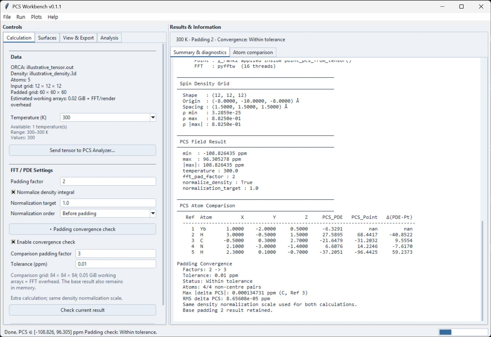

# Calculation & Convergence

Use the **Calculation** tab to choose a temperature and prepare the distributed PCS calculation. Load the ORCA output and matching spin-density grid first; see [Overview](overview.md#inputs).

## Normalization and padding

**Normalize density integral** scales the non-negative calculation density to the **Normalization target**, normally 1. **Normalization order** defaults to **Before padding**. **After padding** is available for reproducing the earlier workflow. Older presets without an order setting retain the after-padding behavior; **Reset to defaults** uses before-padding.

These choices affect the calculation, rather than just its appearance. The original signed density is kept separately for export.

**Padding factor** defaults to 2. Padding expands the grid around the input density to reduce sensitivity to the finite calculation box. Increasing it also increases memory use and calculation time. A factor of 2 gives five times as many samples along each axis, or 125 times as many voxels. Check the input and memory summary before running a large grid.

## Padding convergence check

The check compares atom-level PDE PCS values at two padding factors. It is optional and off by default.

1. Expand **Padding convergence check** on Calculation.
2. Enable the check and choose **Comparison padding factor**, normally 3 when the base factor is 2.
3. Set **Tolerance (ppm)**. The default 0.01 ppm is a starting value, not a universal accuracy requirement.
4. Use **Run computation** to calculate the base result and then check it, or **Check current result** to check a result already available.
5. Read the outcome above the result tabs and the details in **Summary & diagnostics**.

Current UI with illustrative data; the displayed tolerance is an example.

Both calculations use the same density normalization scale. The check reports the maximum absolute difference, RMS difference and worst affected atom, excluding the metal centre. It keeps the base result; it does not replace it with the larger comparison grid.

| Status | Meaning |
| --- | --- |
| Not checked | No check is recorded for this result. |
| Within tolerance | All required atom pairs were compared and the maximum difference meets the chosen tolerance. |
| Above tolerance | The maximum difference exceeds the chosen tolerance. Consider a larger base padding or review the grid. |
| Incomplete | Some required atom values could not be compared. Do not treat this as a pass. |
| Failed | The comparison failed; the successful base result is retained. |

This checks sensitivity to padding. It does not establish experimental agreement or validate the density, tensor, grid resolution or physical model.

## Current results and reproducibility

The summary line describes the recorded result, not settings that have not yet been calculated. Replacing an input file or changing calculation inputs invalidates the result. Display changes can redraw the existing field without recalculating it.

The calculation uses the loaded inputs. If a source file changes outside the application, reload it explicitly. Keep the original inputs, parameter preset and numerical exports together. Export metadata records the calculation conditions and any convergence check; see [3D Data Export](exports.md).
