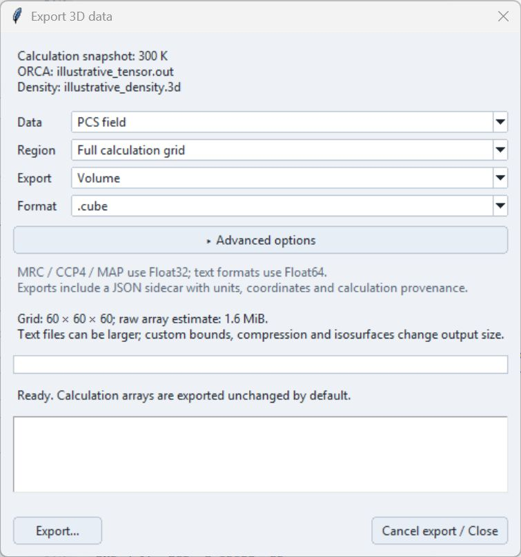
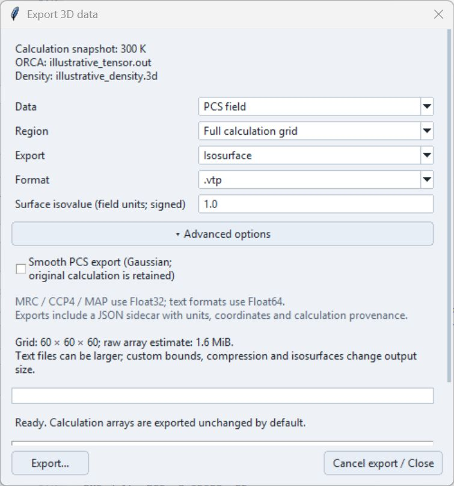

# 3D Data Export

Use **File → Export 3D data…** after calculating a current result. NumPy export is included in this dialog; it no longer has a separate command.

Current export dialog, shown with illustrative data.

## Choose what to export

1. Choose **Data**: **PCS field**, **Density used by solver**, or **Original signed density**.
2. Choose **Region**: the full calculation grid, the input density region, or custom bounds in Å. Bounds appear only for **Custom bounds (Angstrom)** and select existing grid samples without resampling.
3. Choose **Volume** or **Isosurface**, then select **Format**.
4. For an isosurface, enter its signed **Surface isovalue**. A surface export contains that single level, not the complete viewer scene.
5. Open **Advanced options** if needed, then select **Export…** and choose a filename.

The original signed density is distinct from the absolute-valued density used for calculation. Exporting it does not change the PDE result.

## Formats

| Export | Formats |
| --- | --- |
| Scalar volume | CUBE/CUB, VTI, VTK, OpenDX, MRC/CCP4/MAP, NRRD, NPZ, NPY |
| Single isosurface | VTP, PLY, STL, OBJ |

For a Python workflow, choose NPY for the selected array or NPZ for an array with associated data. For a regular 3D viewer, choose a volume format that the viewer supports. Mesh formats describe a surface and may not retain all colours or materials.

Every export also writes a **JSON sidecar** beside the data file. Keep it with the export: it records the field, units, grid, region, calculation conditions and any export smoothing. See [File Formats](../reference/file-formats.md#pcs-workbench-outputs) for the reference summary.

## Advanced options

The section is collapsed initially. Opening or closing it retains the selected values.

- **Precision** offers Float32 or Float64 for NPY, NPZ and NRRD. MRC/CCP4/MAP use Float32; the text formats use Float64 precision.
- **Compression** is available for NPZ and NRRD.
- **Smooth PCS export** applies optional Gaussian smoothing to the exported PCS field. Sigma is in voxels. It leaves the calculation and atom comparison unchanged; the collapsed section indicates when smoothing is on.

These controls appear only when applicable. Export smoothing is separate from **Smooth PCS display**, which affects the viewer only.

An illustrative surface export; precision and compression controls are hidden for this format.

## Units and saved data

PCS values remain **ppm**. CUBE/CUB coordinates, including atoms and grid steps, use **Bohr**; the other implemented formats use **Å**. Normalized calculation density is converted to Bohr⁻³ in CUBE. Raw signed density retains its source values, labelled `source_units`, because the reader does not establish its physical unit. Check the sidecar when exchanging files; see [Units](../reference/units.md#pcs-workbench-exports).

NPY stores the selected array; its coordinates and conditions are in the sidecar. NPZ also includes grid information and metadata. A full, unsmoothed PCS NPZ additionally retains source/solver arrays and tensor settings. Cropped, smoothed or density exports should not be treated as identical full-result archives.

Export runs in the background. Cancellation takes effect between writing steps and may take time during compression or surface extraction. Test a small export in the intended external application before relying on a large batch. Some readers interpret very small NRRD grids differently; VTI is an alternative.

## Other outputs

**Export atom PCS to CSV…** writes the atom-level comparison. **Export PNG…**, slice **Save plot...**, and tensor **Save PNG / Save GIF** save images rather than numerical volumes. Parameter presets save settings, not the loaded inputs or a completed Workbench session.
