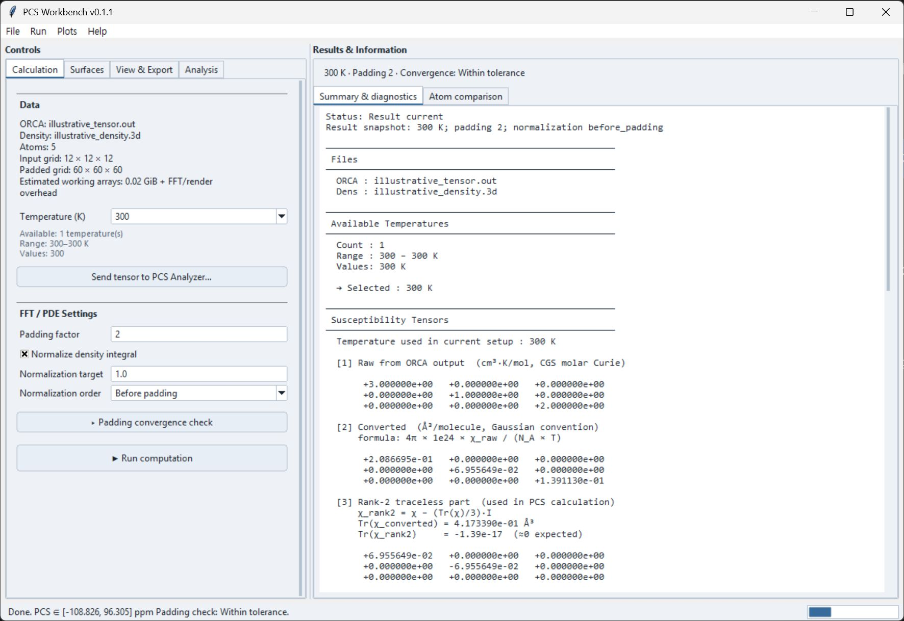
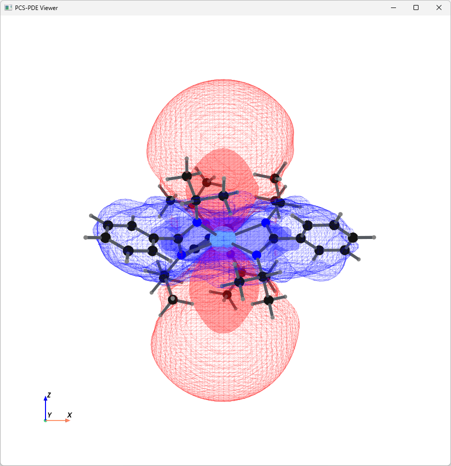
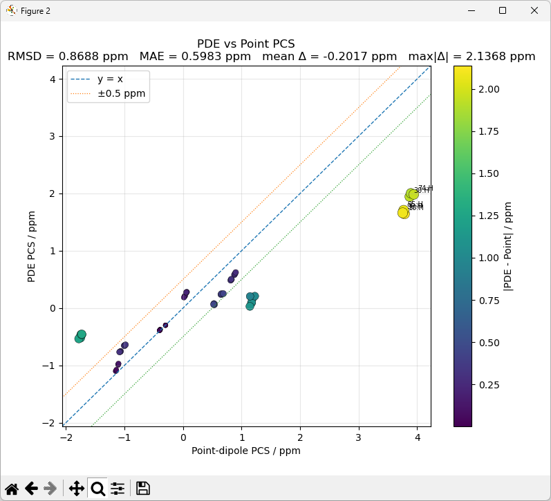
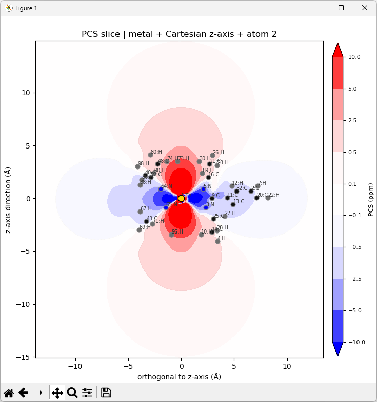
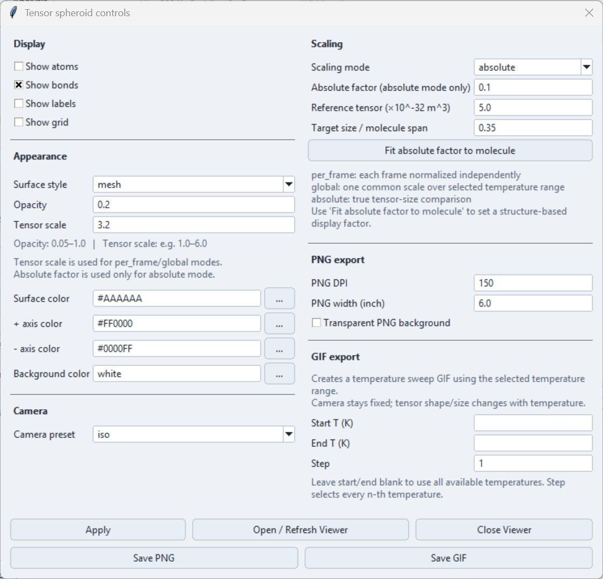
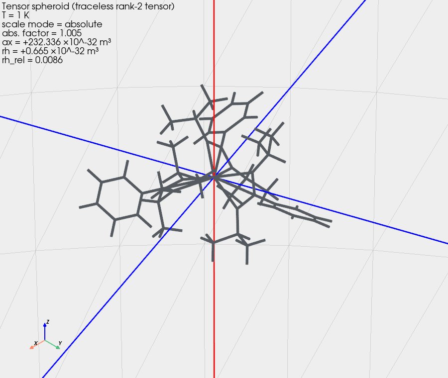

# PCS Workbench

PCS Workbench **0.1.1** is a separate PCS Analyzer window for comparing a point-dipole PCS model with a PCS field generated from an ORCA-derived spatial density grid. Open it from **Modules → PCS Workbench** or the **PCS Workbench** shortcut in the main window.

The Workbench does not import the current main-window structure, tensor, or experimental shifts. It loads its own ORCA output and, for distributed-field calculations, its own spin-density `.3d` file.

Current Calculation tab and result report, shown with illustrative data.

## Point-dipole and distributed PCS

The two calculations answer different model questions:

- **Point-dipole PCS** applies the traceless rank-2 susceptibility tensor at an automatically selected metal coordinate and evaluates the tensor expression at each ORCA atom.
- **PDE PCS** uses the same rank-2 tensor with a three-dimensional density grid in an FFT spectral solver. The resulting field is sampled at the ORCA atom positions by cubic interpolation.

The atom comparison reports

\[
\Delta_{\mathrm{PDE-Point}}
=
\delta_{\mathrm{PDE}}-\delta_{\mathrm{Point}}
\]

in ppm. This difference measures disagreement between these two implemented forward models. It is not an experimental residual and does not by itself identify a bonding mechanism or prove a spin-delocalization interpretation.

The canonical PCS definitions remain in [PCS Theory](../pcs/theory.md) and [Tensor Conventions](../pcs/tensor-conventions.md).

## Inputs

### ORCA output

Use **File → Open ORCA output…** to select `.out` or `.log`. The parser requires both:

- a recognized `CARTESIAN COORDINATES (ANGSTROEM)` or `(BOHR)` block; and
- at least one susceptibility tensor following a `TEMPERATURE/K:` record and a `Tensor in molecular frame` heading.

If several susceptibility sections are found, choose the intended section in the selection dialog. The Workbench does not infer the calculation level automatically. The selected section and its source line appear in the report.

The last coordinate block is used. Bohr coordinates are converted to Å. If several tensors are present, **Temperature (K)** selects one of the parsed temperatures; a programmatic non-exact request is resolved to the nearest available value, while leaving the selection blank uses the first temperature.

The Workbench displays the raw ORCA tensor as a CGS molar Curie quantity in cm³·K/mol and converts it to ų per molecule with

\[
\boldsymbol{\chi}
=
\frac{4\pi\,10^{24}}{N_\mathrm{A}T}
\boldsymbol{\chi}_{\mathrm{raw}}.
\]

It then removes the isotropic trace and uses only the traceless rank-2 tensor in both PCS calculations. The ORCA coordinates and `Tensor in molecular frame` matrix are used in the same molecular frame; the Workbench does not provide an additional tensor rotation control.

### Spin-density grid

Use **File → Open spin density…** to select an ORCA simple-grid `.3d` file. The current reader expects, in order:

1. a title line;
2. positive `nx ny nz` dimensions;
3. `ox oy oz` origin;
4. positive `dx dy dz` spacing; and
5. exactly `nx × ny × nz` scalar samples.

The implementation treats the origin and spacing numbers as Å and performs no length-unit conversion. The grid must therefore already share the ORCA structure's molecular frame and Å coordinate convention.

!!! warning "Current density-sign handling"

    The `.3d` loader currently applies an absolute value to every scalar sample before reshaping the grid. The original signed samples are retained separately for export; the solver continues to use the non-negative grid. With **Normalize density integral** enabled, this non-negative grid is scaled to the requested **Normalization target** using a nested trapezoidal integral. Confirm that these assumptions match the intended calculation before interpreting the PDE result.

The ORCA file alone is sufficient for tensor information, the tensor-spheroid viewer, and [tensor transfer to PCS Analyzer](tensor-transfer.md). A spin-density grid is required for **▶ Run computation**, the PCS field, slices, isosurfaces, and PDE-versus-point comparison.

## Calculation workflow

1. Load the ORCA output, inspect the available temperatures and tensor conversion in **Results & Information**, and select **Temperature (K)** on the **Calculation** tab.
2. Load the matching `.3d` grid.
3. Set **Padding factor**, **Normalize density integral**, **Normalization target**, and **Normalization order** under **FFT / PDE Settings**. The default order is **Before padding**. Optionally enable the [padding convergence check](calculation.md#padding-convergence-check).
4. Click **▶ Run computation**. The calculation runs in a worker thread; another run is rejected while it is busy.
5. Review **Summary & diagnostics** and **Atom comparison** in **Results & Information**. The line above these tabs records the result temperature, padding factor, and convergence status. PCS values in Atom comparison use two decimal places; the report and numerical exports retain their existing precision.
6. Configure **Surfaces**, then use **Open / Refresh Viewer**. Changing surface, molecule, camera, or export controls redraws the stored result; use **Run computation** again after changing calculation inputs.
7. Use **Analysis** or **Plots** for comparison plots and tensor visualization; use **Open Oblique PCS Slice…** for slices. Use **File → Export 3D data…** for [numerical volume and surface exports](exports.md).

The metal centre is selected automatically as the first recognized metal element in the ORCA atom order. If none is recognized, atom 1 is used. There is currently no Workbench control to override this choice; enable **Show atoms** and verify the highlighted centre and atom order before accepting atom-level comparisons.

## FFT/PDE settings and performance

**Padding factor** adds that many original-grid lengths on each side of every axis before the FFT. A factor of 2 therefore produces approximately five times as many points along each dimension, or 125 times as many voxels before FFT working arrays are included. Large source grids can require substantial memory and computation time.

PCS Workbench uses `pyfftw` with available CPU threads when it can be imported and otherwise falls back to `numpy.fft`. This changes the FFT backend, not the documented model. Changing calculation inputs invalidates the current result; calculate again before exporting. See [Calculation & Convergence](calculation.md) for normalization, memory use and optional padding checks.

## 3D field and isosurfaces

The **Surfaces** tab controls two independent displays:

- **Show spin density surface** draws the selected positive **Density isovalue (a.u.)** from the density used by the solver.
- **Show PCS isosurfaces** draws both `+level` and `−level` surfaces for every positive ppm row in **PCS Isosurface Levels**. Each row has positive/negative colors, style, and opacity.

**Smooth PCS display (Gaussian)** filters a copy of the PCS grid for isosurface rendering only. Its sigma is in voxels. It does not recalculate the stored PCS field or the atom comparison. Export smoothing is a separate, optional setting in [Export 3D data](exports.md). Atom and bond display, bond tolerance, labels, grid, outline, colors, opacity, camera, and projection are also visualization controls rather than PCS inputs.

The surface is an interpolated representation of a finite numerical grid. Its apparent smoothness and the chosen isovalue do not increase the precision of the input density or prove a physical boundary.

## Atom-level comparison

**PDE PCS vs Point-dipole PCS…** plots point-dipole PCS on the x-axis and interpolated PDE PCS on the y-axis. **PDE − Point residuals…** plots their signed difference. The plot options can restrict the atom set, minimum absolute PCS or difference, and the largest differences; they can also change color, marker size, labels, and a visual tolerance band.

The displayed RMSD, MAE, mean Δ, and maximum |Δ| summarize the filtered atom rows. They compare two calculations, not calculated values against experimental data.

## Oblique slices

**Open Oblique PCS Slice…** defines a plane through the selected metal using either `cartesian_z` or the tensor principal z direction and the vector from the metal to a chosen **Direction atom**. **Atom plane tolerance (Å)** controls which atom markers are included near the plane; it does not alter the field slice. Contours may use automatic symmetric levels or explicit signed ppm levels.

Slice plots can show Ref/element labels and can be saved as PNG, PDF, or SVG.

## Tensor spheroid

**Tensor spheroid…** diagonalizes the traceless rank-2 tensor, draws its principal directions through the selected metal, and scales an ellipsoidal visual aid from the eigenvalue magnitudes. The controls use two columns, with a scrollable settings area and fixed action buttons. The scaling modes are:

- `per_frame`, which normalizes each temperature independently;
- `global`, which uses a common scale over the selected temperature range; and
- `absolute`, which applies the configured absolute display factor.

Only `global` or a consistently chosen `absolute` factor supports visual size comparison across temperatures. The spheroid is a tensor visualization, not a spin-density surface or molecular orbital. It can be saved as PNG. **Save GIF** sweeps the selected ORCA temperature range with a fixed camera and requires the tensor viewer to be open.

Current controls, shown with illustrative data.

## Exports and presets

| Command | Output |
| --- | --- |
| **Export PNG…** | PNG of the live current camera when **Export view: current** succeeds, or an off-screen render using the configured preset, DPI, width, and transparency. |
| **File → Export 3D data…** | PCS or density volumes, including NumPy, or a selected isosurface. See [3D Data Export](exports.md) for formats and options. |
| **Export atom PCS to CSV…** | UTF-8-with-BOM CSV with Ref, element, XYZ, PDE PCS, point PCS, and PDE-minus-point difference. |
| **Save preset… / Load preset…** | JSON containing Workbench calculation, surface, molecule, camera, and PNG controls. It does not contain input files or a computed field. |
| Tensor **Save PNG / Save GIF** | Static spheroid image or temperature-sweep animation. |
| Slice **Save plot...** | PNG, PDF, or SVG contour plot. |

The Workbench session and camera snapshot are transient and are not part of the main `.pcsp` project. A tensor applied to the main Analyzer document, together with its import source, can be saved in that document; see [Tensor Transfer](tensor-transfer.md). Save the input files, parameter preset, and numerical exports needed to reproduce a result. See [File Formats](../reference/file-formats.md#pcs-workbench-inputs) for the concise format reference and [Units](../reference/units.md) for the application's general unit conventions.

## Interpretation limits

- PDE-versus-point differences are model differences, not experimental validation.
- The solver uses absolute density values and normalization is enabled by default. The original signed samples remain available for export.
- Metal selection is automatic and should be checked for unusual structures.
- Grid extent, spacing, padding, normalization, and interpolation affect the numerical result.
- Display smoothing, surface levels, opacity, colors, and spheroid scale affect presentation only.
- Neither an isosurface, a slice, nor a tensor spheroid uniquely establishes bonding, delocalization, or a physical mechanism.
