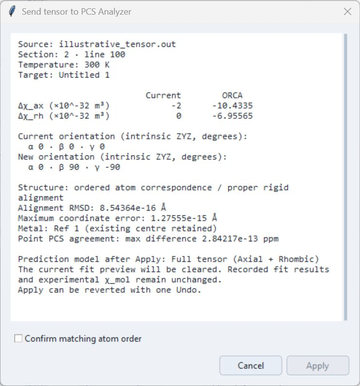

# Tensor Transfer

**Send tensor to PCS Analyzer…** brings the selected ORCA susceptibility anisotropy into the active Analyzer document. It does not transfer a distributed PCS field or experimental shifts.

## Before starting

Open PCS Workbench from PCS Analyzer and load an ORCA output. A spin-density grid and PDE calculation are not required. The command is disabled in a standalone Workbench.

The active Analyzer document must contain the same structure with matching atom order and the corresponding assigned metal centre. A rigid rotation or translation is allowed; a changed conformation, different atom order or incompatible centre is not. Automatic atom matching is not provided.

## Review and apply

1. Select **Temperature (K)** in the Workbench.
2. Click **Send tensor to PCS Analyzer…** beneath the temperature controls, or use the same File-menu command.
3. Review the source, temperature, target document, current/imported tensor and structure agreement.
4. Confirm **matching atom order**, then select **Apply**. **Cancel** leaves the Analyzer tensor unchanged.
5. Review the main **Tensor state** and **Details**. Use document **Undo** to revert the import; **Redo** restores it.

Current review window with illustrative data. Apply is disabled until atom order is confirmed.

The transfer expresses the anisotropic tensor in the target structure's frame and selects **Full tensor (Axial + Rhombic)**. It retains the target structure and assigned centre. Experimental shifts and experimental molar susceptibility are unchanged. A working fit preview is cleared, while recorded fit results remain available.

If the target document or its inputs change during review, open a new preview. Apply or discard an active conformer preview before importing. A rejected transfer is a reason to check the structures and order, not to bypass the checks.

## Source information and saving

The existing Tensor state shows **ORCA** and the selected temperature. Subsequent physical edits can show **Modified from ORCA**. **Details** displays the import source and retains access to the Rhombicity Table. Without an ORCA source, Details keeps its usual Rhombicity Table navigation.

Save the Analyzer document as **.pcsp** to retain the applied tensor and its source information. This does not save the Workbench's loaded files, density grid, result or camera state. Keep the source ORCA output separately. See [Projects and Persistence](../projects.md) and [Tensor Conventions](../pcs/tensor-conventions.md).
