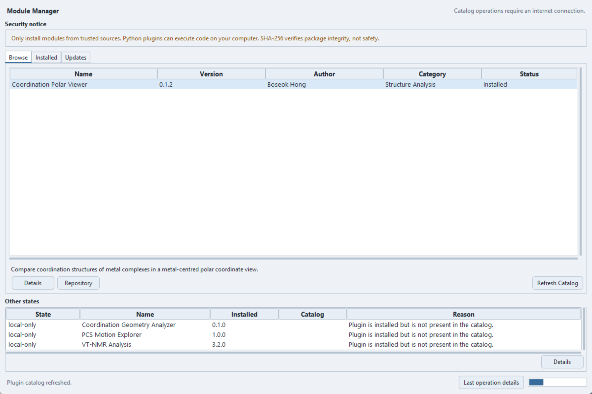
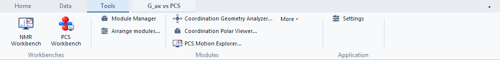
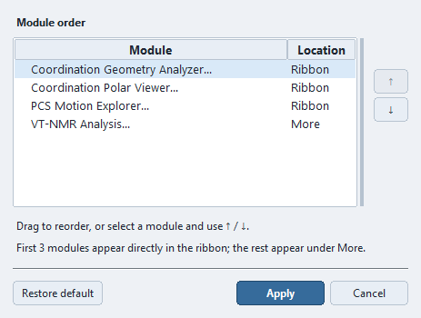

# Module Manager

Open **Modules → Module Manager...** or **Tools Ribbon → Modules → Module Manager**
to browse and manage external Python plugins. Built-in tools such as PCS
Workbench ship with PCS Analyzer and are not removed through this manager.
Most external modules are standalone tools launched from the host; they do
not imply a mature, versioned extension API.

Module Manager — Browse view.

## Launching and arranging modules in the Ribbon

The **Tools → Modules** group keeps **Module Manager** above
**Arrange modules…**, beside launchers from enabled modules that loaded
successfully. Up to three launchers appear directly; additional commands are
under **More**. A module may contribute multiple commands. The original
**Modules** menu remains available.

Choose **Arrange modules…** to open **Arrange ribbon modules**. Drag a row,
or select it and use **↑ / ↓**. **Apply** updates the Ribbon;
**Cancel** discards changes since the last Apply. **Restore default** restores
name order in the draft; use Apply to accept it. Additional new commands are
appended after your saved order. Unavailable commands consume no Ribbon slots.
The arrangement is saved in application settings, not in a `.pcsp`, and does
not reorder the original Modules menu or Quick tools.

Icons use four functional categories: **NMR / PCS**, **Structure**,
**Visualization**, and **Other / Uncategorized**. Missing or unrecognized
category metadata uses the generic icon. Categories do not force the order.

## Browse, Installed and Updates

| View | What to do |
| --- | --- |
| **Browse** | Inspect catalog descriptions, versions, categories and status. Select a module for **Details**, **Repository** or **Homepage** where supplied. **Install** is offered for an eligible uninstalled module; **Update** for an eligible newer release. **Refresh Catalog** retrieves current catalog metadata. |
| **Installed** | Inspect local versions, enabled state and **Session status**. Install a local `.py`, folder or ZIP; enable, disable or remove a selected module. **Details** shows its session diagnostics and **Refresh** rereads local state. |
| **Updates** | Review compatible newer catalog versions, select a module, read **Details** and choose **Update**. Updates are explicit; opening the manager does not install them. |
| **Other states** | Inspect reasons for incompatible, deprecated, unavailable, blocked, local-only or local-error entries. These are not additional installable releases. |

Catalog access requires an internet connection. A failed fetch is reported;
local installations remain available. **Local-only** means absent from the
current catalog, not necessarily broken. A catalog classification is separate
from whether code loaded successfully in this session.

## Install, update and remove

1. Read the selected module's description, compatibility and source information.
2. Choose **Install** or **Update**, or use a local install action in Installed.
3. Review the security confirmation. Wait for completion and read any warning;
   **Last operation details** explains failures and recovery paths.
4. Check **Installed → Session status** and **Details**, then launch its available
   **Modules** command or pin a registered tool launcher in
   **Control Panel → Quick tools → Customize Tools**.

New installations and enable/disable actions refresh the Modules menu.
**Restart PCS Analyzer after an update or replacement to execute the new code**:
a menu refresh can still use the previously imported version. Disabling or
removing a plugin does not close its windows or undo arbitrary Python side
effects; restart for a clean session.

**Remove** asks for confirmation and removes installed files and their record.
Keep any plugin-specific data separately before removal. If an operation cannot
finish or cleanup is incomplete, use its reported details rather than assuming
that either the old or new version is active.

## Compatibility and recovery

New installations validate the plugin ID, version, manifest, entry path and
declared application-version bounds. Catalog downloads additionally check the
published SHA-256 and expected package ID/version. Invalid, incompatible or
unsafe packages are rejected before replacement. This does not install Python
dependencies or prove scientific correctness.

Replacement is staged with a recoverable backup and attempted rollback on
failure. Files locked on Windows, rollback errors or cleanup failures can
require a restart and leave recovery paths. Preserve those paths, close plugin
windows, restart and follow [Troubleshooting](troubleshooting.md); recovery is
not guaranteed if filesystem operations fail.

## Session diagnostics

Installed, enabled and loaded are different states. **Session status** can show
Loaded, Disabled, Skipped, Failed, a warning, or Not loaded in this session.
**Details** provides the load phase, error, missing dependency, warnings and
technical traceback when available. One plugin's load failure is reported
without intentionally preventing other plugins from loading. Runtime failures
inside a launched tool may need to be reported to its author.

Legacy installed manifests are loaded more permissively than new packages:
valid version bounds are checked, but malformed compatibility metadata can be
ignored with a warning. A successful load with such a warning is not evidence
of declared compatibility.

## Security boundary

!!! warning "Trusted code only"

    Plugins execute Python with PCS Analyzer's permissions and are not sandboxed.
    Even inspection of a local `.py` file executes its import-time code.
    SHA-256 verifies integrity against catalog metadata, not safety, authorship
    or scientific correctness. Install only code you trust.

See [Installation and distribution](distribution.md) for package choices and
[Plugin author reference](creating-plugins.md) for development. The current
PluginApp is unversioned; a stable integrated API remains future work.
