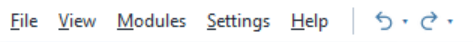
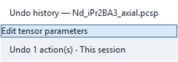

# Projects and Persistence

A **.pcsp project** embeds the structure and PCS analysis inputs needed to
continue an analysis. A **.pcsw workspace** remembers which saved projects to
open and which document is active. Tables, figures and XYZ exports serve
reporting or exchange; they do not replace a project.

## Saving a project

Commands are available in **File** and the **Home** Ribbon. The active document
is the selected document tab; its table, analysis and Control Panel are the
ones being saved by Save or Save As.

| Command | Scope |
| --- | --- |
| **Save PCS Project** / **Save Project** | Save the active document to its current `.pcsp` path; ask for a path if untitled. |
| **Save PCS Project As...** / **Save As** | Save the active document under a new path. |
| **Save All** | Save every modified project document, asking for paths for modified untitled documents. Cancellation stops the remaining saves; earlier saves remain saved. |
| **Save Workspace** / **Save Workspace As...** | Save project references and tab order, not unsaved changes within those projects. |

Saving is explicit. Save projects before saving their workspace, and keep
original structure and experimental source files for independent reproducibility.

## Tensors from PCS Workbench

[Send tensor to PCS Analyzer](pcs-workbench/tensor-transfer.md) applies the
selected ORCA tensor to the active document as one Undo/Redo action. Save the
`.pcsp` project to retain that tensor and its source information. Ordinary
physical edits can show **Modified from ORCA** in Tensor state; Details retains
the original import information.

The Workbench session itself is separate: loaded files, density, calculated field
and camera are not saved in the Analyzer project. Keep the source files and
Workbench presets/exports needed to reproduce that calculation.

## Undo and Redo

Use **Ctrl+N** for a new document, **Ctrl+O** to open a project, **Ctrl+S**
to save, **Ctrl+Shift+S** to save under another name, and **Ctrl+W** to close
with the existing unsaved-change prompt. Ctrl+Tab/Ctrl+Shift+Tab navigate
document tabs. [Help and keyboard shortcuts](interface.md#help-and-keyboard-shortcuts)
describes their window scope and reference list.

The two arrow buttons beside **Help** operate on the active document. Click an
arrow to undo or redo one recorded edit; its small dropdown shows the session
history. Hovering a row highlights all steps up to that row. Clicking it restores
those steps together. The dropdown supports Up/Down, Enter and Escape.

Currently recorded edits are **Apply to Tensor** for standard Mode B/C,
Conformer Search **Apply Candidate** and **Revert**, main-table δ_Exp edits,
CSV/Excel/clipboard shift-import Apply, δ_Exp/δ_obs/δ_dia Clear, and PCS transfers
from NMR Workbench. Confirmed Δχ_ax/Δχ_rh edits, rhombic enablement,
Structure XYZ and Tensor Euler ZYZ edits, and explicit metal-centre assignment
are recorded as well. Main-window XYZ/ORCA structure loading is recorded as one
coupled structure/data edit. The existing **Undo import** command is also recorded.
Control Panel **Reset** is recorded as one document action, including the
standard Fit History that Reset clears.
Selecting **Axial** or **Full tensor (Axial + Rhombic)** in the Control Panel
is one recorded edit. Undo/Redo restores the selected model and refreshes its
PCS table, plots and open NMR predictions. The stored tensor parameters and
rhombic enablement are retained; Full tensor uses the rhombic term only when
that term is enabled. Finish pending tensor/orientation edits before selecting
a different model. Selecting the current model does not add history.
Observations, uncertainties, provenance and prior import buffers are restored
with their corresponding values. Mode A retains
its existing geometry-preview workflow. Fit History and Conformer Search result
records remain available when an application is undone. Reset retains its
existing standard Fit History clearing behavior; Undo restores those records.
Redo restores recorded
values; it does not rerun fitting or search.

Fitting **Preview Geometry** and **Clear Preview** are separate recorded actions.
Preview redraws immediately. Mode A/B retain current tensor strengths; Mode C
uses fitted Δχ input values as well as its temporary orientation/refined centre.
Undoing Preview restores the previous geometry and tensor values. Clear Preview
removes only temporary geometry and keeps current tensor settings; Undo restores
the removed preview. Assigned-centre coordinates and raw atoms are not replaced.
Stored fit reports remain available, with their existing validity checks.

**Ctrl+Z** and **Ctrl+Y** (also **Ctrl+Shift+Z**) invoke document Undo/Redo outside
text and entry controls. Those controls retain their own editing shortcuts.
Finish or cancel pending tensor/orientation input edits before using document
Undo/Redo. Changes to scientific inputs outside the recorded history can block
restoration; the next recorded Apply starts a new history boundary.

Each document keeps up to 100 edits in memory. New edits after Undo discard the
redo branch. Saving keeps the current scientific state, but does not serialize
the session history. Closing and reopening a project starts with an empty history.
Zoom, row/plot selection and residual-colour display settings are not recorded
here. Other import workflows are outside this history scope.

Structure loading first reads and validates the file and requested centre.
Cancel or a parsing/centre error leaves the working document unchanged. A successful
replacement starts a new Ref domain and clears the previous PCS shift layers,
structured observations, transfer provenance/import buffers, rotational groups
and incompatible temporary geometry. Undo restores those values with the old
structure, assigned centre and visibility; the canonical tensor and recorded
fit/search reports are retained. Redo uses the embedded accepted values even if
the input file has since moved or been deleted. Recent-file entries remain a
session log, and row selections are cleared during replacement/restoration.

Confirm Δχ_ax with Enter or **Update** (leaving an edited field also confirms it).
Enter confirmation works while Plot & display is collapsed; keypad Enter uses
the same confirmation command. With a Mode C geometry preview active, a confirmed
Δχ_ax edit also changes its working preview tensor value while retaining its
centre/orientation and the original recorded fit. Undo restores both values.
Confirm Δχ_rh through its existing Apply/Update action. Confirm orientation with
Enter or by leaving the field. A pointer drag across an orientation slider is one
history entry; keyboard steps are individual edits. Switching documents or
starting another recorded operation finishes any held drag in its original document.

Reset clears the main working structure/Refs/centre, coupled shift inputs,
temporary geometry and structure-specific rotational groups, restores the
configured axial/range defaults and returns to the axial prediction policy.
Undo also restores the previous range entries, visibility, rotational enablement
and standard Fit History. Advanced-tool inputs/options/results and recorded
Conformer Search candidates remain separate. Opening the app does not create a
Reset history item. If fit records are subsequently imported or otherwise changed
outside edit history, restoring Reset is blocked to avoid overwriting those records.

To change the assigned metal centre, right-click a raw atom row in the main table
and choose **Set Ref … as metal center (clear preview)**. The coordinates come
from that Ref's absolute raw position in Å, not the displayed rotated table
coordinates. This action clears any geometry preview without deleting fit/search
results. Undo restores the previous assigned centre and preview together.

Undoing an NMR-to-PCS transfer changes the PCS destination, not the source NMR
session or its historical transfer receipts. Redo restores the recorded PCS
data without rereading source files or repeating preparation. Clearing or editing
legacy δ_Exp does not change the existing precedence of structured observations.

## Opening a project

Choose **File → Open PCS Project...**. The embedded structure can be opened
without the original XYZ/ORCA file; its recorded source path is provenance.
Drag-and-drop is also available when the optional drag-and-drop support is
installed (only the first file of a multi-file drop is processed).

After opening, verify the assigned centre, tensor/prediction model, experimental
targets, visibility and averaging. Dependent tables and plots are recalculated;
a project is not an exact restoration of every open window.

## What the current project restores

| Analysis state | Restored |
| --- | --- |
| Structure and centre | Original/working coordinates, Ref IDs, assigned metal Ref and position. |
| Tensor and orientation | Δχ_ax, Δχ_rh, rhombic enablement, Axial/Full prediction model and equivalent XYZ orientation, including orientation entered as Tensor Euler ZYZ. |
| Experimental data | δ_Exp, δ_obs, δ_dia and structured PCS observations, including grouped targets, uncertainties and source information. |
| Averaging and visibility | Local symmetry and rotational settings/groups; element and ligand filters. |
| Residual colouring | Shared main/Rhombicity Table cutoffs and Color state. Invalid or missing cutoffs use 0.10/0.30 ppm; missing Color defaults to off. These settings affect classification only. |
| Standard fitting | Mode, fit options, initialization and weighting; complete Fit History runs, labels and inspected/latest run references. Selecting fit-list rows remains transient. |
| Conformer Search | Embedded input geometry/PCS, recorded search conditions, candidate coordinates and metrics, original reports, fixed/bond selections, displayed candidate and queued preview. An explicitly applied candidate stays applied; reopening never applies a pending candidate. |
| Geometry preview | Active Mode A/B/C preview. Mode C retains its XYZ degree orientation, absolute metal centre in Å and preview tensor values separately from the assigned metal position. |
| Multi-Conformer fitting | Explicit mappings, per-file geometry/metal/frame, inclusion and initial/fixed populations, selected observations, fit conditions and the last recorded result with all attempted starts and contributions. Optional reliability evaluation retains its assumptions, bootstrap/fold runs, intervals and group suggestions. Imported pending mappings remain pending. |
| Joint PCS+RDC | RDC Ref pairs/labels and errors, selected PCS observations, field/temperature/weighting settings and the last verified recorded result, including its detached execution inputs and diagnostics. Reopening does not refit or apply the tensor. |
| PRE | Proton Γ₂ observations and uncertainties, field/moment/preset/bounds/error settings and the last verified recorded result with detached execution inputs. Reopening neither refits nor changes the main tensor. |
| Multi-Lanthanide | Typed PCS/δ_para datasets, Ref mapping, inclusion, conditions and verified recorded results per analysis, including the recorded coefficient identity. Loading validates by deterministic linear replay without installing a new run or applying a tensor. |
| Principal display settings | PCS levels/domain and supported structure, projection and PCS-field controls; live plots are regenerated. |

For the molecular viewer, `.pcsp` restores **Element/PCS color mode** and
**atom-label visibility**. Appearance, PCS palette/range, axes and Figure options
are saved separately through **File → Visualization settings** in the viewer.
That JSON file does not save a structure or camera. Atom size and bond tolerance
remain shared main-application display controls. See
[3D Structure Viewer](visualization/3d-viewer.md#save-and-reuse-visualization-settings)
for the settings scope.

Stored fit reports retain their original parameters and per-observation
predictions; they are not refitted on load. Check **Current**, **Stale** or
**Unknown** before applying them. Restoring a report does not automatically
apply its tensor. See [Fit History](fitting/fit-history.md).

For a prepared example that saves a Multi-Conformer fit and its reliability record,
see the [Multi-Conformer tutorial](fitting/multi-conformer-tutorial.md#7-save-export-and-apply-deliberately).

## State that is transient or only partially restored

| State | Limitation |
| --- | --- |
| Live interaction | Open windows, positions, zoom/hover, row/plot selections and import undo are not restored. |
| Search history | The latest Conformer Search candidate set is retained, not a history of every search. Older projects containing only scalar search summaries cannot reconstruct candidates. |
| General preferences | Theme, fonts, recent files, startup defaults, ribbon module order and plugin settings are separate application settings. Export-DPI values recorded in a project are not reapplied by the current loader. |

Current projects restore an active Mode C preview without refitting or applying
the result to the canonical tensor. In older files that saved only the preview
mode/enabled flag, the missing centre and orientation cannot be reconstructed;
the incomplete preview is disabled. Inspect the saved run and use **Preview**
again if its status allows.
**Apply Tensor** retains the assigned metal centre; it does not adopt the refined
position. Main predictions after applying a Mode C result can therefore differ
from the original fit report. Record whether a figure used this temporary
preview, including its refined centre, and retain the corresponding fit-run JSON.

## NMR work is saved separately

Use **NMR Workbench → VT Series → Manage VT Series… → Files → Save NMR session…**
for a recoverable `.nmrsession`, including single-temperature and prepared-data
work. It retains session-owned committed spectra, processing, peaks, observations
and series/tracking evidence where present. A `.pcsp` can retain handed-off PCS
observations, but does not restore the complete NMR workflow. Read-only
PCS-project shift projections remain owned by the PCS project. Save both files
when continuing both analyses. See [NMR Sessions](nmr/sessions.md).

## Workspaces are project references

A `.pcsw` contains the ordered paths to saved projects and the active project
reference. It embeds no structure, fit results, NMR acquisition or unsaved
scientific changes. Modified untitled documents must first be saved as projects;
empty untitled tabs are omitted. Modified projects with existing paths must
also be saved separately to preserve their latest changes.

**Open Workspace...** replaces the current document set after resolving unsaved
changes. Missing projects are reported and skipped; an invalid available project
prevents replacement. Nearby files use relative references where possible;
files on another drive or farther away may use absolute paths. Relative paths
are resolved from the workspace folder. Share the projects with the workspace
and preserve their folder layout; a workspace file alone is not portable data.

## Compatibility behavior

Older supported project sections are loaded with defaults for missing options;
verify prediction model and averaging when exchanging projects across versions.
Older complete standard results can become history entries; summary-only
records cannot recover full reports. Malformed optional history is reported
rather than shown as a valid result.

Best-effort loading is not a guarantee of identical behavior across releases.
Keep backups, record the application version and review recalculated outputs.
Prefer application controls to editing project files by hand.

See [File Formats and reproducibility](reference/file-formats.md#reproducing-an-analysis)
and [Quick Start](quick-start.md#9-save-the-project).
