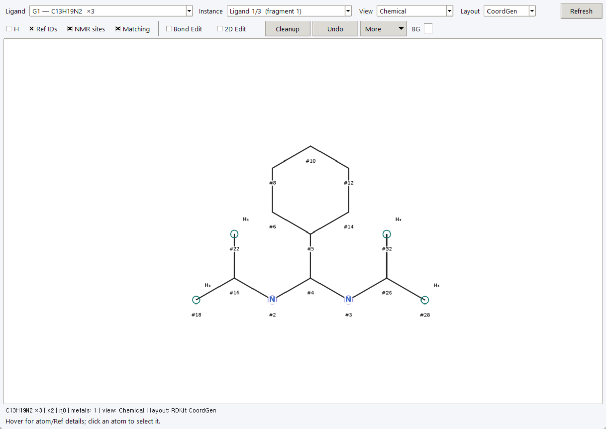
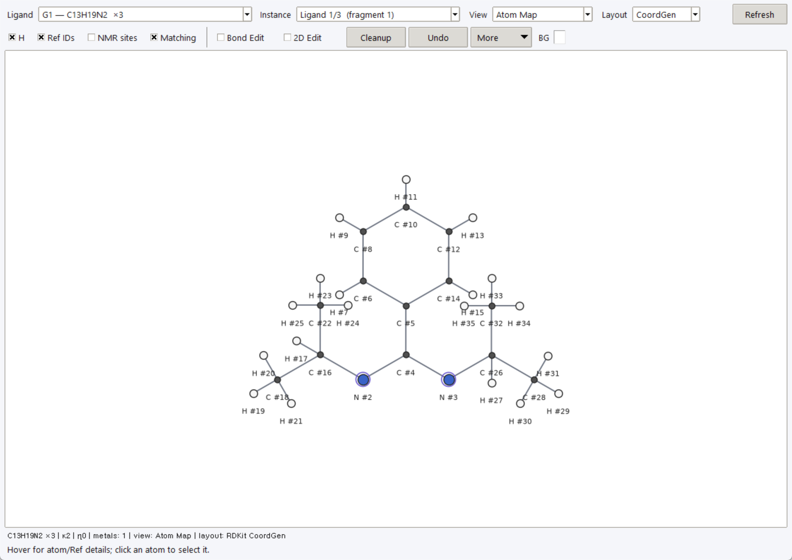
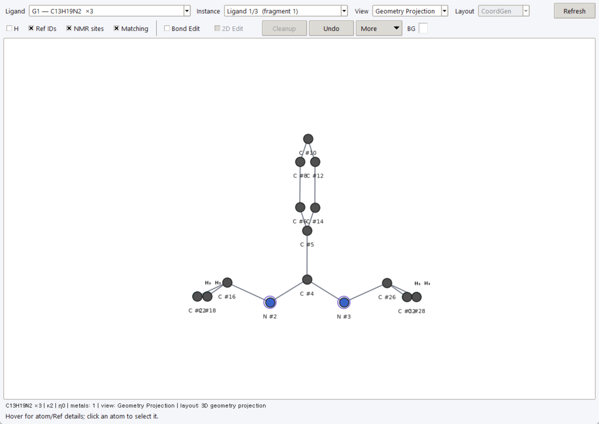

# Chemical Map

Open **View → Chemical Map** or **Ribbon → Data → Chemical Map** with a
structure loaded. Inspect coordinating ligand instances, Ref IDs, and NMR
sites while assigning experimental observations.

## Views and selection

| Control | Purpose |
|---|---|
| **Ligand / Instance** | Choose a ligand group and a particular matching instance. |
| **Chemical** | Compact depiction, including collapsed hydrogen/site representations where applicable. |
| **Atom Map** | Inspect individual atom correspondence and Ref IDs. |
| **Geometry Projection** | Inspect a projection of existing 3D coordinates. |
| **Layout** | **CoordGen**, **RDKit 2D**, or **Graph 2D** for the 2D depiction; engines depend on installed dependencies. |
| **H**, **Ref IDs**, **NMR sites**, **Matching** | Show information needed for atom/site mapping. |

### Chemical

Chemical view with Ref IDs and NMR-site markers.

### Atom Map

Atom Map with hydrogens and Ref IDs.

### Geometry Projection

Geometry Projection view.

Hover for atom/Ref details; click atoms or site representations to publish a
selection to PCS Analyzer. Shared selection links the map, main table, and
Workbench structural context. Grouped sites can select multiple members.
Use **Use in PCS Preparation** in the Workbench to accept an inspected target
explicitly. Selection synchronization does not verify an assignment.

## Editing: three different meanings

- **Bond Edit** changes connectivity/bond-type interpretation. This can affect
  ligand recognition, site detection, and matching. Check inferred bonds before
  using those groups for experimental observations.
- **2D Edit**, **Cleanup**, rotation/flip/scale, and resetting a 2D layout adjust
  the depiction. They do not move molecular XYZ coordinates or change distances
  and angles used in PCS calculations.
- **Geometry Projection** displays existing 3D geometry; Cleanup is disabled
  in this view, and 2D dragging is not geometry refinement. Use
  structure/orientation workflows for scientific coordinate changes.

**Apply to matching ligands** can propagate applicable edits beyond the shown
instance. Check that scope before editing; **Undo** reverses the last map edit.
Bond inference and ligand/site matching need review for unusual coordination
environments. A clean diagram does not prove correct bonding, chemical
equivalence, or an appropriate PCS averaging model.
